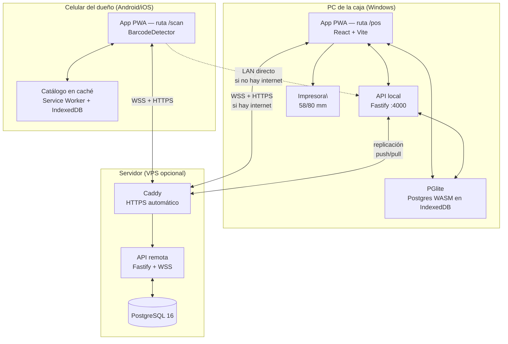
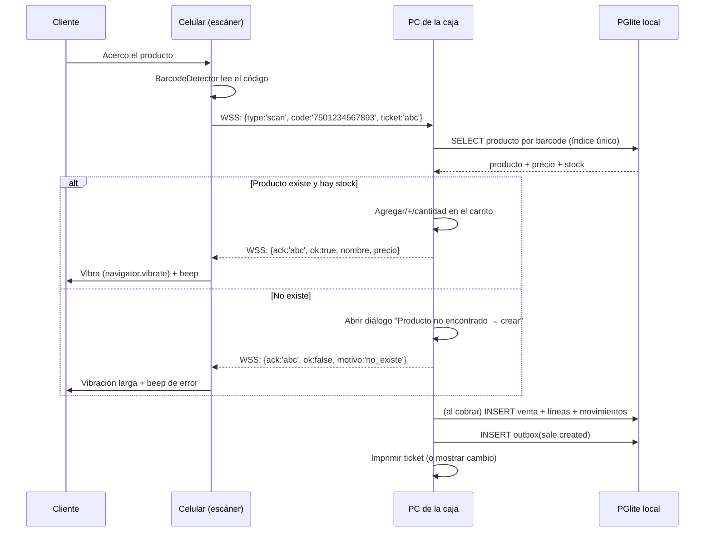

# 01 — Arquitectura

## 1. Vista general



**Tres dispositivos, tres roles, una sola app:**

| Nodo | Rol | ¿Escribe ventas? | ¿Funciona sin internet? |
|------|-----|------------------|--------------------------|
| PC de la caja | Autoridad del negocio | **Sí, es el único que escribe ventas** | Sí, todo local |
| Celular | Escáner remoto | No (solo envía eventos de escaneo) | Sí, contra la API local |
| VPS | Respaldo, reportes remotos, punto de encuentro | No directamente | N/A (es lo que se cae) |

## 2. Por qué local-first y no cliente-servidor

Un POS cliente-servidor normal (React → API → Postgres) es más simple de escribir, pero tiene un fallo fatal para una papelería: **si se cae el internet, no vendes**. No hay mensaje de error que arregle eso; la fila de clientes no espera.

La pregunta correcta no es "¿offline sí o no?", sino **"¿qué tan lejos llevo el offline?"**. Hay tres niveles:

| Nivel | Descripción | Costo de implementación | Veredicto |
|-------|-------------|--------------------------|-----------|
| **0 — Optimista** | La venta se encola en `localStorage` y se reintenta. La UI miente: dice "cobrado" aunque el stock no se validó. | 2 días | ❌ Inaceptable: puedes vender 30 piezas de algo que no tienes. |
| **1 — Réplica local (recomendado)** | La **base de datos completa vive en el dispositivo**. Lee y escribe local siempre. Sincroniza en segundo plano. | 1–2 semanas | ✅ Esto es lo que documenta este proyecto. |
| **2 — P2P/CRDT total** | Cada dispositivo es par; sin servidor central. | Meses | ❌ Complejidad injustificada para 2 dispositivos. |

Nivel 1 con **un solo escritor** (la PC) es lo mejor de ambos mundos: el celular nunca genera conflictos de venta porque nunca vende.

### La clave: no sincronizas estado, sincronizas **hechos**

```text
❌ MAL (sincronización de estado):
   "El stock del producto 123 es 47"
   → ¿47 según quién? ¿Y si el otro dispositivo ya vendió 2? → conflicto, hay que elegir, alguien pierde.

✅ BIEN (sincronización de eventos):
   "Se vendieron 2 unidades del producto 123 a las 10:04:12 en el dispositivo A"
   → Sumar es conmutativo y asociativo. No importa el orden. Nunca hay conflicto.
```

Toda mutación del sistema es un **evento inmutable** en un log. El estado (stock, precio, total del día) es una **proyección** derivada del log. Esto es lo que hace que el modo offline sea *correcto* y no un parche. Detalle en [02](02-modelo-de-datos.md) y [08](08-sincronizacion-offline.md).

## 3. Capas

```text
┌──────────────────────────────────────────────────────────────┐
│ 1. PRESENTACIÓN                                              │
│    Rutas: /pos  /scan  /catalogo  /admin  /reportes  /etiquetas│
│    React + Tailwind. Sin lógica de negocio.                  │
├──────────────────────────────────────────────────────────────┤
│ 2. APLICACIÓN (casos de uso)                                 │
│    crearVenta(), registrarEntrada(), ajustarStock(),         │
│    generarCodigoInterno(), iniciarArqueo()                   │
│    Valida invariantes. Emite eventos. Agnóstico del transporte│
├──────────────────────────────────────────────────────────────┤
│ 3. DOMINIO                                                   │
│    Entidades, reglas (login de precio, centavos, redondeo),   │
│    esquemas Zod compartidos cliente/servidor                  │
├──────────────────────────────────────────────────────────────┤
│ 4. PERSISTENCIA (interfaz única, dos implementaciones)        │
│    Repositorios: ProductoRepo, VentaRepo, MovimientoRepo...   │
│    └─ PGliteRepo  (navegador, PGlite)                         │
│    └─ PgRepo      (servidor, node-postgres)                   │
│    Mismo SQL, mismos tipos.                                   │
├──────────────────────────────────────────────────────────────┤
│ 5. SINCRONIZACIÓN                                            │
│    Outbox local → POST /sync/push → GET /sync/pull → aplicar  │
├──────────────────────────────────────────────────────────────┤
│ 6. INFRAESTRUCTURA                                           │
│    Postgres, Caddy, WebSocket, impresora, respaldos           │
└──────────────────────────────────────────────────────────────┘
```

**Regla de oro:** la capa 2 nunca sabe si corre en el navegador o en el servidor. Recibe un `DbContext` (que envuelve PGlite o `pg`) y devuelve eventos. Esto es lo que te permite **reutilizar exactamente el mismo código de validación** en el celular, en la caja y en el servidor — y es lo que hace viable aplicar las mismas políticas ABAC sin internet ([06](06-authz-rbac-abac.md)).

### La restricción técnica que manda: PGlite

PGlite es Postgres real en WebAssembly. Ventajas enormes (mismo SQL) y cuatro restricciones que debes conocer **antes** de elegirla:

1. **Una sola conexión.** No hay pool. Todo va serializado por un mutex interno.
2. **Un solo "propietario" del archivo lógico.** Si abres dos pestañas, cada una abre su propia instancia contra el mismo directorio de IndexedDB y se corrompen entre sí — sin error visible: los datos empiezan a faltar días después. **Solución implementada** (tarea 0.4): un Web Worker por pestaña, y entre ellos una **elección de líder con Web Locks**. `navigator.locks` garantiza que sólo uno obtenga el cerrojo con nombre, y sólo ése llama a `init()` y abre PGlite; las demás pestañas le mandan sus consultas por `BroadcastChannel`. Si la pestaña dueña se cierra, el navegador libera el cerrojo y otra toma el relevo sin que se note. **La exclusión la impone el navegador, no una convención nuestra** — que es lo que la hace fiable — y encima PGlite serializa `query`, `exec` y `transaction` en un cerrojo exclusivo del líder, así que dos pestañas tampoco se entrelazan a mitad de una transacción.
3. **Es persistente pero no mágico.** Vive en IndexedDB (o en un VFS de OPFS). Un `DELETE` de datos de sitio lo borra. Por eso **el VPS no es opcional**: es el respaldo real.
4. **Por defecto espera al disco después de *cada* consulta.** Es la restricción que más se siente y la que menos se ve venir. Medido en este equipo, con una transacción de 4 sentencias: **3 por segundo** en el modo por defecto frente a **64** con `relaxedDurability` — veintiún veces. Se usa `relaxedDurability` y se paga la durabilidad **sólo donde importa**: el cliente expone `sincronizar()`, que fuerza el volcado y espera, para llamarlo al cerrar una venta o al emitir un evento. Ni un descuento de stock se queda sin confirmar, ni se paga el precio en cada pulsación de tecla. Detalle y mediciones en [`apps/web/README.md`](../apps/web/README.md).

Si estas restricciones te incomodan, la alternativa es **SQLite vía `wa-sqlite` + OPFS** o simplemente **Dexie (IndexedDB puro)**. La arquitectura no cambia: sigue siendo repositorios + outbox + eventos. Pierdes la ventaja del mismo dialecto SQL.

> **Modelo de seguridad de esto:** asumimos que el dispositivo puede perder datos locales en cualquier momento. La base local es **caché durable**, el servidor es **la verdad**. Nunca al revés.

## 4. Flujo de una venta (el camino caliente)

Este es el caso que define si el sistema es usable o no. Objetivo: **< 3 segundos** de "escaneo" a "listo para cobrar".



Detalles finos que marcan la diferencia:

- **JWT de correlación (`ticket`)** en cada escaneo: la PC puede ignorar acks viejos y el celular sabe si su lectura fue aceptada. Sin esto hay *double-add* cuando el celular lee dos veces la misma etiqueta.
- **Debounce por código:** si el mismo código llega 2 veces en <800 ms, se cuenta una sola. Los lectores ópticos sí leen doble.
- **Feedback en el celular es obligatorio.** Vibración + sonido + texto. Si el dueño no sabe si el escaneo "entró", va a escanear de nuevo.
- **Modo "escáner ciego"**: el celular no necesita mostrar el carrito. Una pantalla grande con el último producto y el total acumulado basta, y es más barato de renderizar.

## 5. Estructura de carpetas

Monorepo con pnpm workspaces. El paquete `core` es el que evita duplicar reglas.

```text
papeleria/
├─ pnpm-workspace.yaml
├─ docker-compose.yml              # postgres + api + caddy (despliegue VPS)
├─ packages/
│  ├─ core/                        # ⭐ compartido por todo, sin dependencias de plataforma
│  │  ├─ src/domain/               #   entidades, tipos, dinero (centavos)
│  │  ├─ src/usecases/             #   crearVenta, ajustarStock, generarCodigo...
│  │  ├─ src/schemas/              #   Zod: validación reutilizada cliente+servidor
│  │  ├─ src/policies/             #   ABAC: reglas puras, sin IO  ([06])
│  │  ├─ src/barcodes/             #   cálculo de dígito verificador EAN-13 ([03])
│  │  └─ src/repo/                 #   interfaces de repositorio
│  └─ db/
│     ├─ migrations/               #   SQL numerado, aplicado igual en PGlite y Postgres
│     └─ seed/                     #   categorías base, roles, políticas por defecto
├─ apps/
│  ├─ web/                         # PWA: caja + escáner + admin
│  │  ├─ src/routes/pos/
│  │  ├─ src/routes/scan/
│  │  ├─ src/routes/etiquetas/     #   diseño e impresión de etiquetas
│  │  ├─ src/db/pglite.worker.ts   #   Web Worker dueño de la DB
│  │  ├─ src/sync/                 #   motor de sincronización
│  │  └─ public/manifest.webmanifest
│  └─ api/
│     ├─ src/server.ts             # Fastify
│     ├─ src/routes/sync.ts        # push/pull
│     ├─ src/routes/auth.ts
│     ├─ src/ws/scanner.ts         # canal de escaneo
│     └─ src/local/                # modo "servidor local en el PC"
└─ scripts/
   ├─ backup.ps1                   # respaldo nocturno a archivo + nube
   └─ restore.ps1
```

## 6. Superficie de API (mínima a propósito)

El instinto es diseñar 80 endpoints REST. No lo hagas. Con un modelo de eventos necesitas muy pocos.

### Sincronización (los dos más importantes)

```http
POST /sync/push
Content-Type: application/json
Authorization: Bearer <access_token>

{
  "device_id": "8f3c...",
  "events": [
    { "event_id": "01HX..", "device_seq": 412, "type": "sale.created",
      "occurred_at": "2026-10-18T20:04:12.331Z", "payload": { ... } },
    { "event_id": "01HX..", "device_seq": 413, "type": "stock.adjusted",
      "occurred_at": "2026-10-18T20:05:01.002Z", "payload": { ... } }
  ]
}

→ 200 {
     "accepted": ["01HX..", "01HX.."],
     "rejected": [],
     "next_pull_cursor": 90817
   }
```

```http
GET /sync/pull?since=90817&limit=500

→ 200 {
     "events": [ { "server_seq": 90818, "type": "product.updated", "payload": {...} }, ... ],
     "next_cursor": 91200,
     "has_more": false
   }
```

- `event_id` es **ULID**: ordenable por tiempo y único → idempotencia gratis.
- `device_seq` es el contador local del dispositivo → detecta huecos en la subida.
- `server_seq` (bigserial) es el **orden global** que asigna el servidor → es el único cursor de lectura.

### Autenticación y dispositivos

```http
POST /auth/login          # password + TOTP, o passkey
POST /auth/refresh        # rotación de refresh token
POST /auth/logout
POST /auth/step-up        # re-autenticación para acciones sensibles (cancelar venta, cambio de precio)
POST /devices/pair        # el celular canjea el QR por un token de escáner
GET  /devices             # lista de dispositivos (revocar)
DELETE /devices/:id       # revocar dispositivo robado
```

### Escaneo (WebSocket)

```text
WSS /ws/scanner?terminal=<terminal_id>&token=<scan_token>

→ { "type": "scan",        "ticket": "01HX...", "code": "7501234567893", "symbology": "ean_13" }
← { "type": "scan.result", "ticket": "01HX...", "ok": true, "product": { "id": "...", "nombre": "Lápiz Mirado #2", "precio": 600 }, "qty_in_cart": 3 }
← { "type": "cart.updated","total_minor": 45200, "items": 12 }
← { "type": "ping" }   # cada 20 s: si no responde en 60 s, cerrar y reconectar
```

### Reportes

```http
GET /reports/ventas?desde=2026-10-01&hasta=2026-10-18&agrupar=dia
GET /reports/margen?desde=...&hasta=...
GET /reports/bajo-stock?umbral=default
GET /reports/export.csv?tabla=movimientos   # ⭐ nunca te cases: exporta todo siempre
```

**Diseño deliberado:** no hay `POST /productos`, ni `PUT /productos/:id`, ni `POST /ventas`. Esas operaciones se hacen **localmente** como eventos y **suben por `/sync/push`**. Esto es lo que hace que la caja funcione desconectada *sin código especial*: el mismo camino sirve con y sin internet.

## 7. Decisiones de arquitectura (ADR) resumidas

| ID | Decisión | Alternativa rechazada | Razón principal |
|----|----------|----------------------|-----------------|
| ADR-01 | Web/PWA en lugar de nativo | Expo/React Native, Electron | Un solo código, cero publicación, cámara suficiente |
| ADR-02 | Local-first con PGlite | Cliente-servidor puro | Debe vender sin internet |
| ADR-03 | Escritor único de ventas (PC) | Multi-maestro | Elimina conflictos; 0 pérdida funcional |
| ADR-04 | Eventos inmutables + proyecciones | CRUD sobre tablas de estado | Auditoría, sync sin conflictos, "¿por qué bajó el stock?" |
| ADR-05 | Un solo esquema SQL para PGlite y Postgres | ORM (Prisma/Drizzle) con dos dialectos | Sin traducción; migraciones idénticas |
| ADR-06 | Casbin con políticas en datos | `if (user.role === 'admin')` | Un usuario hoy, N mañana |
| ADR-07 | Celular como escáner tonto | Celular como 2.º POS | 90 % menos complejidad |
| ADR-08 | HID (lector $25) soportado de base | Solo cámara | Velocidad y confiabilidad en el mostrador |
| ADR-09 | Dinero en centavos `bigint` | `numeric`/`float` | Sin errores de redondeo |
| ADR-10 | Exportar siempre a CSV | Solo base de datos | No quedar secuestrado por el sistema |
