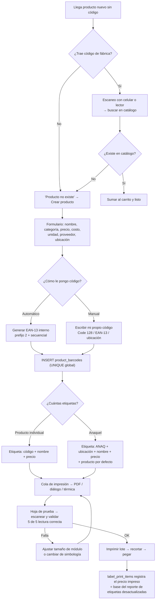

# 03 — Códigos de barras: crear los propios y etiquetar

El requisito es: *"poder crear sus propios códigos y escanearlos"*. La primera decisión no es de software, es **de simbología**. Elegir mal aquí significa etiquetas que no se leen, o un lector de $25 que no sirve, o códigos que chocan con productos reales.

## 1. La decisión: qué simbología usar dónde

| Simbología | Alfabeto | Densidad | Lo lee un láser HID de $25 | Cuándo usarla |
|-----------|----------|----------|---------------------------|----------------|
| **EAN-13** | solo dígitos, 13 | baja | ✅ sí | Código **de fábrica** de producto y **código interno** numérico |
| **UPC-A** | 12 dígitos | baja | ✅ sí | Solo para productos importados de EE. UU. (reconócelo, no lo generes) |
| **Code 128** | ASCII completo | alta | ✅ sí | **Código de anaquel/ubicación** y SKU con letras (`PAP-LAP-MIR-2`) |
| **ITF-14** | 14 dígitos | media | ✅ sí | Código de **caja/carton** del proveedor |
| **QR / DataMatrix** | bytes | muy alta | ❌ **no** (requiere lector 2D o celular) | Solo donde el celular es el escáner garantizado |

### La regla de oro: `2` al inicio del EAN-13

GS1 asigna los prefijos así:

- `750` → México (productos de fabricante).
- **`20` a `29` → uso interno del comercio ("circulación restringida").** GS1 **nunca** los asigna a un fabricante.

Esto significa que un código interno tipo `2 0012 3456 789 0` **jamás podrá chocar** con un producto real de un proveedor. Es exactamente el mecanismo diseñado para lo que pides, y te lo regalan gratis. Úsalo.

```text
┌─ 2 ────────┬─ 00012345 ─────┬─ 6 ───────────┐
│  prefijo   │  secuencial     │  dígito       │
│  interno   │  propio (8)     │  verificador  │
└────────────┴─────────────────┴───────────────┘
   interno     8 dígitos = 100 millones de códigos
```

### Cuándo Code 128 en lugar de EAN-13 interno

| Usa EAN-13 interno si… | Usa Code 128 si… |
|------------------------|------------------|
| Quieres el código **más corto y legible** para pegar en piezas pequeñas | Quieres que el código **sea legible por humanos** como tu SKU: `PAP-LAP-MIR-2` |
| El 99 % de tus códigos ya son EAN-13 y quieres **uniformidad** | Necesitas código de **ubicación/anaquel**: `A-3-12` |
| Vas a usar un láser HID o el celular | También funciona con láser HID y con celular |

**Recomendación concreta para la papelería:**

| Elemento a etiquetar | Simbología | Contenido | Por qué |
|----------------------|------------|-----------|---------|
| Producto con código de fábrica | *(el que ya trae)* | 7501234567893 | No inventes nada; solo regístralo |
| Producto sin código (lápiz suelto, cuaderno sin código) | **EAN-13 interno** | `2000000000015` | Corto, cabe en piezas chicas, jamás choca |
| **Etiqueta de anaquel / charola** | **Code 128** | `ANAQ-A-3-12` | Legible por humanos, lo lee el láser de $25 **y** el celular |
| Caja / paquete de 12 o 144 | **Code 128** | `PAP-LAP-MIR-2-PAQ12` | Va con el producto y el POS sabe el factor de conversión |
| Lista escolar / paquete promocional | **QR** | JSON con `{productos:[...]}` | Dato denso; aquí el celular siempre está disponible |
| Ubicación física de bodega | **Code 128** | `BOD-R2-E4` | Para traspasos entre ubicaciones |

**Evita QR en etiquetas de anaquel.** El lector láser barato del mostrador no lo lee, y entonces dependes 100 % del celular para cada venta. Es una dependencia que vas a odiar el día que el celular se descargue.

## 2. Dónde va cada cosa: producto vs anaquel

Este es el concepto que más confunde al inicio y más tiempo ahorra al operar.

```text
┌─────────────────────────────────────────────────────────────┐
│  ETIQUETA DE PRODUCTO (individual, pegada a la pieza)       │
│  ─────────────────────────────────────────────              │
│  Se usa cuando el producto YA trae código, o cuando es      │
│  caro/robable y quieres rastrear la pieza específica.       │
│  Se pega: en cuadernos buena marca, calculadoras,           │
│  mochilas, artículos de escritorio > $100.                  │
│  Contiene: código + nombre + precio                          │
└─────────────────────────────────────────────────────────────┘

┌─────────────────────────────────────────────────────────────┐
│  ETIQUETA DE ANAQUEL (una por cajón/charola/exhibidor)      │
│  ─────────────────────────────────────────────              │
│  Se usa para TODO lo suelto y barato: lápices, plumas,      │
│  colores, hojas, clips, sacapuntas, borradores.             │
│  Se pega: en el frente del cajón o del exhibidor.           │
│  Contiene: código de anaquel + ubicación + nombre + precio  │
│  El cajero escanea la etiqueta del cajón UNA vez y teclea   │
│  la cantidad (o escanea N veces, una por pieza).            │
└─────────────────────────────────────────────────────────────┘
```

Un lápiz de $6 MXN **no lleva etiqueta individual**. Es un desperdicio de etiqueta, de tiempo y de paciencia. El cajón entero lleva una.

**Consecuencia en el modelo de datos:** la etiqueta de anaquel **no apunta a un producto concreto**, sino a una *ubicación* que tiene un producto por defecto asignado. Por eso `product_barcodes` permite `presentacion_id = null` y por eso existe `products.ubicacion`. Cuando escaneas `ANAQ-A-3-12`, el POS resuelve: ubicación → producto por defecto → agrega al carrito. Si en ese anaquel hay 3 productos parecidos (lápiz HB, lápiz 2B, lápiz 2H), el POS abre una **pantalla de selección rápida** con los 3 botones grandes y el cajero elige. Eso es más rápido que escanear 3 códigos distintos para el mismo tipo de cosa.

```sql
-- Etiquetas de anaquel: no son productos, son puntos de venta rápidos
CREATE TABLE shelf_labels (
  id             uuid PRIMARY KEY,
  codigo         text NOT NULL UNIQUE,     -- 'ANAQ-A-3-12'
  ubicacion      text NOT NULL,            -- 'A-3-12'
  etiqueta       text NOT NULL,            -- 'Lápices de grafito' (lo que ve el cajero)
  product_id     uuid REFERENCES products(id),   -- producto por defecto al escanear
  variantes      uuid[] NOT NULL DEFAULT '{}',   -- opciones para la pantalla de selección
  category_id    uuid REFERENCES categories(id),
  price_at_print_minor bigint,             -- ⭐ precio impreso (ver §6)
  printed_at     timestamptz,
  is_activo      boolean NOT NULL DEFAULT true,
  creado_at      timestamptz NOT NULL DEFAULT now(),
  deleted_at     timestamptz
);
```

## 3. El dígito verificador de EAN-13 (no lo escribas mal)

Este algoritmo tiene una trampa: el **factor 3 va en posiciones alternas empezando por la segunda**. Si lo implementas de memoria, vas a generar códigos que tu lector rechaza y tardarás una tarde en encontrarlo.

```ts
// packages/core/src/barcodes/ean13.ts
/**
 * Calcula el dígito verificador de un EAN-13 a partir de los 12 primeros dígitos.
 * El factor 3 se aplica a las posiciones IMPARES (índice par) contando desde 0.
 *   dígitos: 2 0 0 0 0 0 0 0 0 0 0 1 ?  (índices 0..11)
 *   pesos:   1 3 1 3 1 3 1 3 1 3 1 3
 */
export function digitoVerificadorEAN13(primeros12: string): number {
  if (!/^\d{12}$/.test(primeros12)) throw new Error('Se esperan exactamente 12 dígitos');

  let suma = 0;
  for (let i = 0; i < 12; i++) {
    const d = Number(primeros12[i]);
    suma += i % 2 === 0 ? d : d * 3;   // índice par → peso 1; índice impar → peso 3
  }
  const resto = suma % 10;
  return resto === 0 ? 0 : 10 - resto;
}

export function ean13Completo(primeros12: string): string {
  return primeros12 + digitoVerificadorEAN13(primeros12);
}

export function validaEAN13(codigo: string): boolean {
  if (!/^\d{13}$/.test(codigo)) return false;
  return digitoVerificadorEAN13(codigo.slice(0, 12)) === Number(codigo[12]);
}

// Verificación obligatoria contra los valores conocidos, en el test:
//   ean13Completo('400638133393') === '4006381333931'  ✅ (EAN-13 real de fábrica)
//   ean13Completo('750123456789') === '7501234567893'  ✅ (prefijo México)
//   ean13Completo('200000000001') === '2000000000015'  ✅ (prefijo interno)
//   validaEAN13('4006381333930') === false             ✅ (último dígito alterado)
```

> **Estos tres números salen de correr la prueba, no de calcularlos a mano.** La
> primera versión de este documento tenía `7501234567890` y `2000000000017`:
> los dos estaban mal. Ese es el motivo de que el dígito verificador viva en una
> función con pruebas contra un EAN-13 real de fábrica (`4006381333931`) y no en
> la cabeza de nadie.

`validaEAN13` se usa al **capturar un código a mano**: si el dígito no cuadra, es un error de tecleo, y te lo dice en el momento en lugar de crear un producto fantasma. Validar en la entrada es gratis; limpiar la base después es carísimo.

## 4. Generación de códigos internos: el problema del offline

Aquí está el único riesgo real de seguridad del sistema de códigos: **que dos dispositivos generen el mismo código interno para productos distintos**.

Si la PC es el único dispositivo que genera códigos (recomendado, igual que con las ventas), el problema desaparece:

```sql
CREATE TABLE barcode_sequences (
  prefijo        text PRIMARY KEY,       -- '2' (interno genérico), '2PAQ', '2CAJ'
  siguiente      bigint NOT NULL DEFAULT 1,
  longitud_total int NOT NULL DEFAULT 13,  -- EAN-13 = 13
  checkpoint_at  timestamptz NOT NULL DEFAULT now()
);
```

```ts
// Reserva atómica. Un solo escritor → sin colisiones.
export async function generarCodigoInterno(db, prefijo = '2'): Promise<string> {
  const { rows } = await db.query<{ siguiente: string }>(
    `UPDATE barcode_sequences
        SET siguiente = siguiente + 1
      WHERE prefijo = $1
      RETURNING siguiente - 1 AS siguiente`,
    [prefijo],
  );
  const n = BigInt(rows[0].siguiente);

  // '2' + 8 dígitos secuenciales + 3 de relleno para llegar a 12, luego dígito verificador
  const relleno = (prefijo === '2' ? '' : '').padEnd(0, '0');
  const base = (prefijo + relleno + n.toString().padStart(8, '0') + '00').slice(0, 12);
  const codigo = ean13Completo(base);

  // El UNIQUE de product_barcodes.codigo es la red de seguridad final:
  // si aun así colisiona, el INSERT falla y reintentamos. Nunca un dato malo.
  return codigo;
}
```

> **El ejemplo de arriba no compila tal cual y no debe copiarse.** Tenía una línea de
> relleno que no hacía nada (`const relleno = …padEnd(0, '0')`) y construía la base a mano;
> la implementación real usa `construirEAN13Interno(secuencial, prefijo)` de
> `@papeleria/core`, que es la que tiene las pruebas del dígito verificador. Lo que **sí**
> se copió es la idea: `UPDATE ... RETURNING` atómico dentro de la transacción del
> producto, en `packages/db/src/secuencias.ts` (migración `0006_secuencias.sql`).

### Si algún día son dos dispositivos generando

No improvises. **Asigna bloques**:

```sql
-- El servidor entrega bloques de 1 000 códigos por dispositivo
-- El celular nunca genera códigos de producto: eso lo hace la PC o el panel admin.
UPDATE barcode_sequences SET siguiente = siguiente + 1000 WHERE prefijo = '2';
-- → el dispositivo A recibe el rango [12000, 12999]
```

Un dispositivo **consume su bloque localmente sin preguntar a nadie**, y cuando lo agota pide otro. Es la técnica estándar para generar identificadores únicos offline sin coordinación. Nunca dos dispositivos con el mismo bloque.

### Códigos escritos a mano por el dueño

A veces querrás escribir tu propio código ("ponle `LIB-2026-001` a la libreta especial"). Soportado, con reglas:

```ts
const patronesCodigo = {
  ean13:   /^\d{13}$/,                       // debe pasar validaEAN13()
  code128: /^[A-Z0-9][A-Z0-9\-\.\/]{2,24}$/, // legible, sin minúsculas ni espacios
  ubicacion: /^(ANAQ|BOD)-[A-Z]\d?-\d{1,3}(-\d{1,3})?$/,
};

// Reglas al capturar manualmente:
// 1. Normalizar SIEMPRE: trim, mayúsculas, quitar espacios internos.
// 2. Rechazar si ya existe (UNIQUE) con mensaje: "Ese código ya es de: Cuaderno Scribe 100h".
// 3. Si es numérico de 13 dígitos → validar dígito verificador y avisar, no bloquear
//    (puede ser un código raro de importación, pero avisa).
// 4. Guardar es_interno = false y quién lo capturó (audit_log).
```

## 5. Diseño e impresión de etiquetas

### 5.1 Hardware: qué comprar y en qué orden

| Opción | Costo aprox. | Ventaja | Desventaja |
|--------|-------------|---------|-----------|
| **Hojas de etiquetas A4** (32 etiquetas `63.5 × 38.1 mm`, ~$8 USD el paquete de 100 hojas) | el más barato | Cero hardware; usa la impresora que ya tienes | Se despegan con el calor; quedan feas; hay que alinear la hoja |
| **Impresora térmica de etiquetas** (Xprinter XP-365B, Niimbot B21, Zebra GK420d, ~$45–120 USD) | medio | Etiquetas autoadhesivas profesionales, rollo continuo, sin tinta | Requiere calibración inicial y rollos (consumible) |
| **Impresora térmica de tickets + etiquetas** (58/80 mm) | medio | Una sola impresora para ticket y etiqueta | Etiqueta de ticket no es autoadhesiva salvo rollo especial |

**Recomendación por fases:**

1. **Empieza con hojas A4.** Imprime, pega, valida que tu operación funciona. No gastes en hardware antes de saber si el sistema te sirve.
2. Cuando confirmes que sí, compra la **térmica de etiquetas** (que además suele incluir software, pero usarás el tuyo para tener control del precio y la ubicación).

### 5.2 Generación: `bwip-js` en el cliente

Se genera **en el navegador**, offline, sin llamar al servidor. Esto significa que puedes imprimir 500 etiquetas en el almacén sin internet.

```ts
import bwipjs from 'bwip-js';

export type EtiquetaSpec = {
  codigo: string;
  simbologia: 'ean13' | 'code128' | 'qrcode';
  anchoModuloMm: number;   // tamaño del módulo: 0.25 mm es el mínimo legible confiable
  altoMm: number;
  mostrarTexto: boolean;
};

export async function renderEtiqueta(spec: EtiquetaSpec): Promise<HTMLCanvasElement> {
  const canvas = document.createElement('canvas');
  const dpi = 300;                        // ⭐ imprime a 300 dpi, no a 96
  const pxPorMm = dpi / 25.4;             // ≈ 11.81 px/mm

  await bwipjs.toCanvas(canvas, {
    bcid: spec.simbologia === 'ean13' ? 'ean13' : spec.simbologia === 'qrcode' ? 'qrcode' : 'code128',
    text: spec.codigo,
    scale: Math.max(2, Math.round(spec.anchoModuloMm * pxPorMm)),
    height: spec.simbologia === 'ean13' ? 22 : 12,   // mm de alto de barras (bwip-js usa ~)
    includetext: spec.mostrarTexto,
    textxalign: 'center',
    textsize: 8,                            // pt, legible
    paddingwidth: 10,                       // ⭐ zona de silencio: sin esto NO se lee
    paddingheight: 8,
    backgroundcolor: 'FFFFFF',
  });

  return canvas;
}
```

**Los tres errores que hacen que una etiqueta "no se lea":**

1. **Sin zona de silencio (quiet zone).** El código necesita espacio blanco a los lados: **10× el ancho del módulo** a cada lado. Si pegas el código hasta el borde de la etiqueta o contra texto, el lector falla de forma intermitente — el peor tipo de falla, porque parece que funciona.
2. **Módulo demasiado pequeño.** En EAN-13 el ancho del módulo debe ser ≥ 0.264 mm (norma GS1). Un código de 13 dígitos a 0.2 mm **no se lee con láser**. Si la etiqueta es muy chica para EAN-13 a tamaño válido, usa Code 128 (más denso) o agranda la etiqueta.
3. **Imprimir a baja resolución.** Si generas el canvas pensando en 96 dpi y lo mandas a una impresora de 300 dpi, las barras se ven borrosas y el decodificador sufre. Genera **a la resolución de destino**.

```ts
// Prueba de legibilidad obligatoria antes de imprimir 200 etiquetas:
// 1. Imprime UNA hoja de prueba con el código más largo que uses.
// 2. Escanéala con el lector REAL (o el celular) → debe leer a la primera, 5 de 5 veces.
// 3. Solo entonces imprime en lote.
// Este paso de 5 minutos evita imprimir 200 etiquetas inservibles.
```

### 5.3 La hoja A4: calibración (el paso que todos se saltan)

```ts
// pdf-lib + geometría exacta en milímetros
import { PDFDocument, rgb } from 'pdf-lib';

type PlantillaHoja = {
  nombre: string;                 // 'Avery 5160 (63.5 × 38.1 mm, 3×10)'
  anchoHojaMm: number;            // 210
  altoHojaMm: number;             // 297
  columnas: number;               // 3
  filas: number;                  // 10
  anchoEtiquetaMm: number;        // 63.5
  altoEtiquetaMm: number;         // 38.1
  margenSupMm: number;            // 12.7
  margenIzqMm: number;            // 4.76
  separacionHMm: number;          // 0
  separacionVMm: number;          // 0
  offsetXmm: number;              // ⭐ corrección fina de TU impresora
  offsetYmm: number;              // ⭐
};
```

`offsetXmm` / `offsetYmm` existen porque **toda impresora desplaza la hoja unos milímetros** que varían con el modelo y con cómo estén puestas las guías. Por eso la pantalla de etiquetas debe incluir una herramienta **"Calibrar"**:

1. Imprime una hoja con una **regla** y una cruz por etiqueta.
2. Mide con una regla física: "el contenido quedó 2 mm a la derecha".
3. Ajusta `offsetXmm = -2` en la pantalla.
4. Repite hasta que quede en el centro.

Sin esta herramienta, la primera impresión siempre sale desalineada y el dueño concluye que "el sistema no sirve". **Guarda la calibración por impresora** en `settings`, no por usuario:

```sql
INSERT INTO settings (clave, valor) VALUES
('etiquetas.plantilla_default', '{"nombre":"Avery 5160","columnas":3,"filas":10}'),
('etiquetas.calibracion', '{"HP_M404":"{\"offsetXmm\":-2,\"offsetYmm\":1.5}"}');
```

### 5.4 Impresión térmica directa (fase 2)

Con una impresora térmica de etiquetas hay dos caminos, ambos sin drivers en el navegador:

| Camino | Cómo | Cuándo |
|--------|------|--------|
| **Diálogo de impresión del navegador** | CSS `@page { size: 58mm 40mm; margin: 0 }` + `window.print()` | **Empieza aquí.** Funciona con cualquier impresora, cero código nativo |
| **WebUSB / WebSerial hacia ESC/POS** | Comandos `GS v 0` (bitmap) o `TSPL`/`ZPL` | Cuando imprimas >100 etiquetas y el diálogo se vuelva molesto |

```css
/* etiqueta 58×40 mm en impresora térmica */
@page { size: 58mm 40mm; margin: 0; }
.etiqueta {
  width: 58mm; height: 40mm;
  display: flex; flex-direction: column;
  align-items: center; justify-content: center;
  padding: 1.5mm 2mm; box-sizing: border-box;
  font-family: 'Arial Narrow', sans-serif;
}
.etiqueta__nombre { font-size: 7pt;  font-weight: 700; text-align: center; line-height: 1.05; }
.etiqueta__precio { font-size: 13pt; font-weight: 900; }
.etiqueta__ubic   { font-size: 6pt;  color: #333; }
.etiqueta__codigo { font-size: 7pt;  letter-spacing: .5px; font-family: monospace; }
```

## 6. Detalle de oro: la etiqueta impresa miente cuando cambias el precio

Este es un problema real que todas las papelerías sufren y que tu sistema puede resolver gratis.

**El problema:** imprimes 80 etiquetas de anaquel diciendo "Lápiz Mirado #2 — $6.00". En enero sube a $7.00. Las 80 etiquetas ahora **mienten** al público, y no tienes idea de cuáles son las desactualizadas (a veces ni de qué productos).

**La solución:** guarda **el precio que se imprimió** y compáralo con el precio actual.

```sql
CREATE TABLE label_print_jobs (
  id            uuid PRIMARY KEY,
  plantilla     text NOT NULL,
  impresora     text,
  filas         int NOT NULL,
  creado_por    uuid NOT NULL REFERENCES users(id),
  creado_at     timestamptz NOT NULL DEFAULT now(),
  pdf_blob      bytea                     -- opcional: reimprimir sin recalcular
);

CREATE TABLE label_print_items (
  id            uuid PRIMARY KEY,
  job_id        uuid NOT NULL REFERENCES label_print_jobs(id) ON DELETE CASCADE,
  shelf_label_id uuid REFERENCES shelf_labels(id),
  product_id    uuid REFERENCES products(id),
  codigo        text NOT NULL,
  nombre_impreso text NOT NULL,
  precio_impreso_minor bigint,           -- ⭐ el precio que se imprimió ese día
  impreso_at    timestamptz NOT NULL DEFAULT now()
);
```

Y entonces tienes un reporte que nadie más tiene:

```sql
-- "Etiquetas cuyo precio impreso ya no coincide con el precio actual"
CREATE VIEW v_etiquetas_desactualizadas AS
SELECT sl.ubicacion, sl.etiqueta, li.nombre_impreso,
       li.precio_impreso_minor, p.precio_minor AS precio_actual,
       li.impreso_at, (p.precio_minor - li.precio_impreso_minor) AS diferencia_minor
FROM label_print_items li
JOIN shelf_labels sl ON sl.id = li.shelf_label_id
JOIN products p ON p.id = coalesce(li.product_id, sl.product_id)
WHERE li.precio_impreso_minor IS DISTINCT FROM p.precio_minor
ORDER BY abs(p.precio_minor - li.precio_impreso_minor) DESC;
```

**Flujo operativo:** cambias el precio en el POS → el sistema te avisa *"3 etiquetas de anaquel quedaron desactualizadas"* con un botón **"Reimprimir solo esas 3"**. Reimprimes, las pegas y ya. Cinco minutos de software que evitan multas de la PROFECO (en México el precio exhibido es obligatorio) y discusiones en el mostrador.

**Corolario: no pongas el precio dentro del código de barras.** Hay sistemas que codifican el precio en el código (la vieja técnica de `2` + precio + PLU). Es una trampa: el código queda con el precio viejo pegado a la pieza y ya no lo puedes actualizar. En un QR **sí** puedes poner el precio *a propósito*, pero entonces el sistema debe detectar la discrepancia y avisar al cajero, nunca cobrar en silencio el precio del código.

## 7. Flujo completo: del producto nuevo a la etiqueta pegada



## 8. Etiquetas de anaquel en lote (el caso que más vas a usar)

Pantalla `/<span>etiquetas</span>`:

```text
┌──────────────────────────────────────────────────────────────────────┐
│ ETIQUETAS DE ANAQUEL                                                 │
├──────────────────────────────────────────────────────────────────────┤
│ ▸ Selección                                                          │
│   ○ Por categoría:  [Papelería ▾]                                    │
│   ○ Por anaquel:    [A-3 ▾]                                          │
│   ○ Por rango de precio: [desde 0] a [0]                            │
│   ○ Selección manual (0 productos)                                   │
│                                                                      │
│ ▸ Vista previa (12 productos)  ┌──────────────┐                      │
│   ☑ Lápiz Mirado #2   $6.00    │  Lápiz Mirado #2   │               │
│   ☑ Lápiz Dixon HB    $5.00    │      $6.00         │               │
│   ☑ Sacapuntas metal  $12.00   │   ║║║║║║║║║║║║       │               │
│   ☐ Borrador blanco   $4.00    │  ANAQ-A-3-12       │               │
│                                └──────────────┘                      │
│                                                                      │
│ ▸ Plantilla: [Avery 5160 ▾]   Calibración: [Calibrar…]              │
│ ▸ Opciones: ☑ nombre  ☑ precio  ☑ ubicación  ☐ SKU  ☑ código texto │
│   Ancho de módulo: [0.33 mm ▾]   Imprimir como: [Láser/Inkjet ▾]   │
│                                                                      │
│ [ Imprimir hoja de PRUEBA ]        [ Imprimir 12 etiquetas ]         │
│ [ Reimprimir desactualizadas (3) ]                                   │
└──────────────────────────────────────────────────────────────────────┘
```

**Detalle importante:** el botón dice "Imprimir hoja de **PRUEBA**" por separado, no "Imprimir". Obligar a una prueba de una hoja antes del lote es la diferencia entre 5 minutos y 200 etiquetas tiradas a la basura.

## 9. Checklist de este módulo

- [x] `digitoVerificadorEAN13` con tests contra valores conocidos (incluido el prefijo 20–29)
- [x] `validaEAN13` usado al capturar códigos a mano
- [x] Generador interno con `barcode_sequences` + `UPDATE ... RETURNING` (atómico)
- [x] `UNIQUE (codigo)` global en `product_barcodes` (red de seguridad contra duplicados)
- [x] Soporte de **múltiples códigos por producto** (fábrica, interno, paquete, caja)
- [ ] `shelf_labels` con variantes para la pantalla de selección rápida — **la etiqueta
      Code 128 ya se imprime; falta que escanearla abra la selección del anaquel**
- [x] Render con `bwip-js` con **zona de silencio** — SVG, no mapa de bits; la prueba
      física de lectura sigue pendiente
- [x] Herramienta de **calibración** con offsets por impresora — tamaños, márgenes,
      columnas, filas y separación guardados en `localStorage`
- [x] **Impresión de prueba** de una sola etiqueta antes del lote
- [ ] Registro de `precio_impreso_minor` + reporte de **etiquetas desactualizadas**
- [ ] Reimpresión selectiva sin crear códigos nuevos
- [ ] Validación práctica: el código más largo se lee 5 de 5 con el lector real
