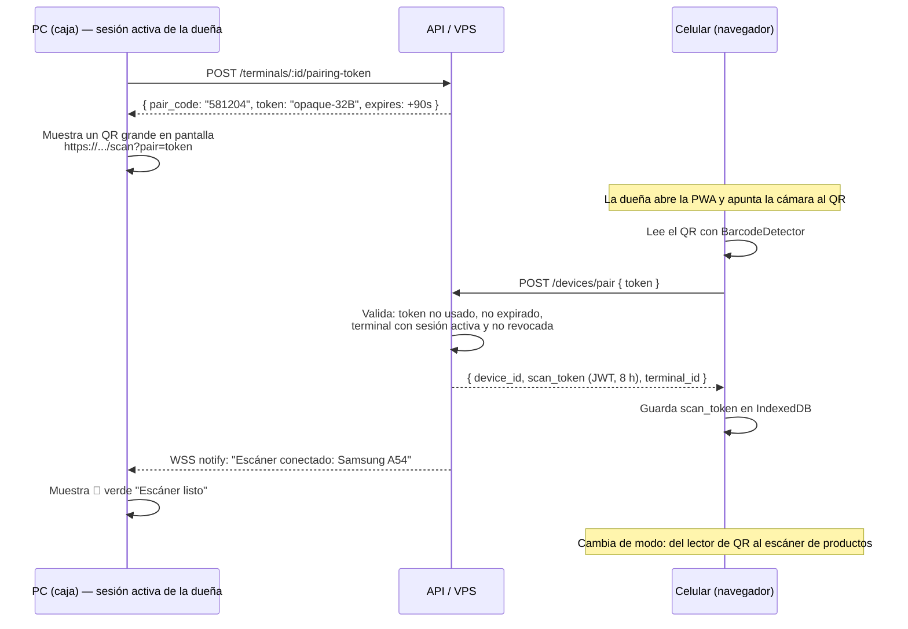

# 04 — Escaneo con el celular (dentro de la misma app)

El requisito: *"escanearlo a través del celular en la misma app"*. Aquí está la decisión de arquitectura y todos los detalles que la hacen o la rompen.

## 1. Las tres formas de hacerlo (y por qué eliges una)

| | "Celular como periférico" ✅ | "Celular como 2.º POS" | "Celular = PC" |
|---|---|---|---|
| **Qué hace el celular** | Lee códigos y los envía a la PC | Vende por su cuenta, con su propio carrito | El celular *es* la caja |
| **Dónde vive el carrito** | En la PC (una sola fuente de verdad) | En cada dispositivo | En el celular |
| **Conflictos de sincronización** | Ninguno (el celular no escribe ventas) | Muchos (dos carritos, mismo stock) | Ninguno |
| **Complejidad** | Baja | Alta | Baja |
| **Costo si el celular se descarga a mitad de venta** | Nada, la venta sigue en la PC | Carrito huérfano, hay que decidir qué hacer | Se pierde la venta |
| **Veredicto** | ✅ **Elegido** | ❌ Fase 4 si de verdad lo necesitas | ⚠️ Viable solo si nunca usarás PC |

### Por qué "periférico" y no "segundo POS"

Con "celular = periférico", el celular es **estúpido a propósito**: lee un código, lo manda, recibe confirmación. No calcula precios, no valida stock, no decide nada. Consecuencias:

- **Cero conflictos de sincronización**: solo un dispositivo escribe ventas (la PC).
- **Cero duplicación de reglas**: las políticas ABAC, el cálculo de IVA, el login de precio viven en un solo lugar.
- **Cero pérdida de datos**: si el celular se apaga, el carrito sigue intacto en la PC.
- **El celular puede ser el más barato del mercado**: no necesita correr la base de datos completa, solo un cliente WebSocket.

El costo de esta decisión es que el dueño tiene que estar en el local con la PC. Para una papelería con un mostrador, eso es exactamente el caso de uso.

## 2. El *gotcha* que hace fracasar el 80 % de estos proyectos

**La cámara del navegador NO funciona sin HTTPS.**

`getUserMedia` (y por tanto `BarcodeDetector`, y por tanto cualquier lectura de cámara) exige lo que el navegador llama un **contexto seguro**. La regla es:

```text
✅ https://cualquier-cosa      → cámara funciona
✅ http://localhost             → cámara funciona (solo en el mismo equipo)
✅ http://127.0.0.1             → cámara funciona
❌ http://192.168.1.50          → CÁMARA BLOQUEADA
❌ http://papeleria.local       → CÁMARA BLOQUEADA
❌ http://mi-dominio.com        → CÁMARA BLOQUEADA
```

Esto significa que la solución "pongo mi servidor local en el PC, abro `http://192.168.1.50:4000` en el celular y listo" **no funciona para el escáner**. El navegador del celular bloquea la cámara con un error que no siempre es obvio (`NotAllowedError` o simplemente la cámara negra).

### Las 4 salidas, ordenadas por conveniencia

| Solución | Funciona sin internet | Dificultad | Comentario |
|----------|----------------------|-----------|-----------|
| **1. HTTPS real contra el VPS** (`https://papeleria.midominio.com`) | Para *pairing* sí hace falta internet | ⭐ Muy baja | **Recomendado como principal.** Caddy + Let's Encrypt, 10 minutos, y funciona también desde fuera del local |
| **2. Certificado local con `mkcert`** | ✅ Sí, 100 % | Media | Instalas la CA de mkcert en el celular una vez. Es la única forma de tener HTTPS **en LAN sin internet** |
| **3. Dominio propio con DNS split-horizon** | ✅ Sí | Media-alta | El router resuelve `papeleria.midominio.com` → `192.168.1.50` dentro del local. Elegante pero requiere router configurable |
| **4. Solo en el celular, PWA en modo "instalada"** | ❌ | Baja | Un PWA instalado **no** evade la regla de contexto seguro. **Es un mito.** No pierdas tiempo aquí |

> **Mito frecuente:** "si instalo la PWA como app, ya puedo usar la cámara sin HTTPS". **Falso.** Los service workers y `getUserMedia` requieren contexto seguro en todos los casos. No hay atajo.

### Solución pragmática recomendada: las dos vías

```text
┌─────────────────────────────────────────────────────────────────────┐
│  VÍA A (normal, hay internet) — HTTPS por el VPS                    │
│  Celular → wss://papeleria.midominio.com/ws/scanner?token=...       │
│  · Cero configuración. Funciona dentro y fuera del local.           │
│  · Es la que usarás el 99 % del tiempo.                             │
├─────────────────────────────────────────────────────────────────────┤
│  VÍA B (no hay internet) — HTTPS local con mkcert                   │
│  Celular → wss://192.168.1.50:4321/ws/scanner?token=...             │
│  · El certificado ya está confiado en el celular (se instaló una vez)│
│  · El PC corre la API local. Latencia ~5 ms. Totalmente offline.    │
│  · Si esta vía falla, SIEMPRE queda el lector HID de $25.           │
└─────────────────────────────────────────────────────────────────────┘
```

**Configuración con `mkcert` (hazlo una vez, 15 minutos):**

```powershell
# 1. En el PC: instalar la CA local y emitir un certificado para la IP de la LAN
mkcert -install
mkcert -cert-file certs/dev-cert.pem -key-file certs/dev-key.pem `
       192.168.1.50 papeleria.local localhost 127.0.0.1

# El certificado DEBE incluir la IP LAN como SAN, no solo el nombre.
# Si el certificado no cubre 192.168.1.50, el celular rechaza la conexión
# y la cámara vuelve a quedar bloqueada. Este es el error #1 al configurar esto.

# 2. Exponer el servidor local con TLS
#    apps/api/src/local/server.ts
```

```ts
// apps/api/src/local/server.ts — servidor local del PC con HTTPS
import Fastify from 'fastify';
import { readFileSync } from 'node:fs';
import { networkInterfaces } from 'node:os';

const ipLan = Object.values(networkInterfaces())
  .flat()
  .find((i) => i && i.family === 'IPv4' && !i.internal)?.address;

const app = Fastify({
  https: {
    cert: readFileSync('certs/dev-cert.pem'),
    key:  readFileSync('certs/dev-key.pem'),
  },
  logger: true,
});

await app.listen({ port: 4321, host: '0.0.0.0' });

// ⭐ Muestra la IP y un QR de emparejamiento en la pantalla del PC
//    para que no haya que teclear URLs largas en el celular.
console.log(`Escáner local disponible en: https://${ipLan}:4321`);
```

```powershell
# 3. En el celular: instalar la CA de mkcert (una sola vez)
#    rootCA.pem está en: mkcert -CAROOT
#    Android: Ajustes → Seguridad → Cifrado y credenciales → Instalar certificado → CA
#             ⚠️ Android 11+ exige hacerlo desde Ajustes, no desde el navegador.
#    iOS:     Envía el .pem → Ajustes → General → VPN y dispositivo → Instalar
#             → y ADEMÁS: Ajustes → General → Información → Confianza en certificados
#             ⚠️ En iOS hay que habilitar la confianza en DOS lugares. Si solo instalas,
#                no funciona y parece un error de código.
#
# 4. Y ADEMÁS en Android: la app de navegador debe confiar en CAs de usuario.
#    Chrome sí lo hace. Algunas apps WebView no. Prueba con Chrome siempre.
```

**Regla:** si vas a hacer la VÍA B, hazla **el día 1** y valida con una foto del input de cámara. No dejes la cámara para el final: es la parte con más riesgo de "esto no funciona y no sé por qué".

## 3. Emparejamiento del celular (pairing)

Problema: ¿cómo sabe la PC que **ese** celular es el escáner autorizado, y no el celular de un cliente en la puerta?



**Propiedades de seguridad del token de emparejamiento:**

```ts
// POST /terminals/:id/pairing-token
const pairCode = crypto.randomInt(100000, 999999).toString();   // 6 dígitos, para teclear también
const pairToken = crypto.randomBytes(32).toString('base64url'); // 256 bits de entropía

await db.query(
  `INSERT INTO pairing_tokens
     (id, terminal_id, user_id, token_hash, code_hash, expires_at, used_at)
   VALUES ($1, $2, $3, $4, $5, now() + interval '90 seconds', NULL)`,
  [uuidv7(), terminalId, userId, sha256(pairToken), sha256(pairCode)],
);

// Reglas:
//  · TTL de 90 segundos. Ni un minuto más.
//  · Uso único: used_at se marca de inmediato; el segundo intento falla.
//  · Atado al terminal_id Y al user_id: no sirve para emparejar otro dispositivo.
//  · Se guarda el HASH, nunca el token en claro. Si te roban la BD, no sirven.
//  · El QR se muestra solo mientras la sesión de la caja tenga "step-up" reciente
//    (ver 06) → nadie empareja un celular desde una PC desatendida.
//  · Rate limit: 5 intentos por minuto por terminal.
```

```sql
CREATE TABLE pairing_tokens (
  id           uuid PRIMARY KEY,
  terminal_id  uuid NOT NULL REFERENCES devices(id),
  user_id      uuid NOT NULL REFERENCES users(id),
  token_hash   text NOT NULL,
  code_hash    text NOT NULL,
  expires_at   timestamptz NOT NULL,
  used_at      timestamptz,
  creado_at    timestamptz NOT NULL DEFAULT now()
);
CREATE INDEX idx_pairing_vigentes ON pairing_tokens(expires_at) WHERE used_at IS NULL;
```

**Fallback sin cámara para el QR:** el celular puede abrir `https://.../scan` y teclear el **código de 6 dígitos** que muestra la PC. Sirve cuando el QR no se lee (pantalla sucia, reflejo) y es más rápido que resolver un problema de cámara.

**Pantalla de emparejamiento (lado PC) — qué debe mostrar:**

```text
┌──────────────────────────────────────────────────────┐
│  EMPAREJAR ESCÁNER                                   │
│                                                      │
│   ┌────────────────────────┐   Código:  581 204     │
│   │                        │                         │
│   │      ██ QR ██          │   Válido por 1:28       │
│   │                        │                         │
│   └────────────────────────┘                         │
│                                                      │
│  Abre la app en el celular y apunta la cámara al QR │
│  ¿No lo lee? Abre la app y teclea el código.         │
│                                                      │
│  Escáner conectado: (ninguno)                        │
│  [ Cancelar emparejamiento ]                         │
└──────────────────────────────────────────────────────┘
```

## 4. El canal de escaneo (WebSocket)

**¿Por qué WebSocket y no `POST /scan`?** Un escaneo por HTTP son ~40–80 ms de latencia mínima y una conexión nueva cada vez (TCP + TLS). Con WS es **una conexión**, ~3–10 ms, y la PC puede empujar eventos de vuelta (`cart.updated`, `total`) sin que el celular pregunte. Además, con HTTP el celular tendría que esperar respuesta para saber si el producto existe; con WS puede leer el siguiente código mientras llega la confirmación — y pegarle a un lector así de rápido es exactamente lo que hace un cajero en hora pico.

### 4.1 Protocolo

```ts
// packages/core/src/ws/scanner-protocol.ts  — tipos compartidos, un solo lugar
export type ClienteEscanner =
  | { type: 'hello';     device_id: string; app_version: string }
  | { type: 'scan';      ticket: string; code: string; symbology?: string; leido_at: string }
  | { type: 'ping';      t: number }
  | { type: 'set_mode';  mode: 'venta' | 'conteo' | 'consulta' };

export type ServidorEscanner =
  | { type: 'ready';        terminal_id: string; catalogo_version: number; items_carrito: number }
  | { type: 'scan.result';  ticket: string; status: 'ok' | 'no_existe' | 'ambiguo' | 'sin_stock' | 'modo_incorrecto';
                            producto?: ProductoResumen; candidatos?: ProductoResumen[]; qty_en_carrito?: number; }
  | { type: 'cart.updated'; items: number; total_minor: number; ultimo_nombre: string; ultimo_precio_minor: number }
  | { type: 'pong';         t: number }
  | { type: 'desconectado'; motivo: string };   // revocaron el dispositivo, cambió el modo, etc.
```

### 4.2 Servidor (lado PC)

```ts
// apps/api/src/ws/scanner.ts
import { WebSocketServer } from 'ws';

const wss = new WebSocketServer({ noServer: true });
const porTerminal = new Map<string, Set<WebSocket>>();

wss.on('connection', async (ws, req) => {
  const claims = await verificarScanToken(req);          // JWT firmado, 8 h
  if (!claims) return ws.close(4401, 'token inválido');
  if (await dispositivoRevocado(claims.device_id)) return ws.close(4403, 'dispositivo revocado');

  const set = porTerminal.get(claims.terminal_id) ?? new Set();
  set.add(ws);
  porTerminal.set(claims.terminal_id, set);

  ws.send(JSON.stringify({ type: 'ready', terminal_id: claims.terminal_id, ... }));

  // Último código visto: evita el doble-add por lecturas repetidas del mismo lector
  let ultimoCodigo: string | null = null;
  let ultimoAt = 0;

  ws.on('message', async (raw) => {
    const msg = JSON.parse(raw.toString());

    if (msg.type === 'ping') return ws.send(JSON.stringify({ type: 'pong', t: msg.t }));

    if (msg.type !== 'scan') return;

    const ahora = Date.now();
    // ⭐ Anti doble-lectura: mismo código en < 800 ms = una sola vez.
    //    Los decodificadores de cámara (sobre todo en ráfaga) leen el mismo
    //    código 2-5 veces seguidas. Sin esto, el carrito suma de más.
    if (msg.code === ultimoCodigo && ahora - ultimoAt < 800) {
      return ws.send(JSON.stringify({ type: 'scan.result', ticket: msg.ticket, status: 'ok',
        qty_en_carrito: await qtyEnCarrito(claims.terminal_id, msg.code) }));
    }
    ultimoCodigo = msg.code; ultimoAt = ahora;

    // Rate limit defensivo: nadie escanea 30 códigos por segundo a mano
    if (!pasaRateLimit(claims.device_id, 30)) return ws.close(4429, 'demasiadas lecturas');

    // La PC decide TODO. El celular no sabe precios ni stock.
    const res = await resolverEscaneo(claims.terminal_id, msg.code);
    ws.send(JSON.stringify({ ticket: msg.ticket, type: 'scan.result', ...res }));
    await pushCart(claims.terminal_id);                  // actualiza la pantalla del POS
  });

  ws.on('close', () => { set.delete(ws); });
});
```

### 4.3 Cliente (lado celular)

```ts
// apps/web/src/routes/scan/useEscanner.ts
export function useEscanner(scanToken: string) {
  const [estado, setEstado] = useState<'conectando' | 'listo' | 'offline'>('conectando');

  useEffect(() => {
    let ws: WebSocket | null = null;
    let cerrado = false;
    let intentos = 0;

    const conectar = () => {
      if (cerrado) return;
      ws = new WebSocket(`wss://${HOST}/ws/scanner?token=${scanToken}`);

      ws.onopen = () => { intentos = 0; setEstado('listo'); };
      ws.onmessage = (e) => manejarMensaje(JSON.parse(e.data));
      ws.onclose = () => {
        setEstado('offline');
        if (cerrado) return;
        // Backoff exponencial con techo: 0.5s, 1s, 2s, 4s, ... máx 15s
        const espera = Math.min(15_000, 500 * 2 ** intentos++);
        setTimeout(conectar, espera);
      };
    };
    conectar();

    // ⭐ Heartbeat: detecta la conexión "zombi" (wifi que dice estar conectado
    //    pero no pasa nada). Sin esto, el celular parece conectado y el
    //    escaneo se va al vacío durante minutos. Es un clásico.
    const hb = setInterval(() => {
      if (ws?.readyState === WebSocket.OPEN) ws.send(JSON.stringify({ type: 'ping', t: Date.now() }));
    }, 20_000);

    return () => { cerrado = true; clearInterval(hb); ws?.close(); };
  }, [scanToken]);

  return estado;
}
```

### 4.4 Lectura con la cámara (y que funcione en Android **e** iOS)

```ts
// La API nativa BarcodeDetector no existe en iOS Safari (o es limitada).
// Solución: ponyfill con zxing-wasm. Usa el nativo si está, si no, WASM.
// npm i barcode-detector     (resuelve exactamente esto)
import { BarcodeDetector } from 'barcode-detector/pure';

const detector = new BarcodeDetector({
  // formato limitado = mucho más rápido. No pidas 15 formatos si usas 3.
  formats: ['ean_13', 'ean_8', 'code_128', 'code_39', 'upc_a', 'upc_e', 'itf'],
});

export async function iniciarCamara(video: HTMLVideoElement) {
  const stream = await navigator.mediaDevices.getUserMedia({
    video: {
      facingMode: { ideal: 'environment' },   // cámara trasera
      width:  { ideal: 1280 },
      height: { ideal: 720 },
      // Enfoque continuo: sin esto, el celular enfoca una vez y el código
      // cercano sale borroso. Detalle que arruina la experiencia.
      advanced: [{ focusMode: 'continuous' } as any],
    },
    audio: false,
  });

  video.srcObject = stream;
  video.setAttribute('playsinline', '');  // ⭐ sin esto, iOS abre el video a pantalla completa
  video.muted = true;                     // ⭐ y sin esto, iOS no permite autoplay
  await video.play();

  return stream;
}

export function bucleLectura(video: HTMLVideoElement, alLeer: (codigo: string, sym: string) => void) {
  let activo = true;
  let ultimoCodigo = '';
  let ultimoAt = 0;

  const ciclo = async () => {
    if (!activo) return;
    if (document.hidden) {                        // ahorra batería si el celular se bloquea
      requestAnimationFrame(ciclo);
      return;
    }
    try {
      const codigos = await detector.detect(video);
      const c = codigos[0];
      if (c) {
        const ahora = Date.now();
        if (c.rawValue !== ultimoCodigo || ahora - ultimoAt > 800) {
          ultimoCodigo = c.rawValue; ultimoAt = ahora;
          alLeer(c.rawValue, c.format);
        }
      }
    } catch { /* frame ilegible: normal, seguir */ }
    requestAnimationFrame(ciclo);
  };
  ciclo();

  return () => { activo = false; };
}
```

**Consejos de UX que definen si el dueño lo usa o lo odia:**

| Problema real | Solución concreta |
|---------------|-------------------|
| Hay poca luz en el pasillo | Botón de **linterna (`torch`)**: `track.applyConstraints({ advanced: [{ torch: true }] })` |
| El código no se lee (producto con etiqueta arrugada) | Botón **"Escribir código"** siempre visible, no escondido en un menú |
| El celular no vibra | Vibración **distinta** para éxito (30 ms) y error (300 ms): el cajero lo distingue sin ver la pantalla |
| El estabilizador de imagen no enfoca de cerca | Guía visual: recuadro con "acerca el código hasta que llene el recuadro" |
| El cajero escanea y no pasa nada por 3 s | Mostrar latencia: si `sin respuesta > 1.5 s`, muestra "⏳ sin respuesta de la caja" |
| La pantalla se apaga | `navigator.wakeLock.request('screen')` mientras el modo escáner está activo |
| Cubre el código con la mano | El recuadro guía ocupa ~60 % del ancho |

```ts
// Feedback multimodal (los 3 a la vez: el cajero no mira la pantalla)
function feedback(ok: boolean) {
  navigator.vibrate?.(ok ? 30 : [80, 60, 80, 60, 300]);
  sonido(ok ? 'beep-ok.mp3' : 'beep-error.mp3');   // precargados y cacheados
  // Reutilizar un solo <audio> con .currentTime = 0 es clave:
  // crear un Audio() por escaneo filtra memoria y se atora en cadenas rápidas.
}
```

## 5. Rendimiento: sosteniendo 1 escaneo por segundo con ráfagas

| Métrica objetivo | Valor |
|------------------|-------|
| Latencia lectura → carrito actualizado | < 150 ms en LAN, < 400 ms por internet |
| Escaneos sostenidos | 3 por segundo sin perder ninguno |
| Batería | > 4 horas de cámara continua a pantalla encendida |
| Datos | < 5 MB por jornada (solo eventos JSON) |

Optimizaciones que importan:

- **No envíes imágenes.** Solo el texto del código. Nada de subir la foto del código o del producto: mata la batería y la privacidad.
- **Detecta en un `requestAnimationFrame`, no en un `setInterval(100)`.** El navegador ya te dice cuándo hay frame nuevo; usar `setInterval` con la cámara a 30 fps duplica el trabajo.
- **Resolución 1280×720, no 4K.** A más píxeles, más lento el decodificador y no mejora la lectura de un código de barras.
- **Cierra la cámara al cambiar de pestaña o modo.** `stream.getTracks().forEach(t => t.stop())`. Dejar la cámara prendida en segundo plano enciende el LED de la cámara del celular y da una mala impresión (la gente cree que los espías).
- **Cola de envío local de 20 escaneos.** Si la conexión parpadea, el celular retiene las últimas lecturas y las manda al reconectar (con `ticket` y `leido_at` originales). Si la desconexión dura > 10 s, muestra alerta y detiene el modo escáner: es mejor que el cajero sepa que está desconectado a que crea que está escaneando.

## 6. Entrada unificada de escaneo (y por qué el lector de $25 importa)

La PC y el celular deben alimentar **la misma cola de escaneo**. Con eso, cambiar de un lector a otro no requiere código nuevo, y la app del celular es un plus, no una dependencia.

```ts
// apps/web/src/routes/pos/cola-escaneo.ts
export type OrigenEscaneo = 'hid' | 'celular' | 'manual' | 'busqueda' | 'conteo';

export type EventoEscaneo = {
  codigo: string;
  origen: OrigenEscaneo;
  leido_at: string;
  symbology?: string;
};

// Un único punto de entrada en toda la app:
export function useColaEscaneo(onEscaneo: (e: EventoEscaneo) => void) {
  // 1) Fuente HID (lector USB/Bluetooth que se presenta como teclado)
  useBarcodeWedge((codigo) => onEscaneo({ codigo, origen: 'hid', leido_at: new Date().toISOString() }));

  // 2) Fuente celular (WebSocket)
  useEffect(() => {
    const off = canalEscanner.onScan(({ code, symbology }) =>
      onEscaneo({ codigo: code, origen: 'celular', leido_at: new Date().toISOString(), symbology }));
    return off;
  }, [onEscaneo]);
}
```

### 6.1 Cómo funciona un lector HID (y por qué es un regalo)

Un lector de códigos barato se conecta por USB o Bluetooth y el sistema operativo lo ve **como un teclado**. Cuando lee un código, "teclea" los dígitos a velocidad de máquina (típicamente < 30 ms entre caracteres) y termina con `Enter`. **No requiere ningún driver ni SDK.**

```ts
// apps/web/src/hooks/useBarcodeWedge.ts
/**
 * Captura códigos de un lector HID globalmente, sin importar dónde esté el foco.
 *
 * Heurística: los humanos no pueden teclear a < 50 ms por carácter sostenido.
 * Si detectamos 6+ caracteres consecutivos con intervalos cortos y un Enter al
 * final, es un lector, no una persona.
 */
export function useBarcodeWedge(onLeer: (codigo: string) => void, opciones?: {
  minLongitud?: number;      // default 4
  maxIntervaloMs?: number;   // default 50
}) {
  const { minLongitud = 4, maxIntervaloMs = 50 } = opciones ?? {};

  useEffect(() => {
    let buffer = '';
    let ultimoAt = 0;

    const onKeyDown = (e: KeyboardEvent) => {
      const ahora = Date.now();
      const delta = ahora - ultimoAt;
      ultimoAt = ahora;

      const enInput = /INPUT|TEXTAREA|SELECT/.test((e.target as HTMLElement)?.tagName);

      if (e.key === 'Enter') {
        if (buffer.length >= minLongitud) {
          // ⭐ CRÍTICO: impedir que el Enter haga submit en el formulario abierto
          //    (si no, el lector "cobra" una venta sin querer). Bug clásico.
          e.preventDefault();
          e.stopPropagation();
          onLeer(buffer);
        }
        buffer = '';
        return;
      }

      if (e.key.length !== 1) return;                 // ignora Shift, Tab, flechas...
      if (delta > maxIntervaloMs) buffer = '';        // muy lento → era una persona
      buffer += e.key;

      // Si escribió rápido y NO hay foco en un campo, es un lector: no lo dejes
      // llegar al DOM (provoca "búsquedas fantasma" que abren el buscador y
      // atoran la siguiente lectura).
      if (!enInput && buffer.length >= minLongitud && delta < maxIntervaloMs) {
        e.preventDefault();
      }
    };

    window.addEventListener('keydown', onKeyDown, true);   // captura: antes de React
    return () => window.removeEventListener('keydown', onKeyDown, true);
  }, [onLeer, minLongitud, maxIntervaloMs]);
}
```

**Configuración recomendada del lector HID** (casi todos se configuran escaneando un manual de códigos que viene incluido):

| Ajuste | Valor | Por qué |
|--------|-------|---------|
| Sufijo | **Enter (CR)** | Es lo que la heurística espera |
| Prefijo | ninguno (o `~`) | Con prefijo puedes distinguir el origen sin heurística |
| Modo | HID Keyboard / HID POS | El modo "HID POS" se comunica por USB y requiere código; el modo teclado, ninguno |
| Velocidad de tecleo | ≥ 20 ms/char | Demasiado rápido puede perder caracteres en algunas apps |
| Sonido | activado | Feedback inmediato en el mostrador |

**Con un lector HID, tu POS funciona el primer día sin escribir ni una línea de integración.** Ese es el argumento completo. El celular te da movilidad y cero costo de hardware adicional; el lector te da velocidad y confiabilidad.

### 6.2 Comparación honesta

| | Lector HID de $25 | Celular con la app |
|---|---|---|
| Costo | ~$25 USD | $0 (ya lo tienes) |
| Tiempo de escaneo | ~100–200 ms | ~300–800 ms |
| Manos libres | Sí | No |
| Funciona con etiqueta en el piso del anaquel | Sí (te acercas) | Sí, y con foto puedes ampliar |
| Batería | ~1 semana (Bluetooth) o nada (USB) | 4 h de cámara continua |
| Lee QR | ❌ (solo láser) | ✅ |
| Modo conteo de inventario | Bueno | **Mejor** (muestra avance, diferencias en vivo) |
| Se puede perder | Sí, $25 | Sí, y es más caro |
| **Veredicto** | **Cómpralo el día 1** | **Construye lo que pediste; úsalo siempre que esté** |

**Recomendación operativa:** el celular vive en el mostrador en modo escáner todo el día. El lector HID está como respaldo y para la hora pico. Los dos alimentan la misma cola de escaneo ([§6](#6-entrada-unificada-de-escaneo-y-por-qué-el-lector-de-25-importa)). No hay que elegir.

## 7. La misma app, tres modos de operación

La clave del requisito "en la misma app": **es la misma PWA**, con rutas y modos distintos según el dispositivo.

```text
┌────────────────────────────────────────────────────────────────────┐
│  /pos          Pantalla grande horizontal (PC). Carrito, cobro.    │
│  /scan         Pantalla vertical (celular). Solo escanea y vibra.  │
│  /scan?modo=conteo  El celular muestra "Anaquel A-3: 12 de 18"     │
│  /scan?modo=consulta Muestra ficha del producto: precio, stock,    │
│                      ubicación, último costo. Para el cliente.      │
│  /etiquetas    Diseño e impresión (PC).                            │
│  /admin        Catálogo, precios, usuarios, políticas (PC).        │
│  /reportes     Ventas, margen, inventario (PC o celular).          │
└────────────────────────────────────────────────────────────────────┘
```

### Modo conteo: el escáner como herramienta de inventario físico

Este modo es la joya operativa del sistema y casi ningún POS comercial barato lo tiene bien resuelto.

```text
┌──────────────────────────────┐
│  CONTEO: Anaquel A-3      ✕  │
├──────────────────────────────┤
│  Avance: 12 / 18 productos   │
│  ▓▓▓▓▓▓▓▓▓▓▓▓░░░░░░  67 %    │
├──────────────────────────────┤
│  Último:                     │
│  Lápiz Mirado #2             │
│  Sistema: 40   Contado: 37   │
│  ⚠️  Diferencia: −3          │
├──────────────────────────────┤
│  [ − ]   37   [ + ]          │
│  [ Siguiente producto → ]    │
│  [ Escribir código ]         │
├──────────────────────────────┤
│  Diferencias hasta ahora:    │
│  −$36.00  (3 productos)      │
└──────────────────────────────┘
```

**Por qué mostrar la diferencia en dinero y no en unidades:** al dueño no le importa que falten 3 lápices de $6; le importa que falten 3 calculadoras de $450. Ordenar las diferencias por **valor** le dice dónde buscar el problema real (y a quién preguntar). Al aplicar el conteo, ve la lista y decide cuáles aceptar.

## 8. Errores que este diseño evita activamente

| Error | Cómo lo evitamos |
|-------|------------------|
| "Puse el servidor en el PC pero la cámara no abre" | Documentado desde el inicio: HTTPS obligatorio. VÍA A (VPS) + VÍA B (mkcert). |
| El escáner agrega el producto dos veces | Debounce de 800 ms por código + `ticket` de correlación + `preventDefault` en el Enter del lector HID |
| El celular dice "conectado" pero no llega nada | Heartbeat de 20 s + `readyState` + reconexión con backoff + aviso al cajero si `sin respuesta > 1.5 s` |
| El celular emparejado sigue funcionando después de robarse | `devices.revoked_at` + verificación en cada conexión WS + cierre con código 4403 |
| Alguien en el wifi manda escaneos falsos | Token de 256 bits atado a `device_id` + `terminal_id` + rate limit + el carrito siempre se ve en la PC |
| El QR de emparejamiento queda visible y alguien se empareja | TTL 90 s, uso único, exige sesión con step-up reciente, rate limit |
| Se imprime una etiqueta que el lector no lee | Prueba de 1 hoja obligatoria + zona de silencio + módulo ≥ 0.264 mm + 300 dpi |
| Cambio el precio y las etiquetas mienten | `precio_impreso_minor` + reporte `v_etiquetas_desactualizadas` + reimpresión selectiva |
| El celular se traba decodificando a 4K | Resolución 1280×720 + 7 formatos máximo + `requestAnimationFrame` |
| Cambio de pestaña y la cámara sigue prendida | `document.hidden` + `stream.getTracks().stop()` + apagado explícito del modo escáner |

## 9. Checklist de este módulo

- [x] Decisión documentada: **celular como periférico**, un solo escritor de ventas
- [ ] HTTPS resuelto (**VÍA A** VPS con Caddy; **VÍA B** mkcert con la IP LAN en el SAN)
- [ ] Certificado de mkcert instalado y **confiado** en el celular de prueba (Android e iOS, dos pasos en iOS)
- [ ] `pairing_tokens` con TTL 90 s, uso único, hash, atado a terminal + usuario
- [ ] Pantalla PC de emparejamiento con QR + código de 6 dígitos + estado del escáner
- [ ] Protocolo WS tipado en `packages/core` (una sola definición)
- [ ] `BarcodeDetector` con ponyfill (`zxing-wasm`) → funciona en iOS
- [ ] Debounce de 800 ms por código en **los dos extremos** (celular y PC)
- [ ] Heartbeat + reconexión con backoff + aviso de "sin respuesta" al cajero
- [ ] Feedback triple: vibración, sonido y texto (reutilizando un solo `<audio>`)
- [ ] Botón de **linterna** y botón de **"escribir código"** siempre visibles
- [ ] `wakeLock` mientras el modo escáner está activo
- [ ] `useColaEscaneo` unificando HID + celular + manual
- [ ] `useBarcodeWedge` con `preventDefault` en el Enter (para no "cobrar" sin querer)
- [ ] Modo **conteo** con avance y diferencias **en dinero**
- [ ] Prueba de carga: 3 escaneos/s durante 5 minutos sin perder ninguno
