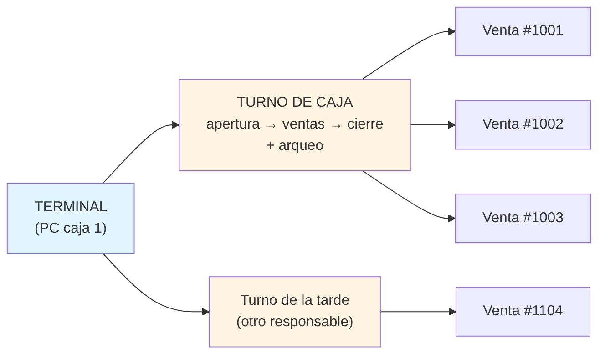

# 05 — Punto de venta y caja

## 1. Los números que definen el diseño

Un POS de papelería no es un POS de supermercado. Las diferencias mandan el diseño:

| Característica | Papelería | Consecuencia de diseño |
|----------------|-----------|------------------------|
| Ticket promedio | $30–$150 MXN | El cobro debe tardar **< 10 s**. Cada segundo extra se multiplica por 100 clientes/día |
| Líneas por ticket | 1–6, a veces 20 en temporada escolar | Optimizar el caso "1 producto, tecleo, cobro" |
| Productos sin código | ~40 % | La **búsqueda y los favoritos** importan tanto como el escáner |
| Cliente que espera | Niños, papás con prisa | **Nada de diálogos modales** en el camino caliente |
| Temporada escolar (jun–ago) | 5–10× el volumen normal | El sistema debe aguantar picos, no ir "fluido en promedio" |
| Precios de $5, $10, $20 | Alto conteo manual de cambio | Denominaciones MXN en un clic |
| Muchas ventas en efectivo | Arqueo de caja crítico | Turnos de caja con fondo inicial obligatorios |

## 2. Estructura mental: Terminal → Turno de caja → Venta



**Reglas estructurales:**

1. **No se puede vender sin turno de caja abierto.** Sin excepción. Si no hay turno, la única acción posible es abrirlo con un fondo inicial. Esto es lo que hace que el arqueo sirva de algo.
2. **Un turno abierto por terminal a la vez.** (`UNIQUE` parcial.) No hay "dos cajeros en la misma PC".
3. **La venta pertenece a un turno.** Si el turno se cierra a las 3 pm y alguien quiere cancelar una venta de las 11 am, se hace durante el turno nuevo con referencia a la venta original (queda en el histórico de ambos turnos).
4. **Cambiar de responsable en la misma PC = cerrar turno y abrir otro.** Es más incómodo y **es a propósito**: es lo que hace que el efectivo cuadre y que se sepa quién tenía el dinero.

## 3. Pantalla de venta (el camino caliente)

```text
┌───────────────────────────────────────────────────────────────────────────────┐
│ PAPELERÍA "EL LÁPIZ FELIZ"     Turno #12 desde 09:14     Cajero: Dueña       │
├──────────────────────────────────────────────┬────────────────────────────────┤
│  CARRITO                                     │  FAVORITOS (los 12 más)        │
│ ┌──────────────────────────────────────────┐ │ ┌────┬────┬────┬────┐          │
│ │ 2 × Lápiz Mirado #2            $12.00    │ │ │FOTO│IMP │LAP │BOR │          │
│ │ 1 × Cuaderno Scribe 100h       $38.00    │ │ │$1.5│$2.0│ $6 │ $4 │          │
│ │ 3 × Hoja opalina carta          $6.00    │ │ ├────┼────┼────┼────┤          │
│ │ ────────────────────────────────────────  │ │ │COLA│TIJ │GOMA│PLU │          │
│ │ 1 × [venta libre] Impresión       $74.00 │ │ │$8  │$35 │$12 │$15 │          │
│ │    37 hojas × $2.00                       │ │ └────┴────┴────┴────┘          │
│ └──────────────────────────────────────────┘ │                                │
│                                              │  TOTAL: $130.00                │
│  Buscar: [lápiz_______________] 🔍           │  Artículos: 7                  │
│           ↑ F2: enfoca aquí                  │  ──────────────────────────    │
│                                              │  [ F1  COBRAR ]  ← tecla F1    │
│  [(escáner listo) 🔵]  [ F4 venta libre ]    │  [ F8  Más opciones ]          │
├──────────────────────────────────────────────┴────────────────────────────────┤
│ F2 Buscar  F3 Cantidad  F4 Libre  F5 Descuento  F6 Eliminar línea  F1 Cobrar  │
│ F9  Cancelar venta   F10  Cierre de turno   F12  Abrir cajón                  │
└───────────────────────────────────────────────────────────────────────────────┘
```

### Atajos de teclado: la diferencia entre vender rápido o no

Sin teclado, un cajero experimentado no puede ser rápido. Diseña **primero el flujo de teclado**, y después los botones táctiles (en la misma pantalla, para el dedo).

| Tecla | Acción | Regla fina |
|-------|--------|-----------|
| `F2` | Buscar producto | Enfoca el buscador y **selecciona** el texto previo (no lo borra) |
| `F3` | Editar cantidad de la línea seleccionada | Acepta `2*` o `2x` al inicio del buscador como "2 veces el siguiente código" |
| `F4` | Venta libre (fotocopia/servicio) | Precio editable; por defecto el de la plantilla |
| `F5` | Descuento en la línea | **Requiere PIN si supera el umbral** (política ABAC, doc 06) |
| `F6` | Eliminar línea | Con confirmación de un solo paso (no un modal) |
| `F1` | **Cobrar** | Abre la pantalla de pago; el foco va directo al monto en efectivo |
| `Enter` | En el cobro: confirmar | Con monto = total, un `Enter` cierra la venta |
| `F9` | Cancelar venta completa | Requiere motivo + PIN; nunca borra, marca `estado='cancelada'` |
| `F10` | Cierre de turno | Muestra el arqueo esperado |
| `F12` | Abrir cajón | Solo registrando motivo (auditoría) |
| `Esc` | Cerrar el diálogo actual | Nunca cierra la venta completa |

**Detalle crítico:** `F4` y `F10` **no pueden compartir** con nada del navegador. En el modo caja, intercepta `keydown` a nivel de ventana y llama `preventDefault()` en todo `F1`–`F12` (menos los que uses para herramientas de desarrollador durante el desarrollo).

### El buscador: lo que realmente se usa

```sql
-- Búsqueda instantánea: nombre, SKU, alias, categoría, y "ventas previas"
-- El orden de resultados importa MÁS que la coincidencia.
SELECT p.id, p.nombre, p.precio_minor, p.ubicacion,
       coalesce(sl.qty_base, 0) AS stock,
       COALESCE(v.relevancia, 0) AS relevancia,
       ts_rank(to_tsvector('spanish', p.nombre), plainto_tsquery('spanish', $1)) AS rank_texto
FROM products p
LEFT JOIN stock_levels sl ON sl.product_id = p.id
LEFT JOIN (
  -- ⭐ "los 100 productos más vendidos" personalizan la búsqueda:
  --    teclear "lap" muestra primero "Lápiz Mirado #2" (el que más vendes),
  --    no "Lapicero gel azul" (el que casi nunca vendes).
  SELECT product_id, row_number() OVER (ORDER BY sum(qty) DESC) AS relevancia
  FROM sale_lines sl2 JOIN sales s ON s.id = sl2.sale_id AND s.estado = 'completada'
  GROUP BY product_id
) v ON v.product_id = p.id
WHERE p.is_activo AND p.deleted_at IS NULL
  AND ( p.nombre ILIKE '%' || $1 || '%'
     OR p.sku    ILIKE '%' || $1 || '%'
     OR to_tsvector('spanish', p.nombre) @@ plainto_tsquery('spanish', $1)
     OR EXISTS (SELECT 1 FROM product_aliases a WHERE a.product_id = p.id
                  AND a.alias ILIKE '%' || $1 || '%'))
ORDER BY (p.nombre ILIKE $1 || '%') DESC,        -- 1.º: empieza con lo que tecleaste
         relevancia ASC NULLS LAST,               -- 2.º: los más vendidos primero
         rank_texto DESC,
         p.nombre
LIMIT 20;
```

**Alias de producto (imprescindible en papelería):** el cliente pide "un lápiz del dos", "un bic", "una goma de migajón". El dueño teclea "bic", "migajón". Sin alias, la búsqueda falla y el cajero pierde 20 segundos cada vez.

```sql
CREATE TABLE product_aliases (
  id         uuid PRIMARY KEY,
  product_id uuid NOT NULL REFERENCES products(id) ON DELETE CASCADE,
  alias      text NOT NULL,          -- 'bic', 'boli', 'pluma', 'migajón', 'goma blanca'
  UNIQUE (product_id, alias)
);
CREATE INDEX idx_alias_busqueda ON product_aliases (lower(alias) text_pattern_ops);
```

Los alias se pueden **sembrar automáticamente** desde tus ventas: cada vez que buscas "bic" y eliges "Pluma BIC Cristal", el sistema puede ofrecerte *"¿Guardar 'bic' como alias?"*. Con 50 productos el sistema ya habla como tus clientes.

## 4. Cobro

```text
┌──────────────────────────────────────────────────────────────────┐
│  COBRAR                                              Venta #1042 │
├──────────────────────────────────────────────────────────────────┤
│                        TOTAL A PAGAR                             │
│                          $130.00                                 │
│                                                                  │
│  EFECTIVO RECIBIDO:   [ $ 200.00________ ]                       │
│                                                                  │
│  Billetes:  [$20] [$50] [$100] [$200] [$500] [$1000]             │
│  Faltante:  $0.00                                                │
│                                                                  │
│  ┌────────────────────────────────────────────┐                  │
│  │        CAMBIO:  $ 70.00                    │                  │
│  │    Sugerencia: 1×$50 + 1×$20                 │                  │
│  └────────────────────────────────────────────┘                  │
│                                                                  │
│  MÉTODO:  [Efectivo ●] [Débito] [Crédito] [Transferencia]        │
│  MIXTO:   agregar otro método →                                  │
│                                                                  │
│  [ F1  COBRAR Y TERMINAR ]   [ F2  COBRAR SIN TICKET ]           │
│  [ Esc  Cancelar venta ]                                         │
└──────────────────────────────────────────────────────────────────┘
```

Detalles que hacen la diferencia:

- **Botones con las denominaciones reales.** El cajero teclea "$200" en un clic. El campo también acepta teclear el monto exacto.
- **Sugerencia de cambio en denominaciones.** "$70 → 1×$50 + 1×$20". Ahorra 5–10 s por venta y reduce errores de cambio, que si no cuadran salen del bolsillo del dueño.
- **Pago mixto.** "$100 efectivo + $30 tarjeta" → 2 filas en `payments`. Es común y debe existir desde el día 1.
- **`Enter` = cobrar.** Con el monto exacto, un solo `Enter` cierra todo. El caso más frecuente debe ser el más corto.
- **"Cobrar sin ticket".** El cliente a veces no lo quiere. Registra igual la venta (para el inventario y el arqueo) y marca `ticket_impreso = false`. Nunca permitas "vender sin registrar".
- **La tarjeta no se integra.** Se cobra en la terminal bancaria aparte y en el sistema se registra el método. **Nunca** captures datos de tarjeta en tu sistema (doc 07 §8).

### Cálculo del ticket (IVA incluido)

```ts
// packages/core/src/domain/totales.ts
export type LineaCalculada = {
  qty: number;
  precioUnitarioMinor: bigint;
  descuentoMinor: bigint;
  taxRate: number;          // 0.16
  taxIncluded: boolean;     // true en papelería
};

export function calcularLinea(l: LineaCalculada) {
  const bruto = l.precioUnitarioMinor * BigInt(Math.round(l.qty * 1000)) / 1000n;
  const neto = bruto - l.descuentoMinor;

  if (l.taxIncluded) {
    // El precio ya trae IVA: se despeja hacia atrás.
    // IMPORTANTE: bigint trunca, por eso roundHalfUp explícito.
    const base = roundHalfUp(Number(neto) / (1 + l.taxRate));
    return {
      totalLineaMinor: neto,
      baseMinor: BigInt(base),
      impuestoMinor: neto - BigInt(base),
    };
  }
  const impuesto = roundHalfUp(Number(neto) * l.taxRate);
  return {
    totalLineaMinor: neto + BigInt(impuesto),
    baseMinor: neto,
    impuestoMinor: BigInt(impuesto),
  };
}

export function totalizarVenta(lineas: LineaCalculada[]): {
  subtotalMinor: bigint; descuentoMinor: bigint; impuestoMinor: bigint; totalMinor: bigint;
} {
  const calc = lineas.map(calcularLinea);
  const totalMinor      = calc.reduce((s, l) => s + l.totalLineaMinor, 0n);
  const impuestoMinor   = calc.reduce((s, l) => s + l.impuestoMinor,   0n);
  const baseMinor       = calc.reduce((s, l) => s + l.baseMinor,       0n);
  const descuentoMinor  = lineas.reduce((s, l) => s + l.descuentoMinor, 0n);
  return { subtotalMinor: baseMinor + descuentoMinor, descuentoMinor, impuestoMinor, totalMinor };
}

const roundHalfUp = (n: number) => Math.floor(n + 0.5);
```

**La regla de redondeo:** se redondea **por línea**, y el total es la **suma de las líneas**. Nunca se redondea el total. Si redondeas el total después, la suma de las líneas no cuadra con el ticket y el contador se vuelve loco buscando el centavo. Este bug aparece inevitablemente en la primera factura con IVA desglosado.

## 5. Ticket

```css
/* Ticket de 58 mm — el formato más común en papelerías */
@media print {
  @page { size: 58mm auto; margin: 0; }
  body * { visibility: hidden; }
  .ticket, .ticket * { visibility: visible; }
  .ticket {
    position: absolute; left: 0; top: 0;
    width: 58mm; padding: 2mm;
    font: 9pt/1.25 'Consolas', 'Courier New', monospace;
    color: #000;
  }
}
```

```text
        PAPELERÍA EL LÁPIZ FELIZ
          Av. Juárez 145, Col. Centro
             Tel. 555-123-4567
              RFC: XAXX010101000
══════════════════════════════════════
Ticket: 1042         18/10/2026 14:32
Cajero: Dueña           Turno: #12
──────────────────────────────────────
2 Lápiz Mirado #2              $12.00
1 Cuaderno Scribe 100h         $38.00
3 Hoja opalina carta            $6.00
1 Impresión B/N (37 hojas)     $74.00
──────────────────────────────────────
ARTÍCULOS: 7
SUBTOTAL                     $112.06
DESCUENTO                      $0.00
IVA 16% incluido              $17.94
TOTAL                        $130.00
──────────────────────────────────────
EFECTIVO                     $200.00
CAMBIO                        $70.00
══════════════════════════════════════
    ¡GRACIAS POR SU COMPRA!
   Cambios dentro de 7 días con ticket
```

Reglas del ticket:

- **Este desglose se calcula POR LÍNEA y se suma.** Si desglosas el total de una
  sola vez obtienes `$112.07 + $17.93` — un centavo de diferencia. Las dos formas
  son defendibles, pero hay que ser consistente con el detalle impreso o el ticket
  no cuadra y el contador se vuelve loco. Por eso `totalizarVenta()` redondea
  línea por línea. Está probado en `packages/core/src/ventas/totales.test.ts`.
- **Nunca imprimas precios redondeados.** `$6.00` y no `$6`.
- **El IVA se muestra "incluido".** Si pones un desglose como si se sumara, el cliente cree que le estás cobrando de más. Texto exacto: `IVA 16% incluido`.
- **Número de ticket visible.** Es lo que permite buscar la venta para una devolución.
- **La leyenda de política de cambios** debe ser configurable (`settings.dias_para_devolucion`, `settings.pie_ticket`).
- **Imprenta y `@media print` primero.** Con `window.print()` funciona con cualquier impresora sin drivers. Cuando quieras velocidad, migra a ESC/POS por WebUSB (§9).

**Reimpresión:** siempre permitida. Busca por folio, presiona "Reimprimir". El sistema registra la reimpresión en `audit_log` (así sabes si alguien reimprime tickets para robar: es un patrón de fraude conocido en caja).

## 6. Turno de caja y arqueo

### Apertura

```text
┌──────────────────────────────────────────┐
│  ABRIR TURNO DE CAJA                     │
│  Responsable: Dueña                      │
│  Fondo inicial (el cambio):  $ 500.00    │
│  [ Abrir turno ]                         │
└──────────────────────────────────────────┘
```

Se guarda como un `payment`… no: se guarda en `cash_sessions.fondo_inicial_minor` y se registra en `audit_log`. **El fondo no es una venta.** Es dinero que ya estaba en el cajón y se está declarando.

### Cierre con arqueo

```text
┌────────────────────────────────────────────────────────────────────┐
│  CIERRE DE TURNO #12                          Desde 09:14 18/10    │
├────────────────────────────────────────────────────────────────────┤
│  ESPERADO (calculado por el sistema)                               │
│    Fondo inicial                                    $  500.00      │
│    + Ventas en efectivo   (18 tickets)              $2,340.00      │
│    + Pagos a cuenta / abonos                        $    0.00      │
│    − Devoluciones en efectivo                       $  −18.00      │
│    − Retiros / gastos del cajón                     $ −120.00      │
│    ──────────────────────────────────────────────────────────      │
│    ESPERADO EN CAJÓN                                $2,702.00      │
│                                                                    │
│  CONTADO (lo que hay físicamente, tú lo cuentas)                   │
│    Billetes:  $200×2  $100×8  $50×6  $20×20 ...     calc. →         │
│    Monedas:   [ 12.50 ]                                            │
│    TOTAL CONTADO                                    $2,700.50      │
│                                                                    │
│    ⚠️  DIFERENCIA:  −$1.50                                          │
│    Nota: [faltan $1.50 de cambio, probablemente redondeo]          │
│                                                                    │
│  OTROS MÉTODOS (informativo)                                       │
│    Tarjeta débito     $ 340.00                                     │
│    Transferencia      $  85.00                                     │
│                                                                    │
│  [ Cerrar e imprimir corte Z ]                                     │
└────────────────────────────────────────────────────────────────────┘
```

```sql
-- Cálculo del esperado en cajón (efectivo). Ejecútalo al abrir el diálogo de cierre.
SELECT
  cs.fondo_inicial_minor
  + coalesce((SELECT sum(p.monto_minor + p.cambio_minor)   -- ⚠️ ver nota abajo
              FROM payments p JOIN sales s ON s.id = p.sale_id
              WHERE s.cash_session_id = cs.id AND p.metodo = 'efectivo'
                AND s.estado = 'completada'), 0)
  - coalesce((SELECT sum(r.total_devuelto_minor) FROM returns r
              JOIN sales s ON s.id = r.sale_id
              WHERE s.cash_session_id = cs.id), 0)
  - coalesce((SELECT sum(cm.monto_minor) FROM cash_movements cm
              WHERE cm.cash_session_id = cs.id AND cm.tipo = 'retiro'), 0)
  + coalesce((SELECT sum(cm.monto_minor) FROM cash_movements cm
              WHERE cm.cash_session_id = cs.id AND cm.tipo = 'ingreso'), 0)
  AS esperado_efectivo_minor
FROM cash_sessions cs WHERE cs.id = $1;
```

> **Nota sobre `cambio_minor`:** el efectivo que entra al cajón es `monto_minor` (lo que dio el cliente) menos `cambio_minor` (lo que se le devolvió en efectivo). Si el cliente paga $130 con $200 y se le dan $70 de cambio, el cajón recibe **$130 netos**, no $200. Guarda `monto_minor` como lo recibido y `cambio_minor` como lo devuelto, y suma `monto − cambio`. **No** sumes `monto + cambio`: es el error más común en un POS casero y desajusta todos los cierres.

```sql
CREATE TABLE cash_movements (            -- retiros, gastos, ingresos que no son venta
  id                uuid PRIMARY KEY,
  cash_session_id   uuid NOT NULL REFERENCES cash_sessions(id),
  tipo              text NOT NULL,       -- 'retiro' | 'ingreso' | 'gasto' | 'fondo'
  monto_minor       bigint NOT NULL CHECK (monto_minor > 0),
  concepto         text NOT NULL,        -- 'Compra de bolsas', 'Retiro de utilidad'
  autorizado_por    uuid REFERENCES users(id),   -- ⭐ quién autorizó el retiro
  user_id           uuid NOT NULL REFERENCES users(id),
  ocurrido_at       timestamptz NOT NULL
);
```

**Los retiros y gastos del cajón son obligatorios de tener.** El dueño saca $200 para comprar bolsas, o $1 000 de utilidad. Si el sistema no lo registra, el cierre siempre da diferencia negativa "inexplicable" y el arqueo se vuelve inútil. Con `cash_movements`, cada peso tiene explicación.

**Política ABAC relacionada:** retiro de cajón > $500 → requiere PIN de step-up. Cierre con diferencia > $20 → requiere nota obligatoria. Ver [06](06-authz-rbac-abac.md).

### Corte Z

Al cerrar, imprimir el **corte Z** (reporte del turno, inmutable): totales por método de pago, número de tickets, cancelaciones con motivo, devoluciones, retiros, diferencias, y la firma del responsable. Este documento es tu respaldo legal y contable. Guárdalo también como PDF en `settings`/archivo.

## 7. Venta libre (fotocopias y servicios)

El caso más frecuente después de vender productos. Debe tomar **menos de 5 segundos**:

```text
┌────────────────────────────────────────────────┐
│  VENTA LIBRE (F4)                              │
│  Precio por hoja:  [ $2.00 ]                   │
│  Cantidad:         [ 37 ]                      │
│  ☐ Doble cara  ☐ Color (+$3.00/hoja)           │
│  Concepto: [ Impresión B/N ]                   │
│  ──────────────────────────────────            │
│  TOTAL:  $74.00                                │
│  [ Agregar al carrito ]                        │
└────────────────────────────────────────────────┘
```

Esto inserta una línea con `es_venta_libre = true` y `tracks_stock` no aplica. Alternativa más rápida todavía: botones con cantidades predefinidas (`1`, `5`, `10`, `20`, `50`, `100` hojas) que suman directo al carrito sin diálogo.

## 8. Devoluciones y cancelaciones

| Situación | Cómo se maneja | Requiere |
|-----------|----------------|----------|
| **Error de captura en la misma venta** | No se cobra: `F6` elimina la línea antes de cobrar | Nada (aún no es venta) |
| **Venta cobrada por error (mismo turno)** | `F9` Cancelar venta → `estado = 'cancelada'` + motivo + movimientos inversos | PIN de step-up + motivo |
| **Cliente regresa el producto** | Devolución parcial/total → `returns` + `return_lines` + reingreso de stock opcional | PIN si > umbral o si ya cerró el turno |
| **Cliente cambió de opinión, quiere otro producto** | Devolución + nueva venta (nunca "editar" la venta original) | PIN si > umbral |

```ts
// Regla de negocio: una devolución NUNCA modifica la venta original.
// Se registra un hecho nuevo que la referencia. Así:
//   · El histórico es inmutable y auditable.
//   · Se ve el historial de devoluciones por producto (detecta patrones de abuso).
//   · El margen se recalcula correctamente con la devolución.
```

**Reglas que evitan abusos:**

- Devolución sin ticket → permitida solo con autorización del dueño (step-up) y el producto debe existir. Se registra sin `sale_id` (venta huérfana) y queda marcada para revisión.
- **Límite de devoluciones:** reporte "productos con más devoluciones" y "clientes con más devoluciones". No acuses a nadie, pero mira el dato.
- **`reingresa_stock = false`** cuando el producto vuelve roto o usado. La devolución del dinero y el reingreso de stock son decisiones **independientes**: si las acoplas, tu inventario se infla con mercancía inservible.

## 9. Impresión: de "funciona ya" a "funciona rápido"

| Fase | Método | Latencia | Cuándo |
|------|--------|----------|--------|
| **1** | `window.print()` con `@page size: 58mm` | 800–1 500 ms | Día 1. Funciona con cualquier impresora, sin drivers |
| **2** | **ESC/POS por WebSerial/WebUSB** | 80–150 ms | Cuando el diálogo de impresión moleste |
| **3** | Impresora de red (Ethernet/WiFi) por socket TCP 9100 | 50 ms | Multi-terminal |

**El cajón de dinero** (si tienes uno): se abre con un pulso eléctrico enviado por la impresora térmica. El comando ESC/POS es `0x1B 0x70 0x00` (pin 2). Requiere el camino 2 (WebSerial/WebUSB) porque pasa por el puerto de la impresora. Si el cajón se abre por separado, también hay cajones con puerto USB que se ven como HID… pero eso es otro proyecto. **Empieza sin cajón automático** y ábrelo con llave.

```ts
// Fase 2: ESC/POS mínimo por WebSerial
export async function imprimirTicketESC_POS(port: SerialPort, lineas: Buffer[]) {
  const writer = port.writable!.getWriter();
  await writer.write(new Uint8Array([0x1b, 0x40]));         // INIT
  await writer.write(new Uint8Array([0x1b, 0x61, 0x01]));   // centrar
  for (const l of lineas) await writer.write(l);
  await writer.write(new Uint8Array([0x1d, 0x56, 0x42, 0x00])); // cortar papel
  await writer.write(new Uint8Array([0x1b, 0x70, 0x00, 0x19, 0xfa])); // abrir cajón
  writer.releaseLock();
}
```

## 10. Lo que queda fuera del MVP (y no lo metas)

| Funcionalidad | Por qué esperar |
|---------------|-----------------|
| Facturación electrónica (CFDI) | Requiere PAC, certificados del SAT, timbrado **online**. Contradice el offline. Es un módulo completo, contrátalo aparte o usa un PAC con API |
| Integración con terminal bancaria | Cada banco tiene su SDK/protocolo. Registra el pago a mano, punto |
| Apartados / layaway | Temporada escolar sí lo pide. Fase 3 |
| Listas escolares (paquete de útiles) | Alto valor en México, pero requiere un modelo de "paquete" y comparación de listas. Fase 3, muy recomendado |
| Múltiples sucursales | Complejidad de sincronización ×10. No hasta que tengas la segunda |
| Programa de lealtad / puntos | Fase 4 |
| Compras y órdenes a proveedor | Fase 2–3. La recepción de mercancía sí es importante; la orden de compra, no urgente |
| Balanzas y venta por peso | Solo si vendes a granel (papel, listones). El prefijo 2 con PLU+peso existe, pero es fase 4 |

## 11. Checklist de este módulo

- [ ] Turno de caja: apertura con fondo, cierre con arqueo, un turno por terminal a la vez
- [ ] No se puede vender sin turno abierto (validado en la capa de casos de uso, no solo en la UI)
- [ ] `cash_movements` para retiros, gastos e ingresos (sin esto el arqueo miente)
- [ ] Arqueo calcula `monto − cambio` para efectivo, **no** `monto + cambio`
- [ ] Cálculo de totales: centavos, `roundHalfUp`, IVA incluido despejado por línea
- [ ] Diferencia de redondeo ajustada por línea, nunca en el total
- [ ] Atajos `F1`–`F12` con `preventDefault` global en modo caja
- [ ] Buscador ordenado por **más vendidos** + alias de producto
- [ ] Favoritos con los 12 productos más vendidos, refrescados semanalmente
- [ ] Botones de denominaciones MXN + sugerencia de cambio desglosada
- [ ] Pago mixto desde el día 1 (2+ filas en `payments`)
- [ ] "Cobrar sin ticket" registra la venta igual
- [ ] Ticket 58 mm con IVA **incluido**, folio visible y política de cambios configurable
- [ ] Reimpresión auditada
- [ ] Devoluciones y cancelaciones: nunca editar, siempre registrar un hecho nuevo
- [ ] Venta libre (F4) en ≤ 5 segundos con cantidades predefinidas
- [ ] RS-232/ESC-POS **no** en el MVP: `window.print()` primero
