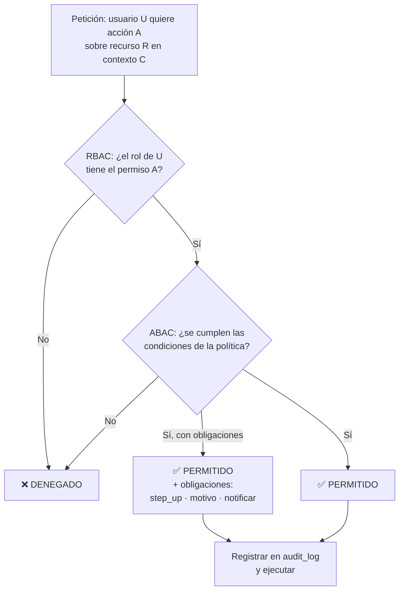
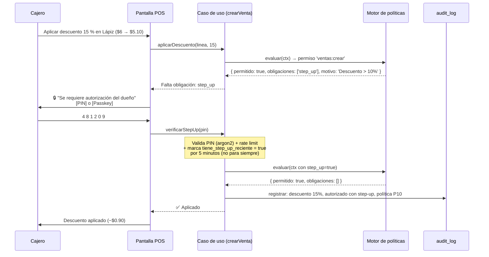

# 06 — Autorización: RBAC + ABAC

Preguntas que responde este documento: *¿quién puede hacer qué? ¿bajo qué condiciones? ¿y por qué con un solo usuario igual vale la pena?*

## 1. Vocabulario (para no confundir los términos)

| Término | Pregunta que responde | Ejemplo en la papelería |
|---------|----------------------|-------------------------|
| **Autenticación** | ¿Quién eres? | "Soy la dueña, entré con mi passkey" |
| **RBAC** (Role-Based Access Control) | ¿Qué puede hacer tu **rol**? | "El rol *cajero* puede vender, no puede cambiar precios" |
| **ABAC** (Attribute-Based Access Control) | ¿Esta acción **concreta**, en **este momento**, con **estos valores**, se permite? | "Descuento del 15 %: no. Descuento del 15 % con refresh de credencial hace 2 minutos: sí" |
| **Step-up auth** | ¿Puedes demostrar tu identidad **otra vez** para esta acción sensible? | El cajero pide el PIN del dueño para cancelar una venta |

**La clave:** RBAC es **grueso y estático** ("el cajero no edita precios"), ABAC es **fino y dinámico** ("...salvo si es lunes, con autorización y descuento menor a $50"). Necesitas los dos.



## 2. ¿Por qué con un solo usuario igual necesitas esto?

Legítima duda. Cinco razones, ordenadas por peso real:

### 2.1 El 90 % de tus problemas serán **errores**, no fraude

No vas a robar tu propia papelería. Pero sí vas a:
- Ajustar el stock de un producto equivocado a las 8:40 pm con prisa.
- Poner un precio en centavos cuando eran pesos ($6 en lugar de $600).
- Vender una calculadora de $450 a $45 por un cero de menos.
- Cerrar el turno con $150 de diferencia sin saber de dónde salió.

ABAC es una **red de seguridad contra ti mismo**. Que la política exija *"si el precio nuevo es menor al costo, pide confirmación y motivo"* te salva del error de un segundo que te arruina el margen del mes. Con un solo usuario esto es **más** valioso, no menos, porque no tienes a nadie más revisando.

### 2.2 La temporada escolar es predecible y va a requerir ayuda

Junio–agosto una persona sola no puede. Vas a meter a alguien: un familiar, un empleado temporal. En ese momento tienes dos opciones:

| Sin estructura previa | Con estructura previa |
|----------------------|----------------------|
| Le das tu contraseña de dueño | Le creas el rol `cajero` |
| Ve todo: costos, márgenes, precios | Solo vende. No ve costos |
| No sabes qué hizo y qué no | Cada venta, cancelación y ajuste con su nombre |
| SIEMPRE queda con tu contraseña. Nunca la cambias | Le revocas el acceso en un clic al terminar |
| Alguien tiene que cerrar turno por él | Cierra su propio turno con su arqueo |

La diferencia entre esas columnas es **una tarde de trabajo** hoy, o **una reescritura** en julio.

### 2.3 La separación de funciones es lo que hace que la auditoría funcione

Si el dueño hace **todo** con la misma identidad, el registro dice:

```text
2026-10-18 20:12  usuario: dueña  acción: Ajuste de stock  producto: Calculadora FX-991  qty: −3
```

…y **no sabes qué pasó**: ¿las vendiste y olvidaste registrar la venta? ¿se cayeron? ¿estaban mal contadas? ¿se las llevó alguien? El registro no ayuda porque es la misma identidad haciendo cosas incompatibles.

Con roles separados el registro dice:

```text
2026-10-18 20:12  rol: cajero  (empleada temporal)  acción: Venta  producto: Calculadora ×3  ✔
2026-10-18 20:15  rol: dueña                         acción: Conteo físico  diferencia: −3  nota: "no aparecen"
```

Ahora sí tienes una historia. **Ese es el punto real de RBAC: trazabilidad, no desconfianza.**

### 2.4 Delegar te da libertad

Con roles puedes irte de viaje y dejar a alguien operando con el rol `cajero`: vende, cobra, cierra turno. No puede cambiar precios, no ve márgenes, no puede exportar la base. Tú sigues siendo el dueño del negocio, no el prisionero de la caja.

### 2.5 El costo de agregarlo después es 10×

Hacerlo hoy: dos tablas (`roles`, `permissions`) y un evaluador de políticas. ~1 día.

Hacerlo en julio con el sistema en uso: tienes que migrar cada consulta, cada endpoint, cada botón, y auditar dónde asumiste "hay un solo usuario". Es el tipo de refactor que nadie termina bien.

> **Costo concreto de esta decisión:** ~1 día hoy (y menos, porque solo siembras un rol). Beneficio: en julio son 20 minutos en lugar de 2 semanas.

## 3. RBAC: el modelo

### 3.1 Tablas

```sql
CREATE TABLE roles (
  id          uuid PRIMARY KEY,
  clave       text NOT NULL UNIQUE,      -- 'dueno' | 'cajero' | 'bodega' | 'auditor'
  nombre      text NOT NULL,             -- 'Dueño', 'Cajero', 'Bodega', 'Auditor'
  descripcion text,
  is_sistema  boolean NOT NULL DEFAULT false,   -- los de sistema no se pueden borrar
  nivel       int NOT NULL DEFAULT 0,           -- mayor = más privilegios
  deleted_at  timestamptz
);

CREATE TABLE permissions (
  id          uuid PRIMARY KEY,
  clave       text NOT NULL UNIQUE,      -- 'ventas:crear', 'precios:editar', ...
  recurso     text NOT NULL,             -- 'ventas'
  accion      text NOT NULL,             -- 'crear' | 'leer' | 'editar' | 'borrar' | 'exportar'
  descripcion text,
  es_sensible boolean NOT NULL DEFAULT false    -- ⭐ requiere step-up por defecto
);

CREATE TABLE role_permissions (
  role_id       uuid NOT NULL REFERENCES roles(id) ON DELETE CASCADE,
  permission_id uuid NOT NULL REFERENCES permissions(id) ON DELETE CASCADE,
  PRIMARY KEY (role_id, permission_id)
);

CREATE TABLE user_roles (
  user_id     uuid NOT NULL REFERENCES users(id) ON DELETE CASCADE,
  role_id     uuid NOT NULL REFERENCES roles(id) ON DELETE CASCADE,
  asignado_por uuid REFERENCES users(id),
  asignado_at timestamptz NOT NULL DEFAULT now(),
  expira_at   timestamptz,               -- ⭐ rol temporal: empleado de temporada
  PRIMARY KEY (user_id, role_id)
);
```

`expira_at` en `user_roles` es el detalle que resuelve la temporada escolar: le das el rol `cajero` con `expira_at = '2026-08-31'` y **se revoca solo**. No dependes de acordarte de quitárselo.

### 3.2 Formato de permiso: `recurso:acción`

Usa `recurso:acción`, **no** `puedeEditarPrecios`. Los permisos basados en el recurso y la acción se pueden automatizar (mapear endpoints, generar pantallas de administración) y no se vuelven un catálogo caótico de 200 permisos ad-hoc.

### 3.3 Catálogo de permisos (el real, no el ideal)

Resiste la tentación de crear 150 permisos. Con ~28 cubres todo, y cada permiso extra es una fila más en la pantalla de administración que nunca vas a configurar.

| Recurso | Permisos | Dueño | Cajero | Bodega | Auditor |
|---------|----------|:-----:|:------:|:------:|:-------:|
| `ventas` | crear, leer, cancelar, devolver | ✅ | ✅ *(cancelar solo con step-up)* | — | leer |
| `turnos` | abrir, cerrar, leer, retiros | ✅ | ✅ | — | leer |
| `productos` | crear, leer, editar, borrar | ✅ | leer | leer, editar | leer |
| `precios` | editar, ver_costos, aplicar_masivo | ✅ | **—** | — | ver_costos |
| `stock` | leer, ajustar, conteo, traspaso | ✅ | leer | ✅ *(ajustar con step-up)* | leer |
| `etiquetas` | generar, imprimir, calibrar | ✅ | imprimir | ✅ | — |
| `catalogos` | categorias, proveedores, unidades, impuestos | ✅ | leer | leer | leer |
| `reportes` | ventas, margen, inventario, exportar | ✅ | **—** | inventario | ✅ |
| `usuarios` | crear, editar, roles, revocar | ✅ | — | — | — |
| `policies` | leer, editar, publicar | ✅ | — | — | leer |
| `dispositivos` | emparejar, revocar | ✅ | emparejar | — | — |
| `config` | leer, editar, respaldos | ✅ | — | — | — |
| `auditoria` | leer | ✅ | — | — | ✅ |

**Detalles deliberados:**

- El cajero **no** tiene `precios:ver_costos`. No ve lo que te costó; no ve tu margen. Es la decisión de privacidad más importante del catálogo.
- El cajero **no** tiene `reportes:ventas`. Su propia pantalla del día sí funciona (no es un reporte de negocio).
- `policies:editar` solo el dueño. Es el permiso que permite cambiar las reglas; si un cajero lo tiene, las reglas no existen.
- `reportes:exportar` es sensible: una exportación de todo el catálogo es la base de datos de tu negocio saliendo por la puerta.

### 3.4 Roles sembrados desde el día 1

```sql
-- Se siembran los 4 roles aunque hoy solo uses uno.
-- Un rol sin usuarios no cuesta nada y estar listo en julio vale todo.
INSERT INTO roles (id, clave, nombre, descripcion, is_sistema, nivel) VALUES
  (uuidv7(), 'dueno',   'Dueño',   'Acceso total. Único rol que edita políticas y usuarios.', true, 100),
  (uuidv7(), 'cajero',  'Cajero',  'Vende y cobra. No ve costos ni márgenes.',                  true, 20),
  (uuidv7(), 'bodega',  'Bodega',  'Inventario, conteos, etiquetas. No vende ni ve precios.',    true, 20),
  (uuidv7(), 'auditor', 'Auditor', 'Solo lectura de reportes y auditoría.',                      true, 10);
```

Hoy, la única fila de `user_roles` es `(dueña, dueno)`. Listo.

## 4. ABAC: políticas por atributos

RBAC dice "el cajero puede vender". ABAC dice **bajo qué condiciones**. Un ABAC completo evalúa 4 grupos de atributos:

```ts
export type ContextoPolitica = {
  // 1. SUJETO — quién
  sujeto: {
    user_id: string;
    roles: string[];                 // ['dueno']
    permisos: string[];              // ['ventas:crear', ...]
    tiene_step_up_reciente: boolean; // ⭐ habilitado por re-autenticación (PIN/passkey)
    step_up_hace_segundos: number | null;
    dispositivo_confiable: boolean;
    dispositivo_id: string;
  };

  // 2. RECURSO — sobre qué
  recurso: {
    tipo: 'venta' | 'producto' | 'movimiento' | 'turno' | 'usuario' | 'politica';
    id?: string;
    // Atributos del recurso concreto:
    precio_actual_minor?: number;
    precio_nuevo_minor?: number;
    costo_minor?: number;
    monto_minor?: number;             // total de la venta / monto del ajuste
    descuento_pct?: number;
    valor_stock_afectado_minor?: number;
    es_venta_ya_cerrada?: boolean;
    producto_tiene_stock?: boolean;
  };

  // 3. ACCIÓN — qué
  accion: {
    permiso: string;                  // 'ventas:crear'
    es_masiva?: boolean;              // ¿afecta a varios productos a la vez?
  };

  // 4. ENTORNO — contexto
  entorno: {
    hora_local: number;               // 0–23
    dia_semana: number;               // 0–6
    en_temporada_escolar: boolean;
    terminal_id: string;
    es_offline: boolean;              // ⭐ hay políticas que cambian offline
    rango_diferencia_conteo?: 'bajo' | 'medio' | 'alto';
  };
};

// ⭐ El resultado NO es solo un booleano:
export type Decision = {
  permitido: boolean;
  motivo: string;                     // siempre explicable: 'descuento 15% > 10% sin step-up'
  obligaciones: Array<
    | 'step_up'                       // pedir PIN/passkey ahora
    | 'motivo_obligatorio'            // exigir una nota (≥10 caracteres)
    | 'notificar_dueno'               // mandar aviso aunque se permita
    | 'marcar_para_revision'          // se permite pero queda marcado
    | 'segunda_aprobacion'            // requiere que el dueño confirme desde otro dispositivo
  >;
  politica_id?: string;               // qué regla decidió → queda en el audit_log
};
```

**La parte más valiosa es `obligaciones`.** Un sistema solo-allow/deny te obliga a elegir entre bloquear al empleado o darle vía libre. Las obligaciones permiten "sí, pero con PIN", "sí, pero con motivo escrito", "sí, pero me avisas". Es exactamente cómo funciona una papelería de verdad.

## 5. Políticas concretas para tu papelería

Estas son las que implementaría. Están escritas en lenguaje natural porque el motor las va a evaluar como datos; abajo está la implementación.

### 5.1 Protección contra el error (aplica al dueño)

| # | Situación | Decisión | Obligaciones | Por qué |
|---|-----------|----------|--------------|---------|
| P1 | Precio nuevo **menor** al costo | 🔴 Denegar | — | Estás vendiendo a pérdida. Ni con PIN. |
| P2 | Precio nuevo es 0 o negativo | 🔴 Denegar | — | Error de captura seguro |
| P3 | Precio nuevo **igual** al costo (margen 0) | 🟡 Permitir | `step_up`, `motivo_obligatorio` | Puede ser promoción, pero que sea consciente |
| P4 | Cambio de precio masivo (>5 productos) | 🟡 Permitir | `step_up`, `motivo_obligatorio`, `notificar_dueno` | El cambio masivo es donde vive el error de multiplicar por 100 |
| P5 | Ajuste manual de stock con valor > $500 | 🟡 Permitir | `step_up`, `motivo_obligatorio` | Este es el agujero por donde se va el inventario |
| P6 | Ajuste manual de stock > $2 000 | 🟡 Permitir | `step_up`, `motivo_obligatorio`, `notificar_dueno`, `marcar_para_revision` | Muy grande: puede ser error grave o algo peor |
| P7 | Conteo físico con diferencia > 10 % del valor | 🟡 Permitir | `motivo_obligatorio` | Cierra el ciclo del inventario |

### 5.2 Protección contra el robo (aplica a cualquiera)

| # | Situación | Decisión | Obligaciones | Por qué |
|---|-----------|----------|--------------|---------|
| P8 | Cancelar una venta ya cobrada | 🟡 Permitir | `step_up`, `motivo_obligatorio` | La cancelación es el fraude #1 en caja |
| P9 | Devolución **sin ticket** | 🟡 Permitir | `step_up`, `motivo_obligatorio`, `notificar_dueno` | Sin ticket no hay prueba de la compra |
| P10 | Descuento en línea > 10 % | 🟡 Permitir | `step_up` | El descuento "de la casa" es la forma más limpia de robar |
| P11 | Descuento > 30 % o mayor a $200 | 🟡 Permitir | `step_up`, `motivo_obligatorio`, `notificar_dueno` | Escala con el monto |
| P12 | Venta total > $5 000 | 🟡 Permitir | `step_up` | Anti-asalto silencioso: no bloquea, pero deja registro de quién y a qué hora |
| P13 | Venta > $1 000 **después de las 20:00** | 🟡 Permitir | `step_up` | Horario de mayor riesgo. La política se vuelve más estricta de noche |
| P14 | Retiro de cajón > $500 | 🟡 Permitir | `step_up`, `motivo_obligatorio` | El retiro es salida de efectivo sin venta |
| P15 | Retiro de cajón > $1 000 o más de 3 retiros en el turno | 🟡 Permitir | `step_up`, `motivo_obligatorio`, `notificar_dueno` | Patrón de vaciado gradual |
| P16 | Reimpresión de ticket (2.ª o más del mismo folio) | 🟡 Permitir | `marcar_para_revision` | Patrón de fraude conocido en caja |
| P17 | Cerrar turno con diferencia > $50 | 🟡 Permitir | `motivo_obligatorio`, `notificar_dueno` | Que se explique solo |

### 5.3 Control de acceso

| # | Situación | Decisión | Obligaciones |
|---|-----------|----------|--------------|
| P18 | Exportar catálogo o ventas | 🟡 Permitir *(solo `dueno`)* | `notificar_dueno`, registrar en auditoría |
| P19 | Emparejar un nuevo escáner | 🟡 Permitir | `step_up` *(la sesión de caja debe tener auth reciente)* |
| P20 | Ver costos y márgenes | 🔴 Denegar si el rol no incluye `precios:ver_costos` | — |
| P21 | Editar políticas o crear usuarios | 🟡 Permitir *(solo `dueno`)* | `step_up` |
| P22 | Revocar un dispositivo | 🟢 Permitir siempre | — *(quitar acceso nunca debe requerir permiso: en una emergencia tienes que poder cortar)* |
| P23 | Consultar auditoría | 🟡 Permitir *(solo `dueno`, `auditor`)* | — |
| P24 | Modificar un conteo ya **aplicado** | 🔴 Denegar | — *(se corrige con un movimiento nuevo)* |

### 5.4 Reglas específicas del modo **offline** (las interesantes)

Cuando no hay internet, la política **no puede consultar al servidor**. Aquí es donde la arquitectura se gana su sueldo:

| # | Situación | Decisión | Obligaciones | Por qué |
|---|-----------|----------|--------------|---------|
| P25 | Venta offline ≤ $500 | 🟢 Permitir | — | El caso normal. No debe estorbar. |
| P26 | Venta offline > $500 y ≤ $2 000 | 🟡 Permitir | `marcar_para_revision` | Se acepta para no frenar el negocio, se revisa al volver la red |
| P27 | Venta offline > $2 000 | 🟡 Permitir | `step_up`, `marcar_para_revision` | Freno razonable sin bloquear la venta |
| P28 | **Descuento offline** (cualquiera) | 🟡 Permitir | `marcar_para_revision` + el descuento se limita a 5 % | Offline es el escenario ideal para el abuso. Se limita por política |
| P29 | **Cambio de precio offline** | 🔴 Denegar | — | Los precios se cambian con red, punto. Evita divergencia de catálogo |
| P30 | Retiro de cajón offline > $300 | 🔴 Denegar | — | Sin red no hay forma de avisar a nadie |
| P31 | Reversión de una venta offline | 🟡 Permitir | `step_up`, `motivo_obligatorio`, `marcar_para_revision` | |

**Cómo funciona técnicamente P25–P31:** las políticas viven **en la base de datos local** (se replican con el resto del catálogo) y se evalúan **en el dispositivo**. Por eso las políticas deben ser **datos puros, versionados y firmados**, no código que hay que desplegar.

```ts
// Las políticas son filas, no if/else en el código:
export type Politica = {
  id: string;
  version: number;
  prioridad: number;              // menor = se evalúa primero
  efecto: 'permitir' | 'denegar';
  aplica_a: { permiso?: string; recurso?: string };
  condicion: CondicionJSON;       // ── árbol serializable ──
  obligaciones: Obligacion[];
  motivo: string;                 // explicación legible, se muestra al usuario
  activa: boolean;
};

// Ejemplo: P10, descuento mayor al 10 %
export const P10: Politica = {
  id: 'P10-descuento-alto',
  version: 3,
  prioridad: 100,
  efecto: 'permitir',
  aplica_a: { permiso: 'ventas:crear' },
  condicion: {
    op: 'and',
    args: [
      { op: 'gt', campo: 'recurso.descuento_pct', valor: 10 },
      { op: 'eq', campo: 'sujeto.tiene_step_up_reciente', valor: false },
    ],
  },
  obligaciones: ['step_up'],
  motivo: 'Descuento mayor al 10 %: se requiere autorización del dueño.',
  activa: true,
};

// Ejemplo: P25–P27, escalado por monto en offline
export const P_OFFLINE_MONTO: Politica = {
  id: 'P-offline-monto',
  version: 2,
  prioridad: 50,
  efecto: 'permitir',
  aplica_a: { permiso: 'ventas:crear' },
  condicion: {
    op: 'and',
    args: [
      { op: 'eq', campo: 'entorno.es_offline', valor: true },
      { op: 'gt', campo: 'recurso.monto_minor', valor: 200_000 },   // $2 000
    ],
  },
  obligaciones: ['step_up', 'marcar_para_revision'],
  motivo: 'Venta offline mayor a $2,000: se registra para revisión posterior.',
  activa: true,
};

// El evaluador es puro, sin IO, ~60 líneas. Va en packages/core y se usa
// igual en el navegador, en el PC, en el servidor y en el celular.
export function evaluar(
  ctx: ContextoPolitica,
  politicas: Politica[],
  permisosDelRol: string[],
): Decision {
  // 1. La puerta gruesa: RBAC
  const permiso = ctx.accion.permiso;
  const tienePermiso = permisosDelRol.includes(permiso)
    || permisosDelRol.includes('*');

  if (!tienePermiso) {
    return { permitido: false, motivo: `El rol no incluye ${permiso}`, obligaciones: [] };
  }

  // 2. Las reglas finas: ABAC, en orden de prioridad
  const aplicables = politicas
    .filter((p) => p.activa && coincideAplica(p, ctx))
    .filter((p) => evaluarCondicion(p.condicion, ctx))
    .sort((a, b) => a.prioridad - b.prioridad);

  // ⭐ DENY-OVERRIDES: si cualquiera deniega, se deniega. Sin excepciones.
  //    Es el patrón seguro: una regla nueva no puede "abrir" un agujero
  //    por error si otra regla ya lo cerró.
  const denegacion = aplicables.find((p) => p.efecto === 'denegar');
  if (denegacion) {
    return { permitido: false, motivo: denegacion.motivo, obligaciones: [], politica_id: denegacion.id };
  }

  // 3. Se permiten las obligaciones de TODAS las políticas aplicables
  //    (acumulativas: si una pide PIN y otra pide motivo, se piden las dos).
  const obligaciones = [...new Set(aplicables.flatMap((p) => p.obligaciones))];

  return {
    permitido: true,
    motivo: aplicables.at(-1)?.motivo ?? 'Sin restricciones adicionales',
    obligaciones,
    politica_id: aplicables.at(-1)?.id,
  };
}
```

`DENY-OVERRIDES` merece un párrafo: es la decisión por defecto correcta en seguridad. Si mezclas allow y deny con "el último gana" o "el más específico gana", tarde o temprano una regla nueva abre un hueco que otra ya había cerrado y **no te enteras**. Con deny-overrides, agregar reglas solo puede restringir.

## 6. Step-up authentication (la pieza que lo hace usable)

Sin esto, ABAC se vuelve "pide la contraseña cada 30 segundos" y lo desactivarías el primer día.



**Características del step-up que debes implementar:**

| Característica | Valor | Razón |
|----------------|-------|-------|
| Método | **PIN de 6 dígitos** o **passkey** | PIN: rápido en el mostrador. Passkey: sin teclear nada |
| Validez | **5 minutos** | Suficiente para aplicar 3 descuentos seguidos en hora pico; no suficiente para "ya autorizado todo el día" |
| Alcance | **Atado a la acción y al objeto** | Autorizar *esta* cancelación, no "cualquier cosa por 5 min" |
| Usos | Ilimitado dentro de la ventana | Si limitas a 1 uso, el dueño pone el PIN 4 veces y lo odia |
| Intentos | 5 fallos → bloqueo de 15 min | 6 dígitos = 1 000 000 de combinaciones. Sin límite, se rompe |
| Registro | **Siempre** en `audit_log` | Quién autorizó qué, cuándo y con qué método |
| Si falla la red | Valida **localmente** | El PIN está hasheado **en la base local**. La obligación se puede cumplir offline |

```sql
CREATE TABLE step_up_grants (
  id            uuid PRIMARY KEY,
  user_id       uuid NOT NULL REFERENCES users(id),
  session_id    uuid NOT NULL REFERENCES sessions(id),
  metodo        text NOT NULL,        -- 'pin' | 'passkey' | 'totp'
  motivo        text NOT NULL,        -- qué acción lo disparó: 'ventas:cancelar'
  entidad_id    uuid,                 -- la venta/producto concreto
  otorgado_at   timestamptz NOT NULL DEFAULT now(),
  expira_at     timestamptz NOT NULL, -- +5 minutos
  intentos_fallidos int NOT NULL DEFAULT 0,
  ip            inet,
  device_id     uuid REFERENCES devices(id)
);
CREATE INDEX idx_stepup_vigente ON step_up_grants(user_id, expira_at) WHERE expira_at > now();
```

**Anti-fuerza bruta del PIN — tres capas, no una:**

```ts
// 1. Hash lento: argon2id. Un PIN de 6 dígitos tiene 10^6 posibilidades;
//    con argon2id (~100 ms por intento) romperlo por fuerza bruta toma ~28 horas
//    de CPU dedicada. Con SHA-256 toma 1 segundo. La diferencia es toda la seguridad.
const pinHash = await argon2.hash(pin, { type: argon2.argon2id, memoryCost: 19456, timeCost: 2 });

// 2. Rate limit por usuario Y por dispositivo (el atacante cambia de IP):
//    5 intentos / 15 min / usuario.
// 3. Bloqueo progresivo: tras 5 fallos, 15 min. Tras 10, 1 hora + alerta al dueño.
//    Y ⭐ SIEMPRE se puede desbloquear con la contraseña completa o passkey:
//    un bloqueo sin salida de emergencia es un secuestro de tu propio negocio.
```

## 7. Dónde se evalúan las políticas (las 3 capas)

```text
┌────────────────────────────────────────────────────────────────────────────┐
│  CAPA 3 — UI (React)                                                       │
│  Oculta o deshabilita botones.                                        ❌ NO│
│  Propósito: que el usuario NO VEA lo que no puede hacer. NO es seguridad. │
├────────────────────────────────────────────────────────────────────────────┤
│  CAPA 2 — Caso de uso (packages/core)                        ✅ SÍ, aquí   │
│  ÚNICO punto de enforcement. Valida ANTES de emitir el evento.            │
│  Es la capa que corre idéntica en el PC, en el celular y en el servidor.   │
│  → En modo offline, ESTA es la única defensa. Es la razón de ser del diseño│
├────────────────────────────────────────────────────────────────────────────┤
│  CAPA 1 — API del servidor                                   ✅ SÍ         │
│  Re-valida TODO al recibir eventos por /sync/push.                         │
│  El servidor NO confía en el cliente: valida el evento con las políticas    │
│  vigentes EN EL SERVIDOR. Un cliente comprometido no debe poder inyectar    │
│  una venta con descuento del 90 %.                                        │
└────────────────────────────────────────────────────────────────────────────┘
```

**Las dos reglas:**

1. **La UI nunca es la seguridad.** Ocultar un botón es UX. Un atacante con las herramientas de desarrollo lo llama igual. Todo endpoint y todo caso de uso debe validar por su cuenta.
2. **El servidor no confía en el cliente, pero el cliente no puede esperar al servidor.** Por eso el **mismo evaluador puro** corre en los dos lados, con las **mismas políticas**. Si divergen, el servidor rechaza el evento y el cliente lo marca para revisión.

**Distribución de políticas (el problema difícil):**

```ts
// Las políticas se sincronizan como datos, versionadas y FIRMADAS.
// Firma con la clave privada del servidor → el cliente verifica con la pública.
// Esto evita el ataque más insidioso: alguien edita la tabla `policies` en la
// base local del PC (es un archivo en disco) y sube el límite de descuento.

export type PaquetePoliticas = {
  version: number;              // monótona creciente
  emitido_at: string;
  politicas: Politica[];
  firma: string;                // Ed25519 sobre el JSON canónico de todo lo anterior
};

// Al arrancar y al sincronizar:
const paquete = await obtenerPoliticas();
if (!verificarFirma(paquete, CLAVE_PUBLICA_POLITICAS)) {
  // ⚠️ Nunca degradar silenciosamente a "permitir todo".
  //    Si no se puede verificar, se sigue usando la última versión válida
  //    y se marca el sistema para revisión.
  usarUltimaVersionValida();
  alertarAdmin('Las políticas locales no se pudieron verificar');
}
```

Si la versión de políticas del cliente es **más antigua** que la del servidor y un evento viola una política nueva, el servidor lo **rechaza** y el evento va a una cola de "revisión manual". Nunca se rechaza en silencio: el dueño ve *"3 ventas de ayer requieren tu revisión: se aplicó un descuento del 20 % antes de que actualizaras la política"*.

## 8. Los 6 errores clásicos (y qué hacer en su lugar)

| Error | Síntoma | En su lugar |
|-------|---------|-------------|
| `if (user.role === 'admin')` regado por todo el código | No puedes agregar un rol sin tocar 40 archivos | Tablas + evaluador. **Cero** condiciones de rol en el código |
| Validar permisos **solo** en la UI | El botón está oculto y el endpoint está abierto | Enforcement en el caso de uso y en el servidor |
| 200 permisos granulares | Pantalla de administración inusable, nadie configura nada | ~28 permisos `recurso:acción` |
| Políticas **hardcodeadas** | Cambiar el umbral del descuento requiere un despliegue | Políticas como **datos** en `policies`, editables en vivo |
| Políticas sin versión ni firma | Un cliente viejo evalúa con reglas viejas y el servidor no lo sabe | `version` + firma Ed25519 + rechazo auditable |
| Políticas sin tests | El día que cambias una regla, rompes otra sin darte cuenta | Tests de tabla (§9), obligatorios en CI |

## 9. Tests de políticas (obligatorios)

Las políticas son **código de seguridad**. Si no tienen tests, vas a romper una sin saberlo. Una tabla de casos cubre el 100 %:

```ts
// packages/core/src/policies/__tests__/evaluar.test.ts
type Caso = {
  nombre: string;
  rol: string;
  ctx: Partial<ContextoPolitica>;
  esperado: { permitido: boolean; obligaciones?: Obligacion[] };
};

const casos: Caso[] = [
  { nombre: 'dueño vende normal',
    rol: 'dueno',
    ctx: { accion: { permiso: 'ventas:crear' }, recurso: { monto_minor: 13_000 } },
    esperado: { permitido: true, obligaciones: [] } },

  { nombre: 'cajero NO cambia precios',
    rol: 'cajero',
    ctx: { accion: { permiso: 'precios:editar' } },
    esperado: { permitido: false } },

  { nombre: 'dueño pone precio bajo el costo → DENEGADO',
    rol: 'dueno',
    ctx: { accion: { permiso: 'precios:editar' },
           recurso: { precio_nuevo_minor: 400, costo_minor: 500 } },
    esperado: { permitido: false } },

  { nombre: 'descuento 15% sin step-up → exige step_up',
    rol: 'dueno',
    ctx: { accion: { permiso: 'ventas:crear' },
           recurso: { descuento_pct: 15 },
           sujeto: { tiene_step_up_reciente: false } as any },
    esperado: { permitido: true, obligaciones: ['step_up'] } },

  { nombre: 'descuento 5% sin step-up → pasa limpio',
    rol: 'dueno',
    ctx: { accion: { permiso: 'ventas:crear' }, recurso: { descuento_pct: 5 } },
    esperado: { permitido: true, obligaciones: [] } },

  { nombre: 'venta offline de $3,000 → step_up + revisión',
    rol: 'dueno',
    ctx: { accion: { permiso: 'ventas:crear' },
           recurso: { monto_minor: 300_000 },
           entorno: { es_offline: true } as any },
    esperado: { permitido: true, obligaciones: ['step_up', 'marcar_para_revision'] } },

  { nombre: 'cambio de precio offline → DENEGADO',
    rol: 'dueno',
    ctx: { accion: { permiso: 'precios:editar' }, entorno: { es_offline: true } as any },
    esperado: { permitido: false } },

  { nombre: 'deny-overrides: una denegación gana sobre dos permisos',
    rol: 'dueno',
    ctx: { accion: { permiso: 'precios:editar' },
           recurso: { precio_nuevo_minor: 0 } },
    esperado: { permitido: false } },

  { nombre: 'cajero NO ve costos',
    rol: 'cajero',
    ctx: { accion: { permiso: 'precios:ver_costos' } },
    esperado: { permitido: false } },

  { nombre: 'cualquiera puede revocar un dispositivo',
    rol: 'cajero',
    ctx: { accion: { permiso: 'dispositivos:revocar' } },
    esperado: { permitido: true } },
];

for (const c of casos) {
  test(c.nombre, () => {
    const d = evaluar(armarCtx(c), politicasSeed, permisosDeRol(c.rol));
    expect(d.permitido).toBe(c.esperado.permitido);
    if (c.esperado.obligaciones) {
      expect(new Set(d.obligaciones)).toEqual(new Set(c.esperado.obligaciones));
    }
  });
}
```

## 10. Interfaz de administración (lo mínimo)

Solo el dueño la ve. Debe ser aburrida y directa:

```text
USUARIOS Y PERMISOS                                    [+ Agregar usuario]
┌────────────────────────────────────────────────────────────────────────┐
│ Dueña (dueno)          activo                    [Editar] [Ver sesiones]│
│ Rol: Dueño — acceso total                                              │
├────────────────────────────────────────────────────────────────────────┤
│ (Sin más usuarios)                                                     │
└────────────────────────────────────────────────────────────────────────┘

ROLES                                    POLÍTICAS
┌──────────────────────┐                 ┌────────────────────────────────┐
│ Dueño        100 ▸   │                 │ P10 Descuento > 10%      ✅    │
│ Cajero        20 ▸   │                 │     → pedir autorización       │
│ Bodega        20 ▸   │                 │ P25 Offline > $500       ✅    │
│ Auditor       10 ▸   │                 │     → marcar para revisión     │
└──────────────────────┘                 │ P29 Precio en offline    🔴    │
                                         │     → denegar                  │
                                         │ (más…)                        │
                                         └────────────────────────────────┘
                                     UMBRALES
                                     ┌────────────────────────────────┐
                                     │ Descuento sin auth    [10] %   │
                                     │ Ajuste sensible     [$500]     │
                                     │ Retiro de cajón     [$500]     │
                                     │ Venta nocturna      [$1000] ⏰ │
                                     └────────────────────────────────┘
```

**Cambiar un umbral debe ser una edición de datos, no un despliegue.** Si el dueño decide que el umbral del descuento son $100 en temporada escolar, lo cambia en 10 segundos y surte efecto al instante (con `version` nueva y firma).

## 11. Checklist de este módulo

- [ ] `roles`, `permissions`, `role_permissions`, `user_roles` con `expira_at` en la asignación
- [ ] 4 roles sembrados (**dueno**, cajero, bodega, auditor) aunque solo uses uno hoy
- [ ] ~28 permisos en formato `recurso:acción`, ninguno ad-hoc
- [ ] **Cero** condiciones de rol hardcodeadas en el código (`if (rol === ...)` prohibido)
- [ ] Evaluador `evaluar()` **puro**, sin IO, en `packages/core` (se usa en las 3 capas)
- [ ] `policies` como **datos** en la base de datos, con `version`, `prioridad` y `activa`
- [ ] **Deny-overrides** implementado y con test explícito
- [ ] `Decision.obligaciones` (step_up, motivo, notificar, marcar para revisión)
- [ ] Step-up: PIN/passkey, 5 min, atado a la acción, 5 intentos, registro en auditoría
- [ ] PIN con **argon2id**, validado **localmente** (para poder cumplirlo offline)
- [ ] Salida de emergencia: el bloqueo del PIN se puede levantar con passkey o contraseña
- [ ] Políticas firmadas con Ed25519 + verificación en el cliente + rechazo auditable
- [ ] Políticas específicas de **offline** (P25–P31) implementadas
- [ ] Server **re-valida** todo en `/sync/push`; nunca confía en el cliente
- [ ] Events rechazados van a una **cola de revisión visible** al dueño (nunca en silencio)
- [ ] Tabla de **tests de políticas** en CI, cubriendo: denegaciones, obligaciones y offline
- [ ] Pantalla de administración: usuarios, roles, políticas y umbrales editables en vivo
