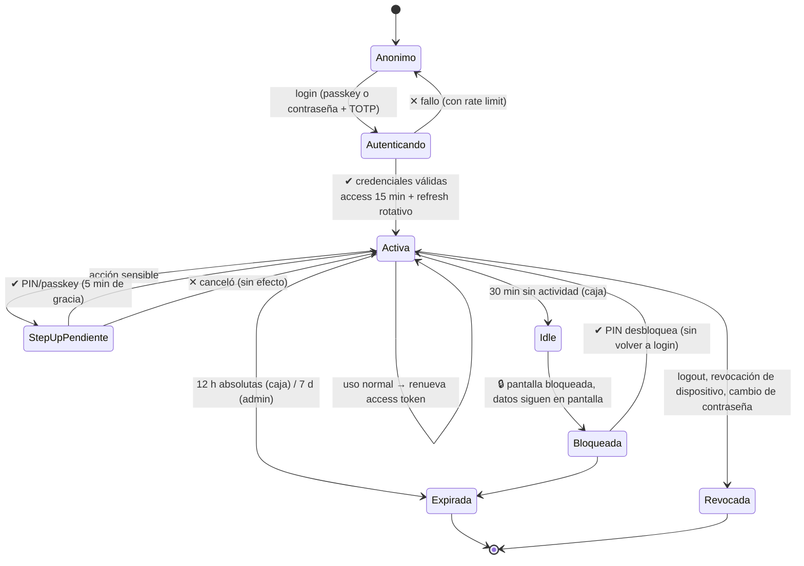

# 07 — Sesiones, identidad y seguridad

Contexto: un solo usuario (el dueño), un dispositivo de caja en un local físico, un celular, y un servidor opcional. La seguridad aquí **no es contra hackers chinos**; es contra las cinco amenazas reales:

1. Que alguien entre al sistema desde la PC desatendida del mostrador.
2. Que le roben el celular o el PC.
3. Que un sitio web malicioso abierto en el navegador del mostrador ataque el servidor local.
4. Que se pierdan los datos (falla de disco, ransomware, borrado accidental).
5. Que cuando entre un empleado, no puedas saber (ni limitar) lo que hizo.

Todo lo demás es ruido. Este documento es proporcional a esas amenazas.

## 1. Identidad: qué tiene el dueño para autenticarse

| Método | Cuándo se usa | Seguridad | Notas |
|--------|---------------|-----------|-------|
| **Passkey (WebAuthn)** | Login principal del PC y del celular | ⭐⭐⭐⭐⭐ | Sin contraseña que robar, resistente al phishing, la llave privada nunca sale del dispositivo |
| **Contraseña (argon2id)** | Login en un dispositivo nuevo, respaldo, recuperación | ⭐⭐⭐ | Obligatoria como respaldo: no puedes quedar fuera de tu negocio |
| **PIN de 6 dígitos** | **Step-up** para acciones sensibles ([06 §6](06-authz-rbac-abac.md#6-step-up-authentication-la-pieza-que-lo-hace-usable)) | ⭐⭐⭐ en su rol | **Nunca** como login de sesión nueva, solo como segundo factor local |
| **TOTP (app autenticadora)** | Opcional, como segundo factor del login remoto | ⭐⭐⭐⭐ | Solo si vas a exponer el panel admin en internet |
| **Códigos de recuperación** | Si pierdes el celular con la passkey | — | 10 códigos de un solo uso, impresos y guardados **fuera** del local |

### 1.1 Passkeys: la recomendación y su *gotcha*

**Úsalas.** Son más rápidas que una contraseña (una huella o el rostro) y mucho más seguras. En el PC de escritorio funciona Windows Hello; en el celular, la huella del propio teléfono.

**Pero hay una restricción que cambia la arquitectura:**

```text
WebAuthn exige un "Relying Party ID" que sea un DOMINIO.
❌ https://192.168.1.50:4321   → passkeys NO funcionan (es una IP)
✅ https://papeleria.midominio.com → passkeys SÍ funcionan
✅ https://localhost             → passkeys SÍ funcionan (solo en el mismo PC)
```

Consecuencia directa: **si quieres passkeys, necesitas el dominio del VPS** (aunque el VPS sea solo para el login). Es otro argumento fuerte para la topología "híbrida" del documento [09](09-despliegue-y-costos.md).

**Plan B si te quedas 100 % en LAN sin dominio:** contraseña + PIN. Perfectamente aceptable para este caso de uso. No te bloquees por las passkeys; son una mejora, no un requisito.

```ts
// Registro de passkey (una sola vez)
const opciones = await generarOpcionesRegistro({
  rpID: 'papeleria.midominio.com',
  rpName: 'Papelería El Lápiz Feliz',
  userID: Buffer.from(user.id),
  userName: user.username,
  userNameDisplay: user.nombre,
  attestationType: 'none',                       // 'none': no necesitas atestación de hardware
  authenticatorSelection: {
    residentKey: 'preferred',
    userVerification: 'preferred',               // biometría si está disponible
  },
  excludeCredentials: credencialesExistentes.map((c) => ({ id: c.credential_id, type: 'public-key' })),
});
// → navigator.credentials.create({ publicKey: opciones })
// → POST /auth/passkey/register con la respuesta
// ⚠️ Guarda sign_count y verifica que siempre AUMENTE. Si retrocede, es un clon
//    de la credencial → revoca y alerta. Este es el 'sign_count' que existe
//    precisamente para detectar authenticators clonados.
```

### 1.2 Contraseñas (respaldo obligatorio)

```ts
// argon2id con parámetros que aguanten: ~100 ms por hash
import argon2 from 'argon2';
const hash = await argon2.hash(password, {
  type: argon2.argon2id,
  memoryCost: 19456,   // 19 MiB — equilibrado para un VPS chico
  timeCost: 2,
  parallelism: 1,
});
// ⚠️ Nunca: md5, sha1, sha256 "con sal", bcrypt con cost < 10.
// ⚠️ Nunca guardes la contraseña en un log, ni completa, ni truncada.
// Reglas de longitud: mínimo 12 caracteres, sin exigir símbolos
// (las reglas de composición forzada producen "Papeleria1!" y nada más).
```

## 2. Ciclo de vida de la sesión



### 2.1 Dos tokens, propósitos distintos

| | Access token | Refresh token |
|---|---|---|
| Formato | **JWT firmado (EdDSA)** | **Opaco** (32 bytes aleatorios) |
| Duración | **15 minutos** | 30 días (caja) / 90 días (admin) |
| Se guarda | En memoria (variable JS) | **Cookie `httpOnly` + `Secure` + `SameSite=Strict`** |
| En la base de datos | No (validación por firma) | **Sí, hasheado con SHA-256** |
| Revocable | No (vive 15 min, es aceptable) | **Sí, inmediatamente** |
| En el celular/escáner | Igual | Igual |

**¿Por qué JWT para el access token y opaco para el refresh?**

- El access token se valida **sin consultar la base de datos** (por firma) → rápido, y en el caso del servidor local funciona incluso si la base está ocupada.
- El refresh token **debe** ser revocable → tiene que estar en la base de datos, hasheado. Si te roban la base de datos, no puedes canjear un refresh.

**¿Por qué EdDSA (Ed25519) y no HS256?**

Con HS256 hay **un secreto compartido**: cualquiera que pueda verificar un token puede también **falsificar** uno. En tu arquitectura, el servidor local del PC y el VPS necesitan verificar tokens. Con EdDSA, el VPS tiene la **clave privada** y todos los demás solo la **pública**. El PC local puede verificar tokens de escáner pero no puede emitirlos. Es la diferencia entre "confío en mi PC" y "mi PC puede suplantar al servidor".

```ts
// Firma (solo el servidor con la clave privada)
import { SignJWT, jwtVerify, importPKCS8, importSPKI } from 'jose';

const privada = await importPKCS8(process.env.JWT_PRIVADA!, 'EdDSA');

export async function emitirAccessToken(user: User, device: Device, session: Sesion) {
  return new SignJWT({
    sub: user.id,
    roles: await rolesDe(user.id),          // ⭐ roles EN el token: el ABAC los necesita
    permisos: await permisosDe(user.id),    // ⚠️ ver nota abajo sobre el tamaño
    dev: device.id,
    sid: session.id,                        // ⭐ para poder revocar por sesión
    pol_v: await versionPoliticas(),        // qué versión de políticas evaluó
  })
    .setProtectedHeader({ alg: 'EdDSA' })
    .setIssuedAt()
    .setIssuer('papeleria')
    .setAudience('papeleria-app')
    .setExpirationTime('15m')
    .sign(privada);
}
```

> **Nota sobre los permisos en el token:** meter 28 permisos en un JWT es ~1 KB. Está bien. Si algún día son 300, mete solo `pol_v` y `roles`, y resuelve los permisos desde la base local (que ya los tiene, porque se sincroniza).

### 2.2 Rotación del refresh token + detección de reuso

Esta es la parte que casi todos hacen mal y que es la mejor defensa contra robo de tokens.

```text
Regla: un refresh token se usa UNA sola vez. Al usarlo, se emite uno nuevo y
       el anterior se marca como "rotado" (no como "revocado": la diferencia importa).

familia_id agrupa toda la cadena de rotaciones de un mismo login.
```

```ts
async function refrescar(refreshTokenRecibido: string) {
  const hash = sha256(refreshTokenRecibido);
  const { rows: [sesion] } = await db.query(
    `SELECT * FROM sessions WHERE refresh_token_hash = $1`, [hash],
  );

  if (!sesion) {
    // Token desconocido: puede ser de una sesión ya purgada, o un token robado
    // de una sesión revocada. Fallar en silencio y registrar.
    await auditar('refresh.desconocido', { hash: hash.slice(0, 12) });
    throw new Error('TOKEN_INVALIDO');
  }

  // ⭐ DETECCIÓN DE REUSO: un token ya rotado se está usando otra vez.
  //    Escenarios:
  //      a) El atacante robó el token y lo usó antes que el dueño.
  //      b) El dueño lo usó, y el atacante lo usa después con la copia robada.
  //    En AMBOS casos no sabemos quién es quién → REVOCAR TODA LA FAMILIA.
  if (sesion.rotado_at) {
    await db.query(
      `UPDATE sessions SET revoked_at = now(), revoked_reason = 'reuso_de_refresh'
        WHERE familia_id = $1 AND revoked_at IS NULL`, [sesion.familia_id],
    );
    await notificarDueno('⚠️ Posible robo de sesión. Todas las sesiones de este login fueron cerradas.');
    await auditar('refresh.reuso_detectado', { familia_id: sesion.familia_id });
    throw new Error('SESIONES_REVOCADAS');
  }

  if (sesion.revoked_at) throw new Error('SESION_REVOCADA');
  if (new Date(sesion.absolute_expires_at) < new Date()) throw new Error('SESION_EXPIRADA');

  // Rotar: el actual se marca, el nuevo nace
  const nuevo = crypto.randomBytes(32).toString('base64url');
  await db.transaction(async (tx) => {
    await tx.query(`UPDATE sessions SET rotado_at = now(), last_used_at = now() WHERE id = $1`, [sesion.id]);
    await tx.query(
      `INSERT INTO sessions (id, user_id, device_id, refresh_token_hash, familia_id,
                             created_at, last_used_at, idle_expires_at, absolute_expires_at)
       VALUES ($1,$2,$3,$4,$5, now(), now(), now() + $6::interval, $7)`,
      [uuidv7(), sesion.user_id, sesion.device_id, sha256(nuevo), sesion.familia_id,
       sesion.idle_expires_at_intervalo, sesion.absolute_expires_at],
    );
    await tx.query(`UPDATE sessions SET rotado_at = rotado_at WHERE id = $1`, [sesion.id]);
  });

  return emitirAccessToken(/* … */), nuevo;
}
```

**El valor de esta mecánica:** sin detección de reuso, un atacante con un refresh token robado tiene acceso **hasta 90 días** y no se enteran. Con esto: en el primer uso simultáneo se **cierran todas las sesiones** de la familia y el dueño recibe un aviso. El costo de un robo pasa de "90 días de acceso" a "cero, más una alerta".

**Costo de implementación: ~40 líneas y una columna (`rotado_at`).** Es una de las mejores relaciones beneficio/complejidad de todo el sistema.

### 2.3 Tiempos de expiración por contexto

```ts
export const POLITICAS_SESION = {
  caja: {                      // PC del mostrador, dispositivo confiable
    accessMin: 15,
    idleMin: 30,               // ⭐ 30 min sin tocar el teclado → bloqueo de pantalla
    absoluteH: 12,             // ⭐ 12 h: al final del día, login obligatorio
    requiereReLogin: false,    // el bloqueo se levanta con PIN, sin re-login
  },
  admin: {                     // panel de administración
    accessMin: 15,
    idleMin: 15,
    absoluteH: 24 * 7,         // 7 días: es tu propio panel, no es de alto riesgo
    requiereReLogin: true,     // acciones sensibles: passkey completa, no PIN
  },
  escaner: {                   // celular en modo escáner
    accessMin: 60,             // se renueva solo; la conexión es WS de larga vida
    idleMin: 60,
    absoluteH: 12,             // al final de la jornada hay que re-emparejar
    requiereReLogin: false,
  },
  localApi: {                  // servidor local del PC: tokens internos
    accessMin: 5,
    idleMin: 5,
    absoluteH: 1,
    requiereReLogin: false,
  },
} as const;
```

**Por qué 12 horas absolutas en la caja:** el mostrador está en un lugar con público. Si alguien entra, distrae al dueño por 3 minutos y toca la PC, una sesión de 12 h con pantalla bloqueada le da poco. Una de 30 días le daría todo.

**Por qué el bloqueo por inactividad usa PIN y no re-login:** el dueño pone el PIN 20 veces al día. Si cada vez tuviera que teclear la contraseña, desactivaría el bloqueo. La seguridad que estorba es la seguridad que se desactiva.

### 2.4 Lo que ya está hecho: el login local (tarea 0.7), y qué es todavía diseño

Todo lo de arriba (passkeys, JWT EdDSA, cookie `httpOnly`, rotación de refresh) es el
destino, y llega con el servidor (F4) y la seguridad completa (F6). Lo que **hoy** existe
es el login mínimo y funciona sin ningún servidor, porque el requisito que manda aquí es
**vender sin internet**: si el PC no arranca su base porque "falta el servidor de
autenticación", el sistema no sirve.

Lo que hay, en concreto:

| Pieza | Dónde | Qué es hoy |
|---|---|---|
| Reglas puras | `packages/core/src/auth/` | `revisarContrasena()`, la escalera de teclado (`esUnaEscalera`), `retrasoTrasFallos()`, `POLITICAS_SESION` y `motivoDeVencimiento()`. Sin dependencias: corre igual en la caja y en el servidor |
| Argon2id | `packages/db/src/auth.ts` | Con `hash-wasm` (WASM puro). Los **mismos parámetros del §1.2** (19 MiB, t=2, p=1) y el **mismo formato PHC**, así que el servidor de F4 podrá verificar los hashes que ya existen sin migrar nada |
| Sesiones | `sessions` (migración `0001`) | Se crea una fila al entrar; se guarda el **SHA-256 del token**, nunca el token. Vencimiento por inactividad (30 min) y absoluto (12 h), que son los del §2.3 para el contexto `caja` |
| Dispositivo | `devices` (migración `0004`) | Al entrar se empareja el PC como `C1` (`terminal`, `is_trusted`). El `codigo` es la fuente de verdad del folio |
| Pantalla | `apps/web/src/auth/pantalla.ts` | Primer arranque (crear la cuenta de la dueña) o entrada, según haya o no usuarios |

**Tres decisiones que conviene conocer antes de tocar esto:**

1. **El token vive en `localStorage`, y sí, es una trampa (§3) — pero hoy no hay
   alternativa.** Una cookie `httpOnly` la pone un servidor, y todavía no hay servidor:
   el navegador no puede escribir su propia cookie protegida. Por eso el token es un
   **apaño temporal** y está marcado como tal en `apps/web/src/auth/almacen.ts`. El día
   que exista `apps/api` en F4, la cookie `httpOnly` ocupa su lugar y esto se borra. Lo
   que **no** se hace es fingir que la cookie ya está: el riesgo de XSS se acepta por
   escrito, y es menor hoy porque la app no carga nada de fuera ni tiene terceros.
2. **Sin servidor no hay recuperación de contraseña.** El "olvidé mi contraseña" no
   existe porque no hay con quién verificarse. La pantalla de primer arranque lo dice
   en voz alta («Apúntala: no hay *olvidé mi contraseña*»). Es una limitación real y la
   solución del diseño son las **passkeys** (§1.1), que llegan en F6: mientras tanto,
   perder la contraseña es perder el acceso a la app local. La base no se pierde, pero
   hay que volver a crear la cuenta.
3. **Un usuario inactivo cierra sus sesiones abiertas.** `verificarSesion()` une `users`
   con `is_activo` y `deleted_at`, así que desactivar a alguien no deja vivo lo que ya
   estaba abierto. Y cuando el usuario no existe, la comprobación **verifica igual un
   hash señuelo** antes de contestar que no: así «usuario que no existe» y «contraseña
   equivocada» cuestan lo mismo y la pantalla no se convierte en un buscador de usuarios.

**Lo que queda pendiente aquí, dicho y no escondido:** la rotación de refresh tokens y la
detección de reuso (§2.2); el PIN y la pantalla de step-up (F6); el limitador de intentos
persistente (hoy hay el `retrasoTrasFallos()` puro más una espera creciente en la propia
pantalla — suficiente para el mostrador, no para internet). Nada de esto bloquea el uso
diario; todo esto está en F6.

## 3. Cookies, CSRF y por qué `localStorage` es una trampa

```ts
// El refresh token SOLO en cookie httpOnly. Nunca en localStorage.
// Middleware de respuesta:
res.setCookie('refresh', refreshToken, {
  httpOnly: true,          // ⭐ JavaScript NO puede leerla → XSS no puede robarla
  secure: true,            // ⭐ solo HTTPS
  sameSite: 'strict',      // ⭐ el navegador no la manda en peticiones cross-site
  path: '/auth',           // ⭐ solo se envía a las rutas de auth, no a todo el sitio
  maxAge: 60 * 60 * 24 * 30,
});
```

| Dónde guardas el token | ¿Lo roba un XSS? | Comentario |
|---|---|---|
| `localStorage` / `sessionStorage` | ✅ **Sí**, con 3 líneas de JS | Un `npm install` comprometido o un anuncio malicioso vacía tu sesión |
| Variable en memoria (access token) | Parcialmente (mientras la pestaña vive) | Aceptable: vive 15 min |
| **Cookie `httpOnly`** (refresh token) | ❌ **No** | Correcto |
| Cookie **sin** `httpOnly` | ✅ Sí | Error frecuente |

### 3.1 CSRF: sí importa aquí (y no por lo que crees)

En un POS mono-usuario podrías pensar que CSRF no aplica. **Sí aplica**, por un motivo concreto: **tu servidor local corre en el PC del mostrador**, y ese navegador visita otros sitios. Un sitio malicioso puede hacer:

```html
<!-- Página maliciosa que el dueño abre en una pestaña mientras la caja está abierta -->
<form action="https://192.168.1.50:4321/sync/push" method="POST" enctype="text/plain">
  <input name='{"events":[{"type":"stock.adjusted","payload":{"qty":-500}}],"x":"' value='"}'>
</form>
<script>document.forms[0].submit()</script>
```

El navegador manda la petición **con las cookies de la caja**. Si tu API acepta cualquier POST con cookie válida, acabas de perder 500 unidades de stock.

**Defensas, todas juntas:**

1. `SameSite=Strict` en las cookies → mitiga el 95 % de los casos.
2. **Doble envío de token**: un `csrf_token` en el body/header que la cookie no incluye y que el atacante no puede leer (`httpOnly` en una cookie aparte + header).
3. **Validar el header `Origin`** en cada petición que muta estado: debe ser exactamente tu origen.
4. **Exigir `Content-Type: application/json`** (un `<form>` solo puede enviar `text/plain`, `multipart` o `urlencoded`; nunca `application/json` sin preflight). Es una defensa elegante y barata.
5. **CORS restrictivo**: `Access-Control-Allow-Origin` con el origen exacto, nunca `*` con credenciales.

```ts
// Fastify: las 5 defensas en un solo hook
app.addHook('onRequest', async (req, reply) => {
  if (['GET', 'HEAD', 'OPTIONS'].includes(req.method)) return;
  const origin = req.headers.origin;
  if (origin && origin !== ORIGEN_ESPERADO) {
    return reply.code(403).send({ error: 'ORIGIN_INVALIDO' });
  }
  if (!req.headers['content-type']?.startsWith('application/json')) {
    return reply.code(415).send({ error: 'CONTENT_TYPE_INVALIDO' });
  }
  if (!timingSafeEqualStr(req.headers['x-csrf-token'] as string, cookieCsrf(req))) {
    return reply.code(403).send({ error: 'CSRF_INVALIDO' });
  }
});
```

## 4. Dispositivos: registro, confianza y revocación

```text
┌────────────────────────────────────────────────────────────────────┐
│ DISPOSITIVOS                                        [+ Emparejar]   │
├────────────────────────────────────────────────────────────────────┤
│ 💻 PC caja 1 (terminal)        confiable ✅   visto hace 2 min     │
│    Windows 11 · Chrome · 192.168.1.50            [Revocar]        │
│                                                                     │
│ 📱 Celular dueño (scanner)     confiable ✅   visto hace 15 min    │
│    Android 14 · Chrome · emparejado 18/10 09:14  [Revocar]        │
│                                                                     │
│ 📱 Tablet mostrador (scanner)  confiable ❌   visto hace 3 días    │
│    ⚠️ Sin usar desde hace 3 días                  [Revocar]        │
└────────────────────────────────────────────────────────────────────┘
```

**Reglas de dispositivos:**

| Regla | Implementación | Por qué |
|-------|----------------|---------|
| Un dispositivo se **registra explícitamente**, no se "reconoce" solo | `devices` con `paired_at` | La huella del navegador es falsificable; no es identidad |
| El dispositivo **no es la identidad** | `sessions` es lo que autoriza; `devices` es contexto | Compartir el dispositivo no comparte la sesión |
| Revocación **inmediata** | `revoked_at` + validación en cada request y en cada mensaje WS | Si te roban el celular, cortas el acceso en 5 segundos |
| Un dispositivo revocado **cierra su WebSocket** | Código `4403` → el cliente muestra "acceso revocado" y para | No dejar canales abiertos |
| Revocar **no requiere permiso** | Política P22 | En una emergencia, quitar acceso debe ser siempre posible |
| Cambio de contraseña **revoca todas las sesiones** | Excepto la actual | Regla estándar y esperada |
| Máximo N dispositivos | 6 por defecto | Evita acumulación de dispositivos olvidados y activos |

## 5. Cifrado: lo que puedes y lo que no

**La verdad incómoda:** si te roban el PC y no está cifrado el disco, **el atacante tiene tu base de datos completa**, incluidas las contraseñas hasheadas y todos tus datos de negocio. Ninguna aplicación puede arreglar eso por sí sola.

| Nivel | Cifrado | Cómo | Notas |
|-------|---------|------|-------|
| **Disco (obligatorio)** | BitLocker (Windows) / FileVault | Actívalo | **Lo más importante de todo este documento.** Es gratis y toma 20 minutos |
| Transporte (obligatorio) | TLS 1.2+ | Caddy con Let's Encrypt; mkcert en LAN | Sin esto no hay cámara ni posibilidades |
| Contraseñas y PIN | argon2id | En la aplicación | Ya cubierto |
| Refresh tokens | SHA-256 (los hashes, no el valor) | En la aplicación | Si roban la BD, los tokens no sirven |
| **Base de datos en reposo (opcional)** | `pgcrypto` por columna | Solo para datos muy sensibles | Añade complejidad y quita capacidad de búsqueda. **No lo hagas en el MVP** |
| **IndexedDB / PGlite (no cifrado)** | — | **No cifres la base local** | El navegador no ofrece cifrado de IndexedDB útil sin la clave del usuario en memoria. Un cifrado con la clave en el mismo lugar es teatro. BitLocker es la respuesta real |

**Frase para recordar:** *la base local es caché durable, no una bóveda*. Todo lo valioso debe llegar al servidor y tener respaldo.

**Sobre datos de clientes:** si algún día guardas RFC y dirección para facturación, eso es **información personal**. Reglas mínimas: no la uses para nada más, no la exportes a Excel para mandarla por WhatsApp, y ten claro que la ley mexicana (LFPDPPP) exige un aviso de privacidad. Para el MVP: **no pidas datos del cliente** salvo nombre para apartados.

## 6. Modelo de amenaza (concreto, sin paranoia)

| # | Amenaza | Probabilidad | Impacto | Mitigación |
|---|---------|:---:|:---:|-----------|
| A1 | Sitio web malicioso en el navegador de la caja ataca `localhost` | Media | Alto | `SameSite=Strict`, header `Origin`, `Content-Type` JSON, CSRF token, CORS estricto ([§3.1](#31-csrf-sí-importa-aquí-y-no-por-lo-que-crees)) |
| A2 | Pantalla desatendida, alguien vende/ajusta | **Alta** | Medio | Bloqueo por inactividad 30 min, bloqueo por PIN, step-up en acciones sensibles, `audit_log` con quién y cuándo |
| A3 | Robo del PC | Media | **Alto** | **BitLocker** + sesiones cortas + revocación de dispositivo + respaldo en el VPS. RPO ≤ 1 día |
| A4 | Robo del celular con la app | Media | Medio | Token de escáner de 8 h, revocación inmediata, el celular **no puede** vender ni ver costos, `wakeLock` se libera al bloquear |
| A5 | Alguien en el WiFi manda escaneos falsos | Baja | Bajo | Token de 256 bits por dispositivo, rate limit, el carrito es visible en la PC antes de cobrar |
| A6 | Ransomware en el PC del mostrador | Baja-media | **Crítico** | Respaldos **fuera del PC** (el VPS y la nube), cuenta de usuario sin privilegios de admin para el POS, no navegar en la PC de la caja, Windows Update activo |
| A7 | Falla del disco duro | Media | **Crítico** | Respaldo nocturno + **prueba de restauración mensual** ([§7](#7-respaldo-y-recuperación)) |
| A8 | Empleado (futuro) roba con cancelaciones/descuentos | Alta si hay empleados | Medio | RBAC sin costos, step-up en cancelar/descontar/retirar, `audit_log`, patrones en reportes |
| A9 | Fuerza bruta del PIN | Baja | Medio | argon2id + 5 intentos / 15 min + bloqueo progresivo + salida de emergencia |
| A10 | Interceptación en WiFi abierto | Baja | Medio | Todo por WSS/HTTPS. **No** conectar la caja a un WiFi público |
| A11 | Filtración en la nube del respaldo | Baja | Alto | Respaldos cifrados (rclone con contraseña, o `gpg`), y **nunca** datos de tarjetas ([§8](#8-pci-dss-no-guardes-datos-de-tarjeta-jamás)) |
| A12 | Secuestro del dominio / certificado | Muy baja | Alto | Registrar el dominio con 2FA, renovación automática de Caddy, monitorizar el vencimiento |

**Lo que NO es una amenaza real aquí** (y no pierdas tiempo): un atacante dirigiéndose específicamente a tu papelería, botnets, inyección SQL remota sin superficie expuesta (no expongas el puerto 5432), DDoS, y "hackers" en general. Esta es una papelería: los riesgos son el mostrador desatendido, el robo físico, el disco que falla y el empleado de julio.

## 7. Respaldo y recuperación

**La regla:** un respaldo que nunca se ha restaurado **no es un respaldo**.

| | Objetivo | Cómo |
|---|----------|------|
| **RPO** (cuánta información puedo perder) | **≤ 1 día** de ventas | `pg_dump` nocturno + incremental cada hora si hay red |
| **RTO** (cuánto tardo en volver a operar) | **≤ 2 horas** | Restaurar el dump en el VPS o en el PC; la PWA se reconecta sola |
| **Regla 3-2-1** | 3 copias, 2 medios, 1 fuera de sitio | 1) PC (base local), 2) VPS (`pg_dump`), 3) nube (`rclone` a Drive/S3/B2) |
| **Prueba de restauración** | **Mensual, obligatoria** | Pon una alarma en el calendario el primer sábado del mes |

```powershell
# scripts/backup.ps1 — respaldo nocturno (Task Scheduler, diario a las 23:30)
$ErrorActionPreference = 'Stop'
$fecha  = Get-Date -Format 'yyyy-MM-dd_HHmm'
$destino = "D:\respaldos\papeleria"
New-Item -ItemType Directory -Force -Path $destino | Out-Null

# 1. Dump lógico (portable, restaurable en cualquier Postgres)
docker exec papeleria-db pg_dump -U papeleria -Fc papeleria > "$destino\papeleria_$fecha.dump"

# 2. Export CSV de las tablas clave: NUNCA quedes secuestrado por el formato
#    del dump. Un CSV lo abre Excel y lo entiende cualquiera.
docker exec papeleria-db psql -U papeleria -c "\copy (SELECT * FROM products) TO STDOUT CSV HEADER" > "$destino\products_$fecha.csv"
docker exec papeleria-db psql -U papeleria -c "\copy (SELECT * FROM sales WHERE ocurrido_at > now() - interval '90 days') TO STDOUT CSV HEADER" > "$destino\ventas_90d_$fecha.csv"
docker exec papeleria-db psql -U papeleria -c "\copy (SELECT * FROM stock_movements WHERE ocurrido_at > now() - interval '90 days') TO STDOUT CSV HEADER" > "$destino\movimientos_90d_$fecha.csv"

# 3. Verificar que el dump NO esté vacío ni corrupto (antes de copiarlo a la nube)
$tam = (Get-Item "$destino\papeleria_$fecha.dump").Length
if ($tam -lt 10KB) { throw "⚠️ El respaldo pesa $tam bytes. Algo salió mal. Abortar." }
docker exec papeleria-db pg_restore --list /dev/stdin < "$destino\papeleria_$fecha.dump" | Out-Null

# 4. Fuera del sitio (regla 3-2-1). Cifrado, con retención.
rclone copy "$destino" "gdrive:papeleria-respaldos" --max-age 24h

# 5. Retención local: 30 diarios + 12 mensuales. Nunca borrar todo.
Get-ChildItem "$destino\papeleria_*.dump" |
  Where-Object { $_.LastWriteTime -lt (Get-Date).AddDays(-30) } |
  ForEach-Object { Copy-Item $_.FullName -Destination "$destino\mensual\" -Force; Remove-Item $_.FullName }

Write-Host "✅ Respaldo $fecha OK: $([math]::Round($tam/1KB)) KB"
```

**Detalles que hacen la diferencia entre un respaldo y una ilusión:**

- **Verificar que el dump no esté vacío.** El error clásico: el respaldo corre todos los días, pesa 0 bytes porque la variable de entorno de la contraseña no estaba, y **nadie se enteró durante 8 meses**. La comprobación de tamaño y `pg_restore --list` son obligatorias.
- **Probar la restauración de verdad, cada mes:**

```powershell
# scripts/restore.ps1 — ÚSALO, no solo lo escribas
docker exec papeleria-db createdb -U papeleria prueba_restauracion
docker exec -i papeleria-db pg_restore -U papeleria -d prueba_restauracion --no-owner < .\respaldos\papeleria_2026-10-01_2330.dump
# Ejecutar las 3 consultas de integridad (02 §4.2) y comparar totales de ventas de ayer:
#   SELECT count(*), sum(total_minor) FROM sales WHERE ocurrido_at::date = '2026-10-01';
# Si los números no coinciden con lo que sabes que vendiste → el respaldo NO sirve.
docker exec papeleria-db dropdb -U papeleria prueba_restauracion
```

- **Respaldar también `settings` y `policies`.** Olvidarlos es un clásico. Sin ellos, restauras datos pero pierdes la configuración del negocio (nombre, IVA, folios, calibración de etiquetas, políticas).
- **Notificación de resultado.** El respaldo debe **avisarte** cuando funciona y **gritar** cuando falla. Un correo o mensaje diario con "respaldo OK, 2.4 MB, 14 203 ventas" es la única forma de confiar.

## 8. PCI-DSS: no guardes datos de tarjeta, jamás

Regla sin excepciones para este sistema:

```text
❌ NUNCA en la base de datos, en un log, en un CSV, en un respaldo, en una variable:
     · Número de tarjeta completo (PAN)
     · Código de verificación (CVV/CVC)
     · Banda magnética (track data)
     · PIN de tarjeta (PIN block)

✅ LO ÚNICO que puedes guardar, y solo si lo necesitas para conciliar:
     · Los últimos 4 dígitos        → payments.referencia
     · El número de autorización    → payments.referencia
     · La marca (Visa/MC)           → payments.referencia
     · El monto y la hora           → payments.monto_minor, ocurrido_at
```

**Por qué esto es fácil de cumplir en tu caso:** la papelería cobra con **terminal bancaria externa** (la del banco, con su propia impresora). Tu sistema solo registra *"se pagó $130 con tarjeta débito, autorización 482910"*. Con ese diseño, tu alcance PCI es mínimo (equivalente a SAQ A) y no heredas ninguna obligación pesada.

**La tentación que debes evitar:** conectar un lector de tarjetas por USB/Bluetooth y "automatizar" el cobro. Eso te mete en un mundo de certificación PCI-P2PE con auditorías de miles de dólares. **No lo hagas.** Registra el pago a mano: son 3 segundos y cero riesgo legal.

**Enmascara en los logs:** si por lo que sea un número de tarjeta llega a un mensaje de error, un logger que enmascara los patrones de 13–19 dígitos (`****1234`) te salva de una fuga por log. Cuesta 5 líneas.

## 9. Endurecimiento del PC del mostrador

El PC de la caja es un dispositivo compartido en un espacio público. Configuración recomendada:

| Medida | Cómo | Por qué |
|--------|------|---------|
| **Cuenta de usuario sin privilegios de admin** | Cuenta `caja` estándar en Windows | Un ransomware o un sitio malicioso no puede instalar nada |
| **BitLocker activado** | Ajustes → Cifrado de dispositivo | Si se llevan el PC, los datos no salen |
| **Bloqueo de pantalla por inactividad** | 5 min a nivel SO **además** del bloqueo de la app | Cinturón y tirantes |
| **Sin sesión de administrador guardada en el navegador** | Perfil de Chrome dedicado, sin guardar contraseñas del banco | Independencia total |
| **Sin navegar** en la PC de la caja | Si necesitas internet, otro dispositivo | Superficie de ataque = 0 |
| **Windows Update activo y reinicio programado** | Fuera de horario del local | Las vulnerabilidades parcheadas son las que no te afectan |
| **Antivirus (Defender basta)** | Activado, con exclusiones para el volumen de Docker | Defender es suficiente; no instales dos antivirus |
| **Monitor con la pantalla hacia el mostrador, no hacia el público** | Físico | Que el cliente no vea tus costos y márgenes |
| **El celular con PIN/biometría obligatorio** | Configuración del celular | Es tu segundo factor y tu escáner |

## 10. Auditoría: qué registrar y por qué te va a salvar

```sql
-- audit_log es append-only. Protégelo a nivel de base de datos, no solo por disciplina.
CREATE OR REPLACE FUNCTION bloquear_modificacion_auditoria() RETURNS trigger AS $$
BEGIN
  RAISE EXCEPTION 'audit_log es inmutable: no se puede UPDATE ni DELETE';
END;
$$ LANGUAGE plpgsql;

CREATE TRIGGER trg_audit_inmutable
  BEFORE UPDATE OR DELETE ON audit_log
  FOR EACH ROW EXECUTE FUNCTION bloquear_modificacion_auditoria();
```

| Qué registrar | Ejemplos de `accion` |
|---------------|---------------------|
| **Autenticación** | `login.ok`, `login.fallo`, `logout`, `step_up.ok`, `step_up.fallo`, `pin.bloqueado`, `refresh.reuso_detectado` |
| **Dinero** | `venta.cancelada`, `devolucion.creada`, `descuento.aplicado`, `retiro.cajon`, `turno.cerrado_con_diferencia` |
| **Precios y costos** | `precio.cambiado`, `precio.masivo`, `costo.cambiado` (con `antes`/`despues`) |
| **Inventario** | `ajuste.manual`, `conteo.aplicado`, `merma.registrada`, `traspaso` |
| **Configuración** | `politica.editada`, `usuario.creado`, `rol.asignado`, `dispositivo.revocado`, `respaldo.ejecutado` |
| **Datos** | `exportacion.ejecutada` (qué tabla, cuántas filas, quién) |

```ts
// Interfaz única. Si algo no pasa por aquí, no se audita, y si no se audita
// es como si no hubiera pasado.
export async function auditar(
  accion: string,
  detalle: {
    entidad?: string; entidad_id?: string;
    antes?: unknown; despues?: unknown;
    ip?: string; device_id?: string; notas?: string;
  },
) {
  await db.query(
    `INSERT INTO audit_log (id, user_id, device_id, accion, entidad, entidad_id,
                            antes, despues, ip, ocurrido_at)
     VALUES ($1,$2,$3,$4,$5,$6,$7,$8,$9, now())`,
    [uuidv7(), ctx.userId, ctx.deviceId, accion, detalle.entidad, detalle.entidad_id,
     detalle.antes ? JSON.stringify(detalle.antes) : null,
     detalle.despues ? JSON.stringify(detalle.despues) : null,
     detalle.ip],
  );
}
```

**Reglas de auditoría:**

- **Nunca registres secretos.** Ni contraseñas, ni PIN, ni tokens, ni datos de tarjeta. Un `audit_log` es un registro histórico que se queda para siempre: si metes una contraseña ahí, la filtraste para siempre.
- **Los fallos de autenticación son más valiosos que los éxitos.** Un patrón de `login.fallo` a las 3 am es lo único que te va a avisar de un ataque.
- **Purgar no, archivarlo sí.** Después de 3 años, mueve el histórico a una tabla `audit_log_archivo`. Nunca borres: es tu memoria del negocio.
- **El dueño tiene que poder leerlo.** Un log que nadie mira no sirve. Pantalla simple: fecha, acción, usuario, entidad, y filtro por "solo acciones sensibles". Revísala una vez al mes.

## 11. Secretos y claves

```bash
# .env (NUNCA en el repositorio; .gitignore desde el commit inicial)
JWT_PRIVADA_ED25519=...           # clave privada Ed25519 (base64 PKCS8)
JWT_PUBLICA_ED25519=...           # clave pública (compartida con el PC local)
POLITICAS_PRIVADA_ED25519=...     # clave para firmar el paquete de políticas
DATABASE_URL=postgres://...
ARGON2_PEPPER=...                 # ⭐ secreto extra para hashear (defensa en profundidad)
VAPID_KEYS=...                    # si usas notificaciones push
```

| Regla | Detalle |
|-------|---------|
| **Las claves no se versionan** | `.env` en `.gitignore` **antes** del primer commit. Una clave commiteada está comprometida para siempre (la historia de git es pública si algún día publicas) |
| **Rotación cada 6–12 meses** | Con EdDSA y JWKS, puedes publicar la clave nueva y retirar la vieja sin cortar sesiones |
| **`ARGON2_PEPPER` como defensa extra** | Un secreto adicional al hash. Si te roban la base de datos, los hashes no sirven sin el *pepper*. Vive en el servidor, nunca en la base |
| **Claves distintas por ambiente** | Las de desarrollo no valen en producción |
| **Generar una vez y respaldar** | Si pierdes la clave privada de políticas, los clientes no pueden verificar las nuevas. Guárdala en el gestor de contraseñas del dueño |

```bash
# Generar el par Ed25519 una sola vez
openssl genpkey -algorithm ed25519 -out jwt-privada.pem
openssl pkey -in jwt-privada.pem -pubout -out jwt-publica.pem
```

## 12. Checklist de este módulo

**Identidad**
- [ ] Passkeys (WebAuthn) como login principal (**requiere dominio**; si no, contraseña + PIN)
- [ ] Contraseña con **argon2id** como respaldo obligatorio
- [ ] 10 códigos de recuperación de un solo uso, impresos y guardados fuera del local
- [ ] `sign_count` de WebAuthn verificado (detecta credenciales clonadas)

**Sesiones**
- [ ] Access token JWT **EdDSA** de 15 min, en memoria, con `roles`, `sid` y `pol_v`
- [ ] Refresh token **opaco** de 32 bytes, **hasheado** en la BD, en cookie `httpOnly` + `Secure` + `SameSite=Strict` + `path=/auth`
- [ ] **Rotación con detección de reuso** de la familia (`familia_id` + `rotado_at`)
- [ ] Timeouts por contexto: caja 30 min inactivo / 12 h absoluto
- [ ] Bloqueo de pantalla por inactividad con **PIN** para desbloquear (no re-login)
- [ ] Cambio de contraseña revoca todas las demás sesiones
- [ ] Sesión de caja termina al cerrar turno (opcional pero recomendado)

**Antifraude y CSRF**
- [ ] `SameSite=Strict` + header `Origin` validado + `Content-Type: application/json` + CSRF token + CORS exacto
- [ ] Rate limit en login, refresh, step-up y emparejamiento
- [ ] Comparaciones de tokens con **tiempo constante** (`timingSafeEqual`)

**Dispositivos**
- [ ] `devices` con `revoked_at`, revocación inmediata y cierre de WebSocket con `4403`
- [ ] La **revocación nunca requiere permiso** (política P22)
- [ ] Máximo de dispositivos configurable

**Cifrado y endurecimiento**
- [ ] **BitLocker activado** (lo más importante de este documento)
- [ ] TLS en todo (Caddy en el VPS; mkcert con IP en el SAN en la LAN)
- [ ] La base local (IndexedDB/PGlite) se asume **no cifrada** y se trata como caché
- [ ] Cuenta de Windows del POS **sin privilegios de admin**
- [ ] **No se navega** con la PC de la caja

**Datos sensibles**
- [ ] **Cero** campos de tarjeta en el esquema (solo `referencia` con últimos 4 + autorización)
- [ ] Logger con enmascarado de patrones de tarjeta
- [ ] Sin datos personales del cliente salvo lo estrictamente necesario + aviso de privacidad

**Continuidad**
- [ ] `pg_dump` nocturno **verificado** (tamaño + `pg_restore --list`), con aviso de éxito/fallo
- [ ] Respaldos **fuera del sitio** y cifrados (3-2-1)
- [ ] Export CSV de tablas clave (no quedar secuestrado por el formato del dump)
- [ ] **Prueba de restauración mensual** con alarma en el calendario
- [ ] `settings` y `policies` incluidos en el respaldo

**Auditoría**
- [ ] `audit_log` append-only con trigger que bloquea `UPDATE`/`DELETE`
- [ ] Registro de autenticación, dinero, precios, inventario, configuración y exportaciones
- [ ] Interfaz única `auditar()`: nada se ejecuta sin pasar por ahí
- [ ] Pantalla de auditoría legible, revisada mensualmente
- [ ] Sin secretos ni datos de tarjeta en el log

**Secretos**
- [ ] `.env` en `.gitignore` **antes del primer commit**
- [ ] Claves Ed25519 generadas, respaldadas en el gestor de contraseñas del dueño
- [ ] `ARGON2_PEPPER` en el servidor, no en la base
- [ ] Plan de rotación de claves a 6–12 meses
