# 10 — Roadmap: cómo construirlo en orden

Premisas realistas:

- **Un desarrollador** (tú), a medio tiempo: ~10–15 horas por semana.
- **No dejas de operar la papelería** mientras construyes.
- Los tiempos son **estimaciones honestas** (rango optimista–pesimista), no promesas.
- **Cada fase entrega algo usable.** Nunca hay 6 semanas de trabajo sin poder probar nada.

## 0. Definición de "MVP terminado"

Antes de saber cuándo parar, define qué es "ya me sirve". Propuesta concreta:

> El MVP está terminado cuando puedes **dejar de usar Excel para vender y controlar inventario**, es decir:
>
> 1. Das de alta un producto y le generas un código interno.
> 2. Imprimes su etiqueta y **la escaneas de verdad**.
> 3. Vendes, cobras (efectivo y tarjeta), e imprimes el ticket.
> 4. Abres y cierras el turno con **arqueo que cuadra**.
> 5. El stock baja solo y puedes ver **por qué** bajó (el ledger).
> 6. Puedes hacer un conteo físico y aplicar las diferencias.
> 7. Puedes ver las ventas del día y del mes.
> 8. **Todo esto con el internet desconectado.**
>
> Eso es: fases 1, 2 y 3. La sincronización al VPS (fase 4) y el celular (fase 5) son mejoras, no requisitos para dejar Excel.

## 1. Vista general de fases

```mermaid
gantt
    title Roadmap (semanas, 1 dev a medio tiempo)
    dateFormat X
    axisFormat %s

    section Fundación
    F0 Cimientos y migraciones      :f0, 0, 2w

    section Núcleo usable
    F1 Catálogo y códigos           :f1, after f0, 3w
    F2 POS y caja                   :f2, after f1, 3w
    F3 Inventario y conteo          :f3, after f2, 2w

    section Continuidad
    F4 Servidor y respaldos         :f4, after f3, 2w
    F5 Escaneo móvil                :f5, after f4, 2w
    F6 Seguridad y roles            :f6, after f5, 2w

    section Valor
    F7 Reportes y pulido            :f7, after f6, 2w
    F8 Extras de alto valor         :f8, after f7, 2w
```



> **Nota sobre el orden de la seguridad:** el *esqueleto* de autorización (tablas + evaluador, con un solo rol) va en **F0/F1**, aunque el pulido (step-up, políticas de offline, firma) va en F6. Retrofitar permisos cuesta 10× ([06 §2.5](06-authz-rbac-abac.md#25-el-costo-de-agregarlo-después-es-10x)), así que las tablas y el `evaluar()` nacen desde el principio, aunque solo tengan un rol. Es el mismo razonamiento por el que el `outbox` va desde F1 aunque el servidor llegue en F4.

---

## F0 — Fundaciones (2 semanas · 20–30 h)

**Objetivo:** que el esqueleto exista y que las decisiones riesgosas estén validadas. Si algo de este documento va a fallar, que falle aquí, no en julio.

### Entregables

| # | Entregable | Criterio de "terminado" | Estado |
|---|-----------|------------------------|--------|
| 0.1 | Monorepo con pnpm workspaces | `pnpm -r build` compila los 3 paquetes | 🟡 workspaces listos y **`apps/web` creado**; falta `apps/api` |
| 0.2 | `packages/core` con dominio y dinero | `bigint` en centavos + `roundHalfUp` con tests | ✅ **195 pruebas en verde** (+ EAN-13, precios y totales; desde 0.5: ULID, UUID v7 y el reloj lógico híbrido; desde 0.6: `evaluar()` y la gramática de condiciones; desde 0.7: las reglas puras de contraseña y sesión; desde 0.8: el lector HID) |
| 0.3 | `packages/db/migrations/0001..0003` | Se aplican en **PGlite y Postgres**, verificado en CI | ✅ **38 pruebas en verde** (hoy **173**, con la 0004–0008 y el login), y verificado también a mano contra un PostgreSQL 16.14 real: los dos motores acaban con el **mismo esquema, línea por línea** (tablas, columnas con tipo y `NOT NULL`, índices, restricciones, funciones y disparadores). El flujo de CI levanta ese mismo Postgres; falta empujarlo a GitHub para que corra solo |
| 0.4 | **PGlite en Web Worker** con cliente tipado | Dos pestañas abiertas **no** corrompen la BD | ✅ **Verificado en un navegador real, con dos pestañas abiertas.** Una es *líder* y la otra *seguidora*; ninguna consulta se entrelaza. En la prueba de estrés —las dos peleando por la misma fila— **261 transacciones en 4 s**, `contador == marcas` exacto y **0 filas perdidas**. Y al cerrar la pestaña líder, otra toma el relevo sin que se note. De paso apareció la restricción que más se siente: en el modo por defecto PGlite **espera el volcado a disco después de cada consulta** (3 transacciones/s frente a 64 con `relaxedDurability`). Se usa `relaxedDurability` y se llama a `sincronizar()` tras las escrituras que no se pueden perder — con una corrección que llegó en 0.7: en modo relajado `syncToFs()` **no espera** el volcado (y lo descarta si ya hay uno en marcha), así que `sincronizar()` reduce la ventana pero no la cierra. Está documentado como deuda con su remedio en [`apps/web/README.md`](../apps/web/README.md) |
| 0.5 | `emitirEvento()` + `outbox` | Una venta de prueba escribe estado + evento en una transacción | ✅ **Hecho y verificado en cuatro sitios.** La venta de prueba escribe venta, líneas, movimiento de stock, evento en la cola y auditoría; forzando un fallo **después** de escribir el estado, la base queda idéntica, contadores incluidos (ni un folio gastado, ni un hueco en `device_seq`). El HLC no retrocede aunque el reloj del PC se vaya a 2010. Probado contra **PGlite** y contra **PostgreSQL 16.14 real**, y a mano en el navegador (sección 4 del panel de diagnóstico). De paso apareció lo que el diseño daba por hecho y no existía: `device_counters`, `folio_counters` y `devices.codigo` (migración `0004_eventos.sql`) |
| 0.6 | `evaluar()` (RBAC+ABAC) con un rol | Tabla de tests de políticas en verde | ✅ **Hecho, y la tabla del doc 06 §9 corre contra las reglas reales.** `evaluar()` es puro y sin IO (corre igual en la caja, en el celular y en el servidor); **`packages/db/src/autorizacion.ts`** es quien carga permisos, políticas y step-up de las tablas, dentro de la transacción del evento. Las **30 filas** de `0005_politicas.sql` cubren las 31 reglas del §5 (P20 y P23 son RBAC puro; P21 son dos permisos). Tres cosas que el diseño no tenía: el lado derecho de una comparación puede ser **otro campo** (sin eso P1 —"precio nuevo menor al costo"— no se puede escribir, y por eso 0002 no sembró nada); `gt_abs`, porque la diferencia de un arqueo puede ser faltante o sobrante; y un **catálogo cerrado de campos** validado al cargar, que lanza con el nombre mal escrito en vez de apagar una regla en silencio |
| 0.7 | Login mínimo (contraseña argon2id + cookie httpOnly) | Entras, la sesión persiste, `logout` funciona | ✅ **Hecho y verificado en un navegador real.** El primer arranque crea la cuenta de la dueña (no hay servidor del que traerla) y a partir de ahí se entra con contraseña. Entrar, recargar y seguir dentro **sin volver a pedir la contraseña**: comprobado. Salir revoca la sesión en la base y recuerda el dispositivo (`C1`). Vencer la sesión (30 min inactivo / 12 h) devuelve a la entrada **con el motivo**. En la base sólo queda el **Argon2id** y el **SHA-256** del token: el token en claro no aparece. Y con una contraseña mala no se crea **ninguna** fila en `sessions`. **La cookie `httpOnly` no se hizo a propósito**: la pone un servidor y no hay servidor todavía, así que el token vive en `localStorage` como apaño temporal y **marcado como tal**; el `apps/api` de F4 lo sustituye. Con la misma honestidad: sin servidor **no hay recuperación de contraseña** (lo resuelven las passkeys de F6, y la pantalla lo avisa), y la rotación de refresh tokens, el PIN y el step-up son F6. Detalle en [docs/07 §2.4](07-sesiones-y-seguridad.md) y [`apps/web/README.md`](../apps/web/README.md) |
| 0.8 | `useBarcodeWedge` (HID) | Un lector de $25 o un script que simule pulsaciones imprime el código en consola | ✅ **Hecho y verificado en un navegador real.** Un lector USB o Bluetooth se presenta como **teclado**: no necesita driver ni SDK. La máquina que separa una ráfaga de máquina de una persona es **pura** (`packages/core/src/escaneo/lectorHid.ts`, 17 pruebas: velocidad, pausas, modificadores, códigos cortos o largos, y el mismo código dos veces), y el adaptador al DOM (`apps/web/src/escaneo/hid.ts`) escucha en **captura**, consume el Enter del lector —para que no envíe el formulario abierto— y publica en la **cola de escaneo** (`apps/web/src/escaneo/cola.ts`), que es el único punto por el que entrará también el celular (F5). El panel tiene una sección 5 que se prueba **sin lector**: simula un escaneo a 10 ms/carácter y otro a 250; el lento **no** dispara. **Sin antirrebote a propósito**: escanear dos veces el mismo código son dos piezas; el antirrebote de 800 ms es de la cámara |
| 0.9 | **Prueba de riesgo: cámara en el celular** | Un `<video>` que lea un EAN-13 con `BarcodeDetector` **en HTTPS** | 🟡 **herramienta lista** — falta probarla en tu celular |
| 0.10 | **PWA instalable y offline** (adelantada) | Se instala desde el navegador y abre con el servidor apagado | ✅ **Hecho y verificado en Chromium con el servidor detenido.** Manifiesto + íconos + un service worker propio que en el build precarga **el build entero** (18 archivos, incluidos los 17 MB de PGlite) y sirve caché primero. Con el servidor apagado la app abrió, reanudó la sesión y el producto siguió en la lista, sin errores en consola. El aviso de versión nueva es manual a propósito: una recarga a media venta es una venta perdida. Apareció un detalle que parece menor y no lo es: el servidor manda `Vary: Origin` y el `<script type="module">` va con `Origin`, así que la caché «tenía» los archivos pero la comparación decía que no; se resuelve con `ignoreVary`. **Ojo al entregarla:** los datos viven en el IndexedDB de ese navegador y ese origen; borrar datos del sitio borra la papelería, y todavía **no hay respaldo automático** (F4) |

> **Lo que queda de F0:** sólo 0.9 (la prueba de cámara, que es la de riesgo, y necesita tu
> celular). 0.1–0.8 y 0.10 ya están hechas. La 0.10 se adelantó porque el requisito es
> entregarla a otra persona y que funcione sin internet.

### La tarea 0.9 es la más importante de esta fase

Antes de escribir nada más, valida el riesgo del proyecto. **Ya está hecho el
probador**: `tools/prueba-camara/` (ver su README). Son dos comandos:

```powershell
pnpm certificado     # crea la CA y el certificado con la IP actual de la LAN
pnpm camara          # levanta el probador y dice qué abrir en el celular
```

Y la secuencia en el celular:

```text
1. Abre la dirección http://IP:8080 que imprime el comando.
   Si esto NO abre: es la red o el firewall de Windows, no el certificado.
2. Descarga e instala el certificado.
   En iOS hay un SEGUNDO paso: activarlo en Ajustes de confianza de certificados.
3. Pasa a https://IP:8443 y revisa la sección 1 (Diagnóstico).
4. Pulsa Encender cámara y apunta a los códigos de la sección 4,
   o a un producto del supermercado.
```

El probador está diseñado para **decir cuál de las cuatro capas falló**:
red → certificado → permiso → decodificador. Además dibuja los códigos de prueba
y **los lee solo**, así que distingue «el decodificador no sirve» de «la cámara no
enfoca» sin necesidad de un segundo dispositivo.

**Si esto funciona**, el proyecto va. **Si no funciona**, no avances hasta
resolverlo: es el único riesgo técnico que podría invalidar el requisito principal
que pediste. Media hora de trabajo que te ahorra semanas.

### Lo que NO se hace en F0

- ❌ Diseño bonito. Tailwind con lo mínimo.
- ❌ Vistas de reportes.
- ❌ Empaquetado nativo (APK/IPA). La PWA cubre instalar y trabajar sin red; no hay tienda
  de apps de por medio.
- ❌ Optimizaciones.

---

## F1 — Catálogo y códigos de barras (3 semanas · 30–45 h)

**Objetivo:** que puedas dar de alta tu inventario de verdad y imprimir etiquetas que se lean.

| # | Entregable | Criterio de "terminado" |
|---|-----------|------------------------|
| 1.1 | CRUD de productos, categorías, unidades, proveedores | Puedes dar de alta 20 productos en menos de 15 minutos |
| 1.2 | `digitoVerificadorEAN13` + `validaEAN13` | Tests con valores conocidos, incluido prefijo 2 |
| 1.3 | Generador de código interno (`barcode_sequences`) | 1 000 códigos sin colisiones, con dígito verificador válido |
| 1.4 | `product_barcodes` con `UNIQUE` global + múltiples códigos por producto | Intentar duplicar un código lo rechaza con un mensaje claro |
| 1.5 | Presentaciones (pieza/paquete/caja) con factor | Un producto con 3 presentaciones y 3 códigos distintos |
| 1.6 | Buscador por nombre + SKU + alias, ordenado por más vendidos | Tecleas "lap" y aparece el lápiz correcto de primero |
| 1.7 | Vista previa e impresión de etiquetas (`bwip-js`) a 300 dpi | **Imprimes, recortas y escaneas 5 etiquetas: 5 de 5 se leen** |
| 1.8 | Herramienta de **calibración** de hoja A4 | Puedes centrar las etiquetas en tu impresora |
| 1.9 | `shelf_labels` con variantes | Escanear `ANAQ-A-3-12` abre 3 opciones de lápiz |
| 1.10 | Importación desde Excel/CSV | Subes tu lista actual de productos de una vez |
| 1.11 | **`outbox` + HLC** desde el primer día | Los eventos se generan con `device_seq` y `hlc` correctos |

**Hecho hasta ahora:** **1.1 en curso y usable** — la capa de datos y la pantalla de
producto (alta, listado con búsqueda y edición) están hechas y probadas contra PGlite y
PostgreSQL; faltan los CRUD de categorías, unidades y proveedores. Dos fallos reales
salieron de usarla, y los dos eran de los que las pruebas no ven: el primero usuario se
creaba **sin rol**, así que la dueña no podía autorizar nada y el alta fallaba con «El rol
no incluye productos:crear» (`crearUsuario()` ahora le asigna `dueno` —sólo al primero— y
hay `asignarRol()`); y el formulario de edición **borraba el stock mínimo** al guardar
cualquier otra cosa, porque la lista no traía ese dato y el campo arrancaba en 0. Los dos
corregidos y con prueba. **1.2** (desde F0.2:
`digitoVerificadorEAN13`, `validaEAN13`, prefijo interno `2`, Code 128 y códigos de
ubicación), **1.3** (`0006_secuencias.sql` + `packages/db/src/secuencias.ts`): la secuencia
se reserva con un `UPDATE ... RETURNING` atómico dentro de la transacción del producto, y
**1 000 códigos seguidos salen únicos y con el verificador correcto**, contra PGlite y
contra PostgreSQL 16; y **1.4** en el esquema (`uq_barcode` es **global**: un código
pertenece a un solo producto, y un producto puede tener varios —el de fábrica y el
interno—, con pruebas de las dos cosas). El mensaje amable al chocar un código va con el
formulario de producto (1.1). El resto de F1 depende de la interfaz de producto (1.1 y de
ahí en adelante).

### El hito real de F1

> **Imprimes una etiqueta, la pegas en un cajón y la escaneas con el lector o el celular, y el producto aparece.**

Ese es el momento en que el sistema deja de ser una idea. **No sigas a F2 sin haberlo logrado con al menos 30 productos de tu catálogo real.**

> **Nota de secuencia (octubre de 2026).** El hito de F1 se pospuso a propósito: se
> validó el cobro con productos de demostración y se siguió con F2 porque vender es lo
> urgente. No es gratis: antes de usar el sistema en producción siguen pendientes los
> **30 productos reales** y **una etiqueta impresa que se lea**. La captura masiva
> (1.10), las presentaciones (1.5) y las etiquetas (1.7–1.9) están en la lista.

### Trampas de F1

| Trampa | Cómo evitarla |
|--------|---------------|
| Generar códigos sin zona de silencio | `paddingwidth` en bwip-js; probar la lectura **siempre** |
| Importar tu Excel sin limpiar | Valida en la importación: precio > 0, nombre no vacío, códigos duplicados → reporte de errores, no importación a medias |
| Modelar "caja de 12" como producto aparte | Eso son **presentaciones**, no productos distintos |
| Perder tiempo con fotos de producto | Fase 7. Un nombre y un precio bastan |

---

## F2 — POS y caja (3 semanas · 35–50 h)

**Objetivo:** dejar de usar Excel para vender. Este es el hito grande.

| # | Entregable | Criterio de "terminado" |
|---|-----------|------------------------|
| 2.1 | `cash_sessions`: abrir / cerrar / arqueo | No puedes vender sin turno abierto |
| 2.2 | Carrito con escaneo (HID + manual) y cantidades | Escanear 3 veces el mismo código suma 3 |
| 2.3 | Pantalla de cobro con efectivo, cambio sugerido y pago mixto | Una venta de 1 producto en < 10 segundos |
| 2.4 | Cálculo de totales con IVA incluido, centavos, `roundHalfUp` | Test: 100 tickets calculados a mano coinciden al centavo |
| 2.5 | Ticket 58 mm por `window.print()` | Se imprime en tu impresora, con IVA incluido y folio |
| 2.6 | `folio_local` por terminal (`C1-000123`) | Funciona **sin internet**, sin huecos, sin duplicados |
| 2.7 | Atajos `F1`–`F12` con `preventDefault` global | `F1` cobra; `F2` busca; nada secuestra el navegador |
| 2.8 | **Movimientos de stock generados por la venta** | `stock_levels` baja y el ledger lo explica |
| 2.9 | **Favoritos** (12 más vendidos) + venta libre (F4) | Una fotocopia de 37 hojas en < 15 segundos |
| 2.10 | Cancelación y devolución con motivo + step-up | Nada se borra: todo se registra |
| 2.11 | `cash_movements` (retiros, gastos) | El arqueo cuadra incluyendo un retiro de $200 |
| 2.12 | Corte Z imprimible | El corte del turno cuadra con el efectivo contado |

**Hecho hasta ahora:** **2.1, 2.2, 2.4–2.6, 2.8, 2.11 y 2.12 funcionan de punta a punta y se
verificaron en un navegador real**: abrir turno, escanear/buscar, cantidades, cobro en
efectivo con cambio sugerido, ticket de 58 mm con folio e IVA incluido, movimientos de
cajón, arqueo, cierre con nota obligatoria y corte Z. La venta y el cierre son
transacciones únicas (venta, líneas, pagos, stock, evento y auditoría; o nada), y el
esperado del cajón se recalcula dentro del cierre con `monto − cambio`.

Lo que falta es honesto de decir: **2.3** cobra con **un solo método** en pantalla
(el pago mixto está en la capa de datos y probado, pero la interfaz todavía no lo
ofrece); **2.7** sólo tiene `F1`, `F2` y `Escape`; **2.9** (favoritos y venta libre) no
empezó; **2.10** tiene la cancelación en la capa de datos con step-up, pero no la
pantalla de devoluciones. Y el **PIN de step-up es F6**: sin él, las políticas que lo piden
—descuento > 10 %, venta > $5 000, venta > $1 000 después de las 20:00, retiro > $500—
se rechazan con un mensaje claro en vez de pedir autorización. Es una decisión
deliberada: es preferible que la regla se cumpla de más a que se apague en silencio.

En la base: **173 pruebas contra PostgreSQL 16** y **171 + 2 saltadas con PGlite** (12
archivos; las dos que necesitan el motor real se saltan solas cuando no está).

### El hito real de F2

> **Un día completo de ventas reales sin abrir Excel.** Y al final, el arqueo cuadra dentro de $5.

Si el arqueo **no** cuadra, no avances a F3: el bug está en el manejo del cambio (`monto − cambio`, doc [05 §6](05-pos-y-caja.md#6-turno-de-caja-y-arqueo)) o en los retiros no registrados.

### Cómo probar F2 sin arriesgar el negocio

**No lo uses en producción el primer día.** Plan de despliegue:

1. **Modo sombra (1 semana):** vendes con tu método actual y **también** registras todo en el sistema sin cobrar por él. Comparas los totales al final del día.
2. **Modo paralelo (1 semana):** cobras con el sistema, pero guardas el Excel como respaldo y comparas cada noche.
3. **Producción:** cuando 5 días consecutivos cuadren, cambias.

Es una semana de trabajo doble y es la única forma responsable de migrar un negocio en marcha.

---

## F3 — Inventario y conteo (2 semanas · 20–30 h)

| # | Entregable | Criterio de "terminado" |
|---|-----------|------------------------|
| 3.1 | Vista de stock con alertas de bajo mínimo | Ordenada por urgencia, no alfabética |
| 3.2 | Recepción de mercancía (entrada por compra) | Recibes 10 productos de un proveedor en < 5 minutos |
| 3.3 | **Costo promedio ponderado** con cada recepción | El costo se recalcula y el margen es correcto |
| 3.4 | Ajustes y mermas con motivo obligatorio | Un ajuste sin nota no se puede guardar |
| 3.5 | Conteo físico: crear, contar, **aplicar** | El conteo genera movimientos, no `UPDATE`s directos |
| 3.6 | Diferencias ordenadas por **valor en dinero** | Encuentras el producto mal contado de $450 |
| 3.7 | Chequeo de integridad (las 3 consultas) | Devuelve cero filas con datos de prueba y de verdad |
| 3.8 | Etiquetas desactualizadas (`precio_impreso_minor`) | Cambias un precio y el sistema te dice qué etiqueta reimprimir |

### El hito real de F3

> **Haces un conteo físico de un anaquel y el sistema te dice exactamente cuánto dinero falta y de qué producto.**

Aquí ya tienes el MVP completo según la definición del inicio.

---

## F4 — Servidor, sincronización y respaldos (2 semanas · 20–30 h)

**Objetivo:** que tus datos estén a salvo y que puedas ver el negocio desde fuera.

| # | Entregable | Criterio de "terminado" |
|---|-----------|------------------------|
| 4.1 | VPS con Docker Compose (Postgres + API + Caddy) | `https://papeleria.tudominio.com` con certificado válido |
| 4.2 | `/sync/push` con idempotencia y re-validación | Enviar el mismo lote dos veces no duplica nada |
| 4.3 | `/sync/pull` con cursor `server_seq` | Un dispositivo limpio se pone al día desde cero |
| 4.4 | Indicador de sincronización visible | Muestra pendientes / sin conexión / rechazados |
| 4.5 | **Respaldo nocturno verificado** + copia fuera del sitio | El script avisa cuando funciona y **grita** cuando falla |
| 4.6 | **Prueba de restauración** ejecutada de verdad | Restauras en una BD de prueba y los totales coinciden |
| 4.7 | Export CSV de tablas clave | Abres las ventas del mes en Excel |
| 4.8 | Políticas firmadas (Ed25519) y versionadas | Un paquete alterado es rechazado |

### El hito real de F4

> **Puedes ver las ventas de hoy desde tu casa, y has restaurado un respaldo con éxito al menos una vez.**

**No pases a F5 sin la prueba de restauración 4.6.** Un respaldo no probado es un respaldo imaginario.

---

## F5 — Escaneo con el celular (2 semanas · 20–30 h)

| # | Entregable | Criterio de "terminado" |
|---|-----------|------------------------|
| 5.1 | Emparejamiento por QR + código de 6 dígitos | Emparejas en < 15 segundos |
| 5.2 | Canal WebSocket con heartbeat y reconexión | El celular se reconecta solo tras perder WiFi |
| 5.3 | Escaneo con `BarcodeDetector` + ponyfill (`zxing-wasm`) | Funciona en Android **y** en iOS |
| 5.4 | Debounce de 800 ms + `ticket` de correlación | Escanear dos veces el mismo código suma 1 |
| 5.5 | Feedback triple (vibración, sonido, texto) | Sabes si el escaneo entró **sin mirar la pantalla** |
| 5.6 | Botones de linterna y "escribir código" | Se lee una etiqueta con poca luz |
| 5.7 | Revocación de dispositivo inmediata | Revocas desde la PC y el canal se cierra en ≤ 5 s |
| 5.8 | **Modo conteo** con avance y diferencias en dinero | Cuentas un anaquel de 20 productos con el celular |
| 5.9 | VÍA B (mkcert en LAN) funcionando | Escaneas **sin internet**, contra la API local |
| 5.10 | `wakeLock` + liberación de cámara al cambiar de pestaña | La batería aguanta la jornada; el LED se apaga |

### El hito real de F5

> **Escanear 20 productos seguidos con el celular en hora pico sin un solo error ni doble conteo.**

### Compra el lector HID en esta fase

No esperes más. Si compraste el lector de $25, en esta fase compararás experiencias y te darás cuenta de por qué el documento [04](04-escaneo-movil.md#62-comparación-honesta) dice que son complementarios: el celular es el que **construiste**; el HID es el que **usas** en el rush.

---

## F6 — Seguridad completa, roles y políticas (2 semanas · 20–30 h)

| # | Entregable | Criterio de "terminado" |
|---|-----------|------------------------|
| 6.1 | Passkeys (WebAuthn) con contraseña de respaldo | Entras con huella en el PC y en el celular |
| 6.2 | Rotación de refresh tokens + detección de reuso | Usar un token rotado cierra **toda** la familia |
| 6.3 | Bloqueo por inactividad con PIN | El mostrador se bloquea a los 30 min; el PIN lo abre |
| 6.4 | Step-up en: cancelar, descontar, retirar, ajustar | Cada acción sensible pide el PIN y queda auditada |
| 6.5 | **Todas las políticas P1–P31** implementadas como datos | La tabla de tests cubre las 31 con obligaciones |
| 6.6 | Pantalla de administración de usuarios y roles | Creas un rol `cajero` y expira solo |
| 6.7 | Economía de umbrales editable en vivo | Cambias el umbral del descuento sin desplegar |
| 6.8 | `audit_log` inmutable con trigger | No se puede `UPDATE` ni `DELETE` |
| 6.9 | Pantalla de auditoría legible | Revisas las acciones sensibles del mes en 2 minutos |
| 6.10 | Revocación de todas las sesiones al cambiar contraseña | Funciona |
| 6.11 | Políticas de **offline** (P25–P31) y cola de revisión | Una venta offline grande aparece para aprobación |

### El hito real de F6

> **Das de alta un rol `cajero`, vendes con él, y confirmas que no puede ver costos ni cambiar precios.**

Ese día quedaste listo para la temporada escolar.

---

## F7 — Reportes y pulido (2 semanas · 20–30 h)

| # | Entregable | Valor |
|---|-----------|-------|
| 7.1 | Ventas del día/mes, por método de pago y por día | El reporte que usarás a diario |
| 7.2 | **Margen por producto y por día** (con costo histórico) | Descubres qué te deja dinero y qué no |
| 7.3 | Top productos y productos sin movimiento | Decides qué comprar y qué descontinuar |
| 7.4 | Reporte de mermas y ajustes por motivo y por persona | Encuentras el problema, no solo la diferencia |
| 7.5 | Alertas de bajo stock por categoría/proveedor | Ordenas la compra desde el sistema |
| 7.6 | Comparativo mes contra mes / temporada escolar | Ves la estacionalidad |
| 7.7 | Pantalla de cliente (precio mientras se cobra) | Confianza en el mostrador |
| 7.8 | PWA instalable refinada, funcionamiento en celular | Se siente una app |
| 7.9 | Export completo a Excel/CSV de todo | **Nunca estás secuestrado** |
| 7.10 | Pulido de UI y rendimiento con 5 000 productos | La búsqueda responde en < 100 ms |

---

## F8 — Extras de alto valor (2 semanas · 20–30 h)

Solo después de que el MVP esté estable **en producción** al menos un mes. Ordenados por valor real para una papelería mexicana:

| Prioridad | Funcionalidad | Por qué |
|:---:|---------------|---------|
| 1 | **Listas escolares (paquete de útiles)** | Junio–agosto. El papá trae la lista, la escaneas (QR) o la buscas, y el sistema arma el carrito completo, marca lo faltante y calcula el total. Ahorra 10 minutos por cliente en hora pico |
| 2 | **Apartados** | "Aparto 3 cuadernos y pago el viernes" es común y hoy se anota en papel |
| 3 | **Múltiples listas de precios** (público/mayoreo) | Escuelas y oficinas compran a mayoreo |
| 4 | **Órdenes de compra a proveedores** | Genera la orden desde el reporte de bajo stock |
| 5 | **Impresión de etiquetas térmicas directa (ESC/POS)** | Dejas de usar el diálogo de impresión |
| 6 | **Cajón de dinero automático** | Apertura desde el sistema, registrada |
| 7 | **Programa de lealtad simple** | Después de 10 compras, un descuento |
| 8 | **Segunda terminal** | Ver [08 §12](08-sincronizacion-offline.md#12-si-algún-día-hay-dos-pcs-vendiendo-a-la-vez) antes de hacerlo |

**Lo que NO hagas nunca en este sistema:** integrar pagos con tarjeta en el POS (PCI), facturación electrónica CFDI en el camino de la venta (exige internet), y sincronización multi-maestro. Los tres te costarían más que todo el proyecto junto.

---

## 2. Estrategia de pruebas (proporcional al riesgo)

No necesitas 100 % de cobertura. Necesitas cubrir **lo que si falla te cuesta dinero o datos**:

| Qué probar | Cómo | Prioridad |
|-----------|------|:---:|
| **Dinero**: totales, IVA, redondeo, cambio | Unitarios con centavos, casos límite (0.005, 0.015), 100 tickets a mano | 🔴 Crítico |
| **Políticas de autorización** | Tabla de casos (doc [06 §9](06-authz-rbac-abac.md#9-tests-de-políticas-obligatorios)), incluido deny-overrides y offline | 🔴 Crítico |
| **Contraseña y sesión** | Vector dorado de Argon2id, el vencimiento leído de la fila, el usuario inactivo que cierra su sesión, el token que nunca llega a la base | 🟡 Alto |
| **Lector HID** | La máquina pura con tiempos inyectados: ráfaga, persona, pausa, modificadores y largo; y la simulación del panel por el camino real | 🟡 Alto |
| **Migraciones en PGlite Y Postgres** | Comparar el esquema resultante en CI | 🔴 Crítico |
| **Sincronización**: idempotencia, huecos, HLC | Integración: push dos veces, reloj atrasado, 200 eventos offline | 🔴 Crítico |
| **Ledger vs stock cacheado** | Consulta de reconciliación; debe dar 0 filas con datos aleatorios | 🔴 Crítico |
| **Códigos de barras** | Dígito verificador con valores conocidos + lectura real impresa | 🟡 Alto |
| **Cálculo de arqueo** | Turno con ventas, mixto, retiros, devoluciones | 🟡 Alto |
| **Estados de la UI** | Pruebas de componentes solo en lo crítico (carrito, cobro) | 🟢 Medio |
| **E2E** | Playwright: login → vender → cobrar → arqueo. Uno solo, el camino completo | 🟡 Alto |
| **Accesibilidad** | Botones táctiles ≥ 44 px, contraste | 🟢 Medio |

**Prueba de campo obligatoria antes de cada fase:** vender 10 productos de verdad, con dinero de verdad, a un cliente real (un familiar sirve). Los bugs de usabilidad y de cambio **solo** aparecen así.

---

## 3. Los 10 errores que te costarían semanas

| # | Error | Costo | Prevención |
|---|-------|:---:|-----------|
| 1 | **No validar la cámara en HTTPS el día 1** | Semanas | Tarea 0.9 |
| 2 | Usar `float` para dinero | Semanas de descuadres | Centavos `bigint` desde el primer commit |
| 3 | Editar el stock con `UPDATE` en lugar del ledger | Nunca sabes por qué no cuadra | `stock_movements` desde F1 |
| 4 | Retrofitar permisos cuando llegue el empleado | 2 semanas | Tablas + `evaluar()` en F0/F1 |
| 5 | Validar permisos solo en la UI | Agujero de seguridad | Enforcement en el caso de uso y en el servidor |
| 6 | Imprimir 200 etiquetas sin hoja de prueba | 200 etiquetas a la basura | Prueba obligatoria de 1 hoja |
| 7 | No hacer respaldos probados | Pérdida total posible | F4 + prueba mensual en el calendario |
| 8 | Emitir eventos fuera de la transacción del estado | Ventas perdidas en silencio | *Outbox* transaccional |
| 9 | `SUM(monto + cambio)` en el arqueo | Ningún cierre cuadra jamás | Es `monto − cambio` |
| 10 | Migrar en producción sin modo sombra | Riesgo del negocio | 2 semanas de modo sombra/paralelo |

---

## 4. Cómo partir de tu inventario actual

El paso más subestimado. Tienes (probablemente) un Excel o un cuaderno con cientos o miles de SKU.

```text
1. EXPORTAR tu Excel actual a CSV (sin tocarle nada).
2. LIMPIAR con un script (no a mano):
     · Normalizar nombres: quitar espacios dobles, MAYÚSCULAS consistentes
     · Detectar duplicados (mismo producto con dos nombres distintos) → listado para que TÚ decidas
     · Validar precios: > 0, sin centavos raros
     · Detectar códigos de barras repetidos → reporte de conflictos
3. CATEGORIZAR: asigna categorías a los productos sin categoría (agrupa por similitud de nombre).
4. IMPORTAR en dos pasos:
     a) "Importación de prueba" → reporte de errores, NO escribe nada
     b) Importación real
5. GENERAR códigos internos para los productos sin código (en lote).
6. IMPRIMIR etiquetas por anaquel (empezando por las categorías de mayor rotación).
7. CONTEO INICIAL: el stock que declares será la base. Cuenta lo que puedas y usa "ajuste de inventario inicial" con motivo, para que quede registrado de dónde salió el número.
```

**Consejo de priorización:** no intentes tener los 5 000 productos perfectos antes de empezar. Carga los **200 que representan el 80 % de tus ventas**, empieza a vender con el sistema, y ve agregando el resto en las horas muertas. Un inventario perfecto que nunca llega no vale nada; uno imperfecto que ya vende, sí.

---

## 5. Métricas para saber que va bien

Mídelas al terminar cada fase:

| Métrica | Objetivo | Cuándo |
|---------|:---:|--------|
| Tiempo del escaneo al carrito | < 150 ms | F2, F5 |
| Tiempo de una venta de 1 producto | < 10 s | F2 |
| Diferencia de arqueo | < $5 | F2 |
| Etiquetas legibles al primer intento | > 98 % | F1 |
| Productos importados sin error | > 95 % | F1 |
| Ventas offline sincronizadas sin pérdida | 100 % | F4 |
| Restauraciones de respaldo exitosas | 100 % | F4 |
| Créditos de recuperación probados | ✔ | F6 |
| Cobertura de tests de dinero y políticas | 100 % de los casos críticos | Continuo |
| Días de uso real sin abrir Excel | 30 seguidos | Después de F3 |

---

## 6. Qué hacer este fin de semana

Si de todo el documento solo puedes ejecutar tres cosas:

1. **Valida la cámara en HTTPS** (tarea 0.9). Es el único riesgo que puede invalidar el requisito principal. Media hora.
2. **Compra el UPS ($50) y el lector HID ($25).** El UPS protege lo que ya tienes; el lector va a hacer que el sistema sea agradable desde el primer día.
3. **Exporta tu inventario actual a CSV y cuéntalo.** Saber si son 800 o 4 500 SKU cambia el plan de carga y las estimaciones.

Y después: **la tarea 0.9** (la cámara), que es la única de F0 que falta.

> 0.2, 0.3, 0.4, 0.5, 0.6, 0.7, 0.8 y 0.10 ya están hechas: `pnpm test` corre **370 pruebas** sobre
> dinero, EAN-13, precios, totales, ULID, UUID v7, reloj lógico, migraciones, esquema,
> la transacción que ata cada cambio del negocio a su evento, las políticas del
> doc 06 §9 contra las reglas sembradas, el login local (contraseña, sesión, rol de la
> primera cuenta y vencimiento), el lector HID, los códigos internos (1 000 sin repetir),
> el catálogo de productos (alta, búsqueda y edición) y la venta y el arqueo.
